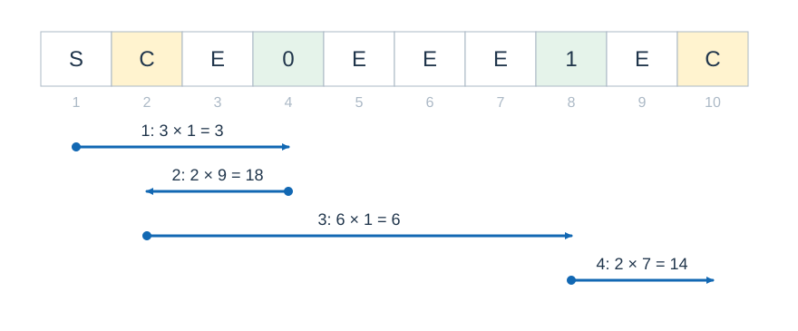

# 剪羊毛

- 参考时间限制：0.5 秒（参考环境：[评测环境与性能](../../../docs/评测环境与性能.md)；仅供预估）
- 实际时间限制：标准程序在目标评测环境中处理最慢正式测试文件的基准时间的 2 倍，按 0.5 秒的倍数向上取整；若平台仅支持更粗的粒度，再向上取整到平台可设置值。
- 内存限制：32 MB

## 背景故事

农场新养了一批药水绵羊。有些羊毛能让携带者走得更快，有些却会拖慢脚步。村长准备给每群羊剪一次羊毛，再把全部羊毛存进箱子。合理安排剪毛顺序和存箱时机，可以省下不少时间。

## 形式化问题描述

农场是 $a$ 行 $b$ 列的网格。`S` 为起点，`C` 为箱子，`E` 为空地，`B` 为障碍，数字 $0,\ldots,p-1$ 表示各羊群的位置。每个羊群恰好出现一次。除障碍和网格外，所有格子均可通过。

共有 $k$ 种羊。第 $j$ 种羊的每份羊毛使移动一格的耗时增加 $d_j$ .初始不携带羊毛，基础耗时为 $t$ .若当前携带第 $j$ 种羊毛 $c_j$ 份，则一次上下左右移动的耗时为

$$\max\left(1,t+\sum_{j=1}^{k}c_jd_j\right)$$

第 $i$ 群含第 $j$ 种羊 $w_{i,j}$ 只。到达尚未剪毛的羊群时，可以不剪，也可以一次剪完该群所有羊，每只羊得到一份对应种类的羊毛。每群只能剪一次。到达箱子时，可以放入携带的任意种类、任意数量羊毛，也可以不放；已存入的羊毛不再取出。剪毛和存箱均不耗时，羊毛不能丢在其他位置。

求从 `S` 出发，剪完所有羊群并将全部羊毛放入一个或多个箱子的最少时间。不要求回到起点。

## 输入格式

第一行五个整数 $a,b,p,k,t$ .第二行 $k$ 个整数 $d_j$ .接下来 $p$ 行，按羊群编号 $0$ 到 $p-1$ 排列，每行 $k$ 个整数 $w_{i,j}$ .最后 $a$ 行，每行 $b$ 个以空格隔开的字符，表示地图。

## 输出格式

输出一个整数，表示最少耗时。

## 样例 1

### 输入

```text
4 4 2 2 10
-5 2
0 1
1 0
1 B C E
E B B E
E E E 0
B B B S
```

### 输出

```text
106
```

## 样例 2

### 输入

```text
4 4 2 2 2
-3 4
1 0
0 1
S E B B
E E 0 B
E 1 B B
E E E C
```

### 输出

```text
17
```

## 样例 3

### 输入

```text
1 10 2 2 1
10 -2
1 1
1 1
S C E 0 E E E 1 E C
```

### 输出

```text
41
```

## 样例解释

样例 1 可以依次访问羊群 $1$ 、羊群 $0$ 和箱子，耗时为 $6\times10+5\times5+3\times7=106$ .样例 2 可以依次访问羊群 $0$ 、羊群 $1$ 和箱子，耗时为 $3\times2+2\times1+3\times3=17$ .

样例 3 按下图路线移动。在左箱子只存下增加耗时的羊毛，继续携带使耗时减少的羊毛；最后在右箱子存下全部羊毛。四段耗时为 $3,18,6,14$ ，合计 $41$ .



## 数据范围与保证

所有数据满足 $1\le a,b\le10$ ，$1\le p\le10$ ，$1\le k\le50$ ，$1\le t\le10^6$ ，$-100\le d_j\le100$ ，$0\le w_{i,j}\le10$ .每群至少有一只羊。地图中恰有一个起点、$1$ 到 $10$ 个箱子，所有羊群和箱子都能从起点到达。

| 分值比例 | 额外条件 |
| --- | --- |
| 100% | 无额外条件 |
