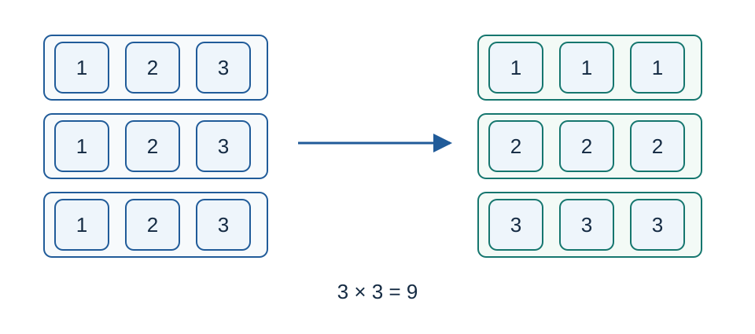

# 牌组前缀的可行划分：题解

贡献：Codex（GPT-6）完成顺子数量规范化证明、前缀状态设计、转移查表与标准 C++17 实现。有限状态动态规划与查表是经典工具。

## 每个起点只需零到两个顺子

三个起点相同的三张顺子，共使用连续三个数字各三张牌，可以改为三个同牌三张组。反复替换后，每个起点至多有两个顺子。替换不影响任何对子，也不改变所使用的牌。因此只需寻找具有这种形式的划分。

图中两边都恰好使用数字一、二、三各三张。

## 十八个状态

处理数字 $i$ 前，令 $x,y\in\{0,1,2\}$ 为起点 $i-2,i-1$ 的顺子数量，令 $p\in\{0,1\}$ 表示是否已经使用唯一对子。初始只有 $(0,0,0)$ .

数字 $i$ 的数量为 $c=a_i$ .选择 $q\in\{0,1\}$ 表示是否在这里放一个新对子，要求 $p+q\le1$ .再选择当前开始的顺子数量 $z\in\{0,1,2\}$ .此前开放顺子需要 $x+y$ 张，所以必须满足

$$c-x-y-z-2q\ge0,\qquad c-x-y-z-2q\equiv0\pmod3.$$

余下的牌全部组成同牌三张组。对于固定状态及 $q$ ，$z$ 由模三条件唯一确定，取 $c-x-y-2q$ 的非负模三余数即可。转移至 $(y,z,p+q)$ .

每读入一个数字后，状态 $(0,0,0)$ 的可行性就是第一个答案；状态 $(0,0,1)$ 的可行性就是第二个答案。必须检查两项开放数量均为零，不能用未来牌完成当前前缀。

## 常数时间处理一个数字

分别用九位整数 $X_0,X_1$ 保存尚未使用、已经使用对子的状态集合；位号为 $3x+y$ .预计算两张表：

- $T_c[X]$ ：所有状态不放新对子时的目标集合；
- $U_c[X]$ ：所有状态恰放一个新对子时的目标集合。

集合 $X$ 只有 $512$ 种。所需牌数 $x+y+z+2q\le8$ ，因此 $c\ge8$ 后只需知道模三余数。用类别零到七及代表值八、九、十，共十一类，覆盖全部数量。更新

$$X'_0=T_c[X_0],\qquad X'_1=T_c[X_1]\mathbin{|}U_c[X_0].$$

两个新值都从更新前的集合计算。答案取各集合的最低位。

## 正确性

规范化引理保证所有合法划分都有每起点至多两个顺子的等价划分。状态记录了未来所需的全部信息：只有前两个起点的顺子尚未完成，对子只需记已用与否。当前数字满足转移条件恰好等价于能补齐既有顺子、选择新顺子和可选对子，并把余量组成三张组。按数字归纳，状态集合既不漏解，也不会引入非法划分。前缀合法恰好要求无开放顺子，并按是否使用对子选择相应状态。查表只是完整枚举这一有限递推。

## 复杂度与实现

十一类、两个九位集合表的初始化规模固定，约两万两千字节。总时间 $O(n)$ ，辅助空间 $O(1)$ ；实现边读取边输出，无需保存整个序列。数量、状态编号与余数均可用三十二位整数。

直接十八状态递推与查表法具有相同的建模，前者用于核验全部正式前缀；没有把编码差异列作另一种解法。独立小规模检查递归取最小剩余数字，分别尝试顺子、三张组和唯一对子。

参考程序：[std.cpp](std.cpp)。数据与测量：[plan.json](tests/plan.json)、[generate.py](tests/generate.py)、[性能数据](../../../docs/benchmark-R26.json)。
