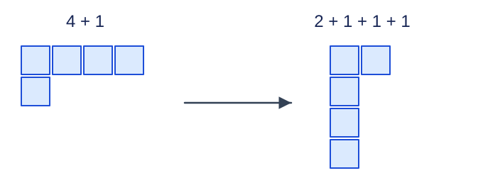

# 无标号容器分配: 题解

## 方法与贡献

Codex（GPT-6）应用整数分拆的共轭对应和完全背包递推，给出 [std.cpp](std.cpp)、证明及实现。另一方案使用[五边形数递推与生成函数](solution-alternative.zh.md)，对应 [alternative.cpp](alternative.cpp)；当容器数接近物品数时，它能减少计算量。两者都覆盖完整范围，使用线性空间。

容器和物品各自不可区分。把非空容器中的物品数按非增序排列，一个方案就对应一个整数分拆，正部件数至多为 $m$ .空容器补足数量，不增加方案。

## 从部件数限制变成部件大小限制

用左对齐的小方格画出分拆，每行长度等于一个部件。将图按主对角线转置，原来的行数变成转置图第一行的长度。这是可逆操作，因此“至多 $m$ 个部件”的分拆与“每个部件都不超过 $m$”的分拆一一对应。

图中 $4+1$ 只有两行；转置后为 $2+1+1+1$ ，每行长度不超过二。两个图都含五个方格。

## 完全背包计数

维护 $D_s$ ，表示用已经处理过的部件大小组成总和 $s$ 的分拆数。初始 $D_0=1$ ，其余为零。依次处理部件大小 $j=1,\ldots,\min(n,m)$ ，对 $s=j,j+1,\ldots,n$ 按升序执行

$$D_s\leftarrow D_s+D_{s-j}\pmod{10^9+7}$$

升序允许同一个大小使用多次；部件大小的处理顺序固定，避免把相同部件的不同排列重复计数。最后输出 $D_1,\ldots,D_n$ .

## 正确性证明

处理大小 $j$ 时，一个分拆要么不使用 $j$ ，由更新前的 $D_s$ 计数；要么至少使用一个 $j$ ，去掉一个后就是使用大小不超过 $j$ 、总和为 $s-j$ 的分拆。升序更新使 $D_{s-j}$ 已经包含可重复使用 $j$ 的全部情况。两类互斥且完备，因此每轮保持不变量。

全部大小处理后，得到最大部件不超过 $m$ 的分拆数。共轭对应把它们一一映射回最多 $m$ 个非空容器的方案，所以输出正确。

## 复杂度与选择

时间 $O(n\min(n,m))$ ，空间 $O(n)$ .当 $m>n$ 时，超过 $n$ 的部件不会使用，循环自然截断。每个数始终取模，两项相加小于 $2\times(10^9+7)$ ，32 位有符号整数可以保存。

五边形方案同为线性空间，在 $m$ 接近或超过 $n$ 时更快；在 $m$ 很小时，完全背包只需少量部件轮次，因此保留为首选并明确两者适用条件。
