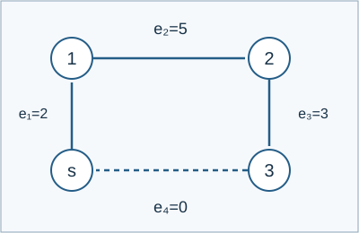

# 可修改环上的边权游戏

参考时间限制：0.5 秒；内存限制：256 MiB。实际时限取目标环境中最慢正式文件的标程中位耗时乘2，再按0.5秒向上取整。见[评测环境](../../../docs/评测环境与性能.md)。

## 背景故事

游戏社团用一圈带计数器的边设计双人游戏。成员不断修改这圈边，想在每次修改后判断，从固定起点出发的先手能否获胜。

(本故事由GPT-6重写)

## 形式化问题描述

有一个固定起点 $s$ .沿顺时针方向排列的边权序列为 $w_1,\ldots,w_n$ ，形成一个无向环。两人轮流操作，棋子最初位于 $s$ .每步选择棋子相邻的一条正权边，沿该边移动到另一端，并把该边权减少为任意严格更小的非负整数。无法移动者失败，两人均采取最优策略。

边权总和每步严格下降，所以游戏一定结束。判断先手是否必胜。

还要依次处理 $q$ 次对边权序列的修改：

- `1 R V` ：把第 $R$ 条边的权值改为 $V$ .
- `2 R V` ：在当前第 $R$ 条边之前插入权值为 $V$ 的边；$R=n+1$ 表示追加在末尾。
- `3 R` ：删除第 $R$ 条边。

修改后按新序列重新构成环，起点仍是最后一条边与第一条边之间的接点。每个状态都独立开始一局游戏；分析游戏时的减权不会影响后续修改所维护的序列。

为覆盖空序列与短序列，约定：$n=0$ 时只有孤立起点，没有合法移动；$n=1$ 时唯一边是起点上的自环，沿它移动后棋子仍在起点；$n=2$ 时两条边是相同两个顶点间的不同平行边。$n\ge3$ 时为通常的简单环。



样例1中，先手沿权值2的边移动并将其清零，留给对手一条长为2的可行路径，因此先手必胜。

## 输入格式

第一行两个整数 `n q` .第二行包含 $n$ 个整数，按顺时针顺序给出初始边权；$n=0$ 时该行为空。接下来 $q$ 行各为一个修改操作。

## 输出格式

输出 $q+1$ 行。第一行对应初始状态，其余依次对应每次修改后的状态；先手必胜输出1，否则输出0。

## 样例 1

### 输入

```text
4 0
2 5 3 0
```

### 输出

```text
1
```


## 样例 2

### 输入

```text
4 4
2 2 2 3
1 1 0
1 4 0
3 1
2 1 2
```

### 输出

```text
1
1
0
0
1
```


## 样例 3

### 输入

```text
0 3

2 1 0
1 1 7
3 1
```

### 输出

```text
0
0
1
0
```

## 数据范围与保证

初始 $0\le n\le10^5$ ，$0\le q\le10^5$ .所有边权和修改权值均在 $[0,100]$ 内。修改和删除保证 $1\le R\le$ 当前边数；插入保证 $1\le R\le$ 当前边数加一。过程中边数可超过初始上界，但不会超过初始 $n+q$ .

由 Codex（GPT-6）补齐并记录为重新设计：明确零、一、两条边时的结构、插入位置及每个状态独立开局的规则。

| 分值比例 | 额外条件 |
| --- | --- |
| 100% | 无额外条件 |

共有10个正式文件，每个10%。

[生成说明](tests/README.md)。
