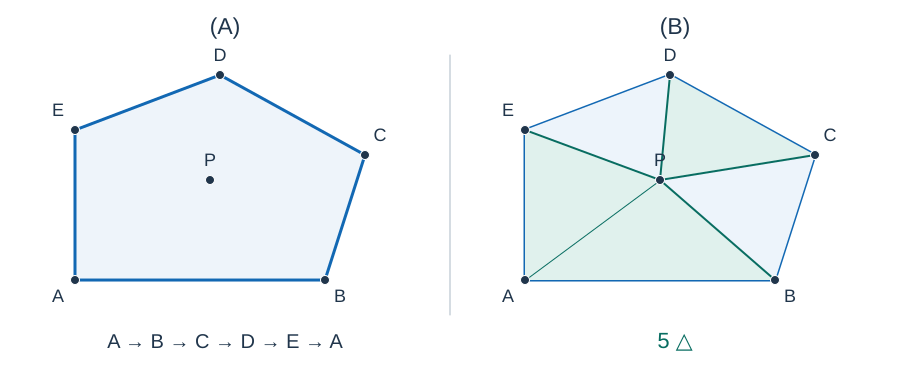
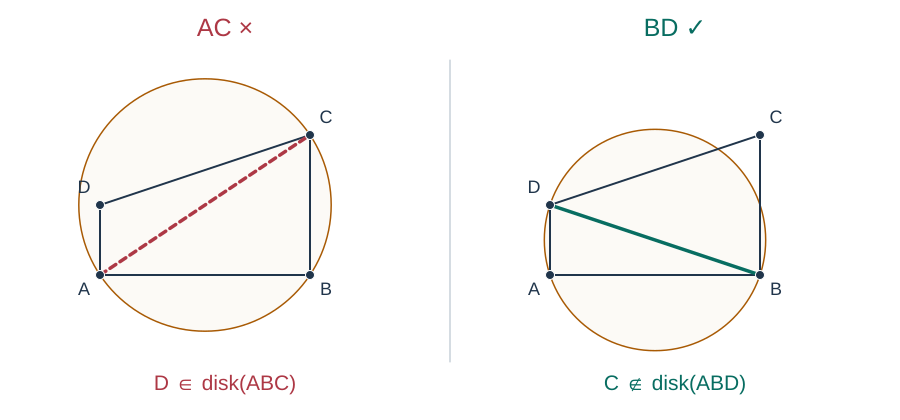
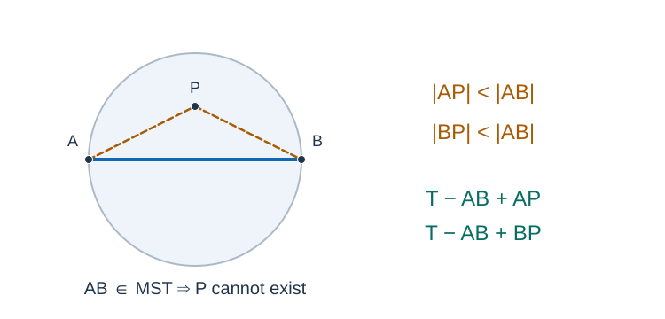
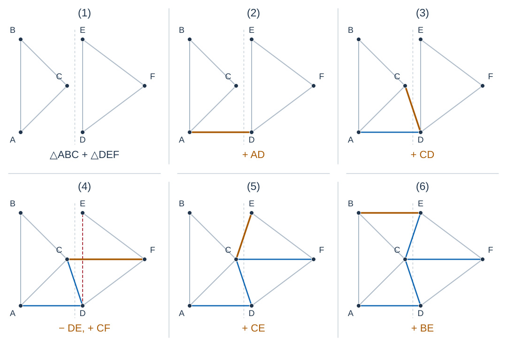
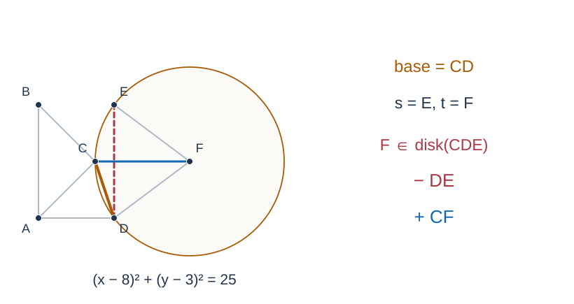
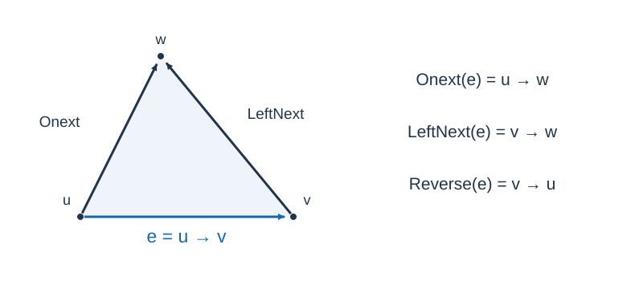

# 游耕者（昼）题解

## 解法比较

按输入编号依次访问并回到起点的做法没有使用坐标。它能给出一条巡回，却不能满足题目的长度保证。例如按顺序输入 $(0,0),(100,0),(1,0),(101,0)$ ，这条巡回长为 $400$ ，而最小生成树权值为 $101$ ，超过允许的 $2.001\times101+0.001=202.102$ .

Codex（GPT-6）采用的实现采用欧氏最小生成树的加倍遍历与三角不等式捷径，再用 Delaunay 候选边避免完全图，时间为 $O(n\log(n+1))$ 、空间为 $O(n)$ ，证明和退化情形见下文。它增加了几何构图工作，换取可证明的路线长度保证；不能把只输出编号的线性时间当成有效解法来比较快慢。

## 从最小生成树构造巡回路线

把农场作为顶点，两点之间的距离作为无向边权。题面定义的最小连接成本 $M$ 正是这个完全图的最小生成树权值：任何连通图都能删除环上的边，得到权值不增的生成树。

求出一棵最小生成树 $T$ ，以农场 $1$ 为根做深度优先遍历，只在首次到达顶点时将它加入序列，最后补上 $1$ .实际实现使用显式栈，避免长链上的递归栈溢出。

### 为什么总代价不超过两倍

沿树边往返的完整遍历把每条边走两次，总代价恰为 $2M$ .从这个行走序列中跳过已经访问过的顶点，保留首次访问顺序和最终返回起点。由三角不等式，用一条直达边替换一段路径不会增加代价，所以得到的巡回路线满足：

$$C\le2M$$


图中左侧树的完整往返顺序为 $1,2,3,4,3,2,1$ ，代价为 $60$ .跳过重复访问后得到右侧的 $1,2,3,4,1$ ，代价为 $40$ .

若最优巡回长度为 $OPT$ ，从最优回路中删去一条边便得到生成树，因此 $M\le OPT$ .参考构造满足 $C\le2OPT$ .题面为评测保留的容差允许 $C\le2.001M+0.001$ ，因此不能把所有获接受路线都宣称为严格的 2 倍近似。

## 重合点和边界

按坐标排序，将同坐标的农场保留一个代表，其余编号用零权边连接到代表。仅对互不相同的坐标求树，再加入这些零权边。它们不改变 $M$ ，并保证每个原始编号都出现在最终巡回中。

单个农场输出 `1 1` ；全部农场重合时 $M=C=0$ .不假设点处于一般位置，也不以随机扰动改变坐标或边权。

## 上取整会不会影响 MST 的正确性

**任意一棵按真实欧氏距离求出的 MST，在每条边分别向上取整后，仍然是新边权下的 MST。** 因此可以先用欧氏几何筛边、按平方距离做 Kruskal，再累加选中边的取整长度。下面分别验证巡回构造与 MST 筛边需要的两个性质。

### 1. 三角不等式仍成立

设真实欧氏距离为 $e(a,b)$ ，本题边权为 $d(a,b)=\lceil e(a,b)\rceil$ .由欧氏距离的三角不等式和 $\lceil u+v\rceil\le\lceil u\rceil+\lceil v\rceil$ ，可得：

$$d(a,c)\le\lceil e(a,b)+e(b,c)\rceil\le d(a,b)+d(b,c)$$

所以上文跳过重复顶点的证明对本题仍然有效。向下取整不一定满足这个性质。

### 2. 用割性质和换边证明 MST 仍最优

设 $T$ 是真实距离下的一棵 MST，$f$ 是任意单调不减的函数，即 $x\le y$ 时 $f(x)\le f(y)$ .本题取 $f(x)=\lceil x\rceil$ .

从 $T$ 中删除任意树边 $e$ ，树恰好分成两个连通块 $A,B$ .这两个点集组成一个**割**；端点分别在两侧的边称为跨割边。对任意跨割边 $g$ ，必有：

$$w(e)\le w(g)\quad\Longrightarrow\quad f(w(e))\le f(w(g))$$

否则在原树中用 $g$ 替换 $e$ ，便得到更轻的生成树，与 $T$ 最优矛盾。

接下来证明这些比较足以保证取整后的总权值最优。任取另一棵生成树 $S$ ，若 $S\ne T$ ：

1. 选一条属于 $T$ 、不属于 $S$ 的边 $e$ ，考虑刚才的割 $A,B$ .
2. $S$ 中连接 $e$ 两端的唯一路径必然跨过这个割，取其中一条跨割边 $g$ .
3. $g$ 不属于 $T$ ：$T$ 中唯一跨越这个割的边就是 $e$ ，而 $e$ 不在 $S$ 中。
4. 向 $S$ 加入 $e$ ，再删除路径上的 $g$ ，仍得到生成树。根据上述不等式，新的 $f$ 权值总和不会增加，而且它比 $S$ 多包含一条 $T$ 的边。

重复至多 $n-1$ 次，便把 $S$ 变成 $T$ ，期间权值总和从未增加。由于 $S$ 任意，$T$ 在新边权下也最优。证明允许相等边权，因此上取整制造的并列情况没有影响。

也可以从 Kruskal 理解：按真实距离排好的边，在上取整后仍是一个合法的不降序排列。沿用同一顺序、执行同样的并查集合并，就会选出同一棵 MST。平方距离与真实距离的大小关系相同，所以程序排序时无需开平方。

### 3. 这个结论的准确范围

上取整可能增加新的最优树。例如 $A=(0,0),B=(5,0),C=(2,4)$ 的三条边长为 $5,5,\sqrt{20}$ .真实 MST 必须使用 $AC$ ；取整后三条边均为 $5$ ，任意两条边都组成权值为 $10$ 的 MST。因此，我们只需保证候选边中保留了原欧氏 MST，无需保留取整后所有可能的最优树。

这个证明依赖树的换边性质，不能简化为“单调函数保持任意两组数的和的大小关系”。实际成本必须计算为：

$$M=\sum_{e\in T}\lceil w(e)\rceil$$

它一般不等于 $\left\lceil\sum_{e\in T}w(e)\right\rceil$ .程序必须对每条选中边单独取整。

## 为什么引入三角剖分

完全图有 $n(n-1)/2$ 条边，大规模输入无法全部生成。我们需要一个只有 $O(n)$ 条边、又包含欧氏 MST 的图。接下来从几何概念开始构造这样的图；只需事先理解生成树和 Kruskal。

### 1. 凸包与三角剖分

想象在平面上的所有点外面套一根橡皮筋，拉紧后围出的边界就是**凸包**。若点不全共线，凸包围成一个凸多边形。

对点集做**三角剖分**，就是连接若干点对，把凸包内部铺满三角形，并满足：

- 每个输入点都是剖分的顶点。
- 边只在公共端点相交，不能交叉，也不能从另一个顶点中间穿过。
- 三角形内部互不重叠，内部不能遗漏输入点。



左图的 $P$ 是凸包内部的点；右图把它接入剖分。对同一组点，通常可以画出多种三角剖分。任意画一种还不够，我们需要增加空圆条件。

### 2. Delaunay 三角剖分与空圆条件

三个不共线的点唯一确定一个经过它们的圆，称为三角形的**外接圆**。如果剖分中每个三角形的外接圆内部都没有其他输入点，它就是 **Delaunay 三角剖分**。其他点落在圆周上是允许的，所以四点共圆时答案可能不唯一。[CGAL 的三角剖分说明](https://doc.cgal.org/latest/Triangulation_2/index.html)采用同样的定义。



图中 $A=(0,0),B=(6,0),C=(6,4),D=(0,2)$ .左图使用 $AC$ ，但 $D$ 在 $\triangle ABC$ 的外接圆内，因此不合格。右图换成 $BD$ ，两个三角形的外接圆都不含第四个点，因此合格。右图只画出 $\triangle ABD$ 的外接圆，避免两圆重叠遮挡。

这种更换四边形对角线的操作称为**翻边**。分治算法不必先画出任意剖分再逐条翻边，但同样使用圆内判定来决定哪些边应该删除、哪些边应该加入。

### 3. 与 Voronoi 图是什么关系

Voronoi 图把平面分成若干区域：一个站点的区域由“到它的距离不大于到其他站点的距离”的位置组成。两个区域共享一段边界时，连接对应的两个站点，得到 Delaunay 图的边；共圆造成的多边形面可以再补入对角线，成为三角剖分。

因此，用 Voronoi 图求欧氏 MST 的方向是正确的。参考程序直接构造它对应的 Delaunay 三角剖分，省去 Voronoi 顶点、外心和边界交点的坐标计算。

### 4. 为什么它一定保留欧氏 MST

取欧氏 MST 中的一条边 $AB$ ，考虑以 $AB$ 为直径的闭圆盘。如果其中存在另一个不同的点 $P$ ，则：

$$|AP|<|AB|,\qquad |BP|<|AB|$$



从树中删除 $AB$ 后，$P$ 必在 $A$ 或 $B$ 所在的连通块之一。若在 $A$ 一侧，便能用更短的 $PB$ 重连；若在 $B$ 一侧，便能用更短的 $PA$ 重连。两种情况都与 MST 最优矛盾。因此，直径圆盘内及圆周上，除 $A,B$ 外都没有输入点。

在圆心处，$A,B$ 距离相等，且严格比所有其他点近。沿 $AB$ 的垂直平分线移动足够小的距离，这个严格关系仍成立，所以两者的 Voronoi 区域共享一段边界。对应的 $AB$ 必须出现在 Delaunay 三角剖分中。这个论证也排除了共圆时对角线选择的影响：我们需要的 MST 边属于必须保留的边。[CGAL 的欧氏 MST 示例](https://doc.cgal.org/latest/BGL/index.html)正是先构造 Delaunay 三角剖分，再运行 Kruskal。

因此，先求真实欧氏距离的 Delaunay 图，再求欧氏 MST，最后逐边上取整，就得到了本题准确的 $M$ .若所有点共线，则只需保留按位置排序的相邻边，同样包含所需的 MST。

### 5. 为什么边数只有线性级

设不同坐标有 $k$ 个，且不全共线。记边数为 $E$ 、包括外部区域的面数为 $F$ .平面图的欧拉公式给出 $k-E+F=2$ ；每个面的边界至少含三条边，每条边被两个面各数一次，所以 $3F\le2E$ .合并得 $E\le3k-6$ .全共线时只有 $k-1$ 条相邻边。

所以三角剖分把候选边从平方级降到了线性级。接下来的关键是用 $O(k\log k)$ 时间把这些边找出来。

## 分治 Delaunay：先看整体流程

参考程序使用 Guibas–Stolfi 分治算法，最坏时间为 $O(k\log k)$ .算法原始描述位于[论文第 9 节](https://people.eecs.berkeley.edu/~jrs/meshpapers/GuibasStolfi.pdf)；第 8 节介绍几何判定。下面按本题实现解释其步骤。

1. 对不同坐标按 $(x,y)$ 字典序排序，只排序一次。
2. 将连续下标区间平分为左半 $L$ 和右半 $R$ ，分别递归求出剖分。
3. 合并时，删除两侧不再适用的旧边，加入连接左右两半的**跨区边**。
4. 返回合并后的剖分，以及凸包最左端、最右端的边句柄，供上一层合并使用。

只有两个点时直接连边；三个点不共线时连成三角形，共线时连成按位置排序的链。去重后只有一个点的情况在递归入口外处理。四个及以上的点平分后，两侧都至少有两个点。

同横坐标时以纵坐标打破平局。为了理解左右分隔，可以想象将坐标轴旋转一个足够小的角度，使新横坐标的顺序恰好等于原来的字典序；这只改变观察方向，所有距离、共线和共圆关系都保持不变。程序仍用原整数坐标计算，不实际旋转或扰动点。

## 分治的核心：怎样合并左右两张剖分

### 1. 从下公切线开始

两个凸包的**下公切线**是连接左右凸包的直线，所有点都在它的上方或线上；取其两端的输入点作为第一条跨区边。可以从左凸包最右端和右凸包最左端出发，沿各自凸包移动端点，直到连线同时支撑两个凸包。每个端点只沿凸包前进，不需要枚举所有点对。

以下用 $\ell\in L,r\in R$ 表示当前跨区边的两端。讲解中把它写成从左到右的 $\ell\to r$ ；**代码的 `Base` 存储相反方向 $r\to\ell$** .这里“上方”指点位于有向直线 $\ell\to r$ 的左侧，不是单纯比较纵坐标。

### 2. 为什么下一步只移动一个端点

想象一条将 $L,R$ 分开的竖直线。最终剖分中的跨区边都与它相交，可以按交点由下往上排序。相邻两条跨区边之间经过同一个三角形面，因此它们共享一个端点。

所以从当前边 $\ell r$ 出发，下一条只可能是：

- 保持右端 $r$ ，把左端换成 $L$ 中的某个点 $p$ ，加入 $pr$ .
- 保持左端 $\ell$ ，把右端换成 $R$ 中的某个点 $s$ ，加入 $\ell s$ .

每次确定一个新三角形，继续沿两半之间的区域向上推进，直到上公切线。下面的实际例子贯穿整个合并过程。



坐标为 $A=(0,0),B=(0,6),C=(3,3),D=(4,0),E=(4,6),F=(8,3)$ ；左半为 $A,B,C$ ，右半为 $D,E,F$ .虚线是分隔线，灰边来自递归结果，蓝边为已加入的跨区边，橙边为当前边。图中从左到右、从上到下阅读：先连下公切线 $AD$ ，随后左端移到 $C$ ，右端移到 $F$ 、$E$ ，最后左端移到 $B$ ，到达上公切线 $BE$ .

### 3. 先找到两侧候选，再删除不合适的旧边

左侧先从方向 $\ell\to r$ 开始，绕 $\ell$ 逆时针取第一条相邻边 $\ell p$ ；右侧从 $r\to\ell$ 开始，绕 $r$ 顺时针取第一条相邻边 $rs$ .候选点必须严格位于当前边上方。不能按编号、横坐标或距离随意挑一个邻点：这里用的是平面中绕顶点的顺序。

先处理左侧。如果 $\ell p$ 的下一条逆时针邻边为 $\ell q$ ，且 $q$ 严格位于 $\triangle\ell rp$ 的外接圆内，那么 $p$ 还不是应该选的点；删除旧边 $\ell p$ ，令候选前进到 $q$ ，再检查它的下一位邻点。右侧完全对称：若 $rs$ 的下一条顺时针邻边为 $rt$ ，且 $t$ 严格位于 $\triangle\ell rs$ 的外接圆内，就删除 $rs$ ，继续检查 $t$ .

删除的是递归结果里的旧边。它在单独一半点集内可能合法，但加入另一半后，空圆条件可能被破坏。不能只增加跨区边而保留所有旧边。

若下一条邻边已经绕到当前边下方，清理也会停止：在当前边上方扩大的圆，其下方部分同时缩小，而此前的空圆保证下方点不会进入圆内。遇到重复端点时圆内行列式为零，也不会触发删除。



在六点例子中，当前边到达 $CD$ 时，右侧先看到 $DE$ .$\triangle CDE$ 的外接圆为 $(x-8)^2+(y-3)^2=25$ ，而 $F=(8,3)$ 正好位于圆心，所以必须删除 $DE$ .随后右侧候选变为 $F$ .这也说明候选清理不是一个可以省略的优化。

### 4. 两侧候选都合法时，选哪一侧

完成清理后，设左候选为 $p$ 、右候选为 $s$ ：

- 两侧都没有上方候选：当前边已经是上公切线，结束合并。
- 仅一侧有候选：选这一侧。
- 两侧都有候选：检查 $s$ 是否严格位于 $\triangle\ell rp$ 的外接圆内。若在内部，选 $s$ ，加入 $\ell s$ ；否则选 $p$ ，加入 $pr$ .

直观上，圆经过固定的两点 $\ell,r$ ，圆心可以沿它们的垂直平分线移动。让圆在当前边上方覆盖的部分逐渐扩大，它最先碰到哪个新点，就应先形成哪个三角形。若 $s$ 已在经过 $p$ 的圆内，说明它比 $p$ 更早被碰到，应先选 $s$ .这个过程只用于理解，代码并不计算或移动圆心。

四点共圆时两种选择都满足空圆条件。本实现使用严格的圆内判定；相等时不因该判定删除旧边，并在左右最终选择时优先左候选。

六点例子中的选择可逐步核对：

| 当前边 | 清理后的左、右候选 | 选择依据 | 新跨区边 |
| --- | --- | --- | --- |
| $AD$ | $C,E$ | $E$ 在 $\triangle ADC$ 的圆外，选左侧 | $CD$ |
| $CD$ | 左侧无有效候选，右侧为 $F$ | 删除 $DE$ 后，仅右侧有效 | $CF$ |
| $CF$ | $B,E$ | $E$ 在 $\triangle CFB$ 的圆内，选右侧 | $CE$ |
| $CE$ | $B$ ，右侧无有效候选 | 选左侧 | $BE$ |
| $BE$ | 两侧均无有效候选 | 到达上公切线 | 结束 |

特别地，$B$ 虽然纵坐标较大，但位于有向直线 $C\to D$ 的右侧，所以在 $CD$ 这一轮并不是有效左候选。判定必须用叉积。

### 5. 为什么检查相邻候选就够了

这里不能仅凭“下一位邻点不在圆内”就对任意图下结论；我们用到了两侧已经是 Delaunay 剖分这一条件。

先只看左侧，将当前边通过平移、旋转写成 $\ell=(0,0),r=(a,0)$ ，其中 $a>0$ .一个上方候选点 $p=(x,y)$ 满足 $y>0$ .经过 $\ell,r,p$ 的圆心是 $(a/2,h(p))$ ，其中：

$$h(p)=\frac{x^2+y^2-ax}{2y}$$

圆心越高，圆盘在当前边上方覆盖的区域越大。因此“最先碰到的候选点”等价于“使 $h(p)$ 最小的候选点”。圆内比较就能比较这两个高度，无需真的算除法。

将 $\ell$ 上方的邻点按逆时针记作 $p_1,p_2,\ldots$ .Delaunay 邻点具有如下性质：$h(p_i)$ 先下降，可以在最低值处持平，然后上升；下降段或上升段可以为空。也就是说，从第一位开始向后检查，在遇到第一个不再下降的位置时，已经到达最小值。

这里先考虑该侧原剖分中的邻点。合并只会删除其中一部分同侧邻边，而取这个序列的子序列仍然保持上述性质。

这个性质可以用相邻三角形的空圆条件理解。设 $\triangle\ell p_i p_{i+1}$ 的外接圆与横轴除 $\ell$ 外的另一个交点横坐标为 $b_i$（相切时记为 $0$）。相邻外接圆都经过 $\ell,p_{i+1}$ ，下一个邻点不能落在前一个圆内；因此沿这个邻点顺序，$b_i$ 只会向左移动。比较圆的方程可得：

$$h(p_{i+1})-h(p_i)=\frac{b_i-a}{2}\left(\frac{x_{i+1}}{y_{i+1}}-\frac{x_i}{y_i}\right)$$

括号内严格为负，因为邻点的方向角在增加。因此，$b_i>a$ 时高度下降，$b_i\le a$ 后高度便不再下降，无法再次出现一个更低的候选。右侧镜像同理。这解释了为何清理循环可以在第一次圆内测试失败时停止，而不必扫描所有剩余点。

为什么最先碰到的点一定是这些邻点之一？它与 $\ell,r$ 确定的圆此前没有碰到同侧其他点，因而提供了一张同侧空圆证据，它与 $\ell$ 的连线正是同侧 Delaunay 邻边。共圆时按绕顶点的顺序选择最先的并列点即可。

### 6. 合并正确性与伪代码

从下公切线开始，存在经过当前边两端且内部无点的圆。候选清理找到左右两侧最先会被这个圆碰到的点；再做一次左右比较，便得到对整个点集都为空的外接圆。因此新形成的三角形合法，新跨区边仍有空圆证据，可以继续作为当前边。

被删除的旧边也不是误删：清理时旧边两侧的点已经构成圆内冲突，使它无法在合并后的点集内满足空圆条件。每次加入的跨区边都按分隔线上的顺序向上推进，不与已经完成的部分交叉。到达上公切线后，左右剖分之间的区域被填满，留下的剖分满足空圆条件。

以下伪代码使用讲解中的左到右端点约定。`next_ccw` 、`next_cw` 都是绕同一个起点取邻边；实现方法见下一节。

```text
Merge(L, R):
    (l, r) = lower_common_tangent(L, R)
    add edge l-r
    loop:
        lp = first edge counterclockwise from l->r
        if endpoint p is above l->r:
            while next endpoint q is inside circle(l, r, p):
                next = next_ccw(lp)
                delete lp
                lp = next

        rs = first edge clockwise from r->l
        if endpoint s is above l->r:
            while next endpoint t is inside circle(l, r, s):
                next = next_cw(rs)
                delete rs
                rs = next

        recompute whether p and s are above l->r
        if neither is valid: break
        if p is invalid or (s is valid and s is inside circle(l, r, p)):
            add edge l-s
            r = s
        else:
            add edge p-r
            l = p
```

## 怎样在程序里维护这些边：quad-edge

### 1. 普通邻接表还缺少什么

邻接表能找到“与顶点相邻的所有边”，但合并需要在常数时间找到“绕这个顶点的下一条边”，以及“沿当前面的下一条边”。如果每次重新按极角排序，或者在线性容器里寻找和删除，合并就可能退化。

**quad-edge** 为每条无向边维护四条记录，把绕顶点和绕面的顺序一起编码。先把它理解成一组可以修改的环形链表，几何计算仍只针对原输入点。



图中 $u,v,w$ 按逆时针构成三角形。`Onext(e)` 绕起点 $u$ 逆时针移动；`LeftNext(e)` 沿 $e$ 左侧面的边界继续走，起点变成 $v$ .这两个“下一条边”不能混淆。

### 2. 四条记录与导航函数

在 [mst.hpp](mst.hpp) 中，第 $j$ 条无向边占据下标 $4j,4j+1,4j+2,4j+3$ .偏移 $0,2$ 是原边的两个方向；偏移 $1,3$ 是维护相邻面关系的两个对偶方向，后两者不存输入点编号。每条记录都存一个 `Next` 指针。

| 操作 | 几何或结构含义 | 本实现的计算 |
| --- | --- | --- |
| `Reverse(e)` | 同一条边反向 | 同组偏移加 2，即 `e ^ 2` |
| `Rotate(e)` | 转到同组下一条记录，原图与对偶图交替 | 偏移加 1，模 4 |
| `InverseRotate(e)` | 撤销一次 `Rotate` | 偏移加 3，模 4 |
| `Onext(e)` | 绕起点逆时针的下一条边 | `Edges[e].Next` |
| `OriginPrevious(e)` | 绕起点顺时针的下一条边 | `Rotate(Onext(Rotate(e)))` |
| `LeftNext(e)` | 沿左侧面边界继续走 | `Rotate(Onext(InverseRotate(e)))` |
| `Destination(e)` | 终点 | 反向边的起点 |

`Rotate` 是四条记录之间的编号操作，不是在平面上把坐标旋转 $90^\circ$ ，也不需要算 Voronoi 顶点。

### 3. 创建、拼接、连接、删除

- `MakeEdge(u,v)` 创建一条孤立边。四个偏移的初始 `Next` 依次指向偏移 $0,3,2,1$ ；原图的两个方向各自成环，对偶方向互相连接。
- `Splice(a,b)` 交换两条边的后继，同时更新对应的对偶后继。若两者原本处于不同环，就把环接起来；若处于同一环，就将它拆开。这使顶点环和面环保持一致。
- `Connect(a,b)` 新建从 `Destination(a)` 到 `Origin(b)` 的边，把新边拼接到 `LeftNext(a)` ，并把反向边拼接到 $b$ .
- `DeleteEdge(e)` 分别将 $e$ 和它的反向边从各自起点环中摘除，再回收四条记录。删除前先保存要继续访问的邻边句柄。

`Splice` 的核心只有两次交换，必须在交换前取出两个辅助下标：

```text
alpha = Rotate(Onext(a))
beta  = Rotate(Onext(b))
swap(Next[a], Next[b])
swap(Next[alpha], Next[beta])
```

初读时可以先将这些操作当作常数时间的接口，再对照完整实现检查四个偏移和环的变化。

### 4. 对照实际合并代码

递归返回的两个句柄分别是：从最左顶点出发、沿凸包逆时针的边，以及从最右顶点出发、沿凸包顺时针的边。合并时把左半右端句柄记为 `LeftInner` ，右半左端记为 `RightInner` .下公切线的查找是：

```text
loop:
    if Origin(RightInner) is left of LeftInner:
        LeftInner = LeftNext(LeftInner)
    else if Origin(LeftInner) is right of RightInner:
        RightInner = Onext(Reverse(RightInner))
    else:
        break
Base = Connect(Reverse(RightInner), LeftInner)
```

两次移动分别沿对应凸包走一步；最终新边 `Base` 从右端指向左端。若下公切线改写了整体最左或最右端的返回边，代码也同时更新外侧句柄。

由于 `Base` 的方向是 $r\to\ell$ ，左候选为 `Onext(Reverse(Base))` ，右候选为 `OriginPrevious(Base)` .代码用 `RightOf(candidate, Base)` 判断候选是否在讲解中的“上方”。最终比较中的 `InCircle(p,l,r,s)` 与 `InCircle(l,r,p,s)` 只是前三点的循环移位，符号一致。

这一层只维护点、边和相邻关系。全部算法见 [mst.hpp](mst.hpp) 的 `FDelaunay` ；求树入口为 `BuildMinimumSpanningTree` ，输出巡回的入口在 [std.cpp](std.cpp)。

## 几何判定：只算符号，不算圆心

### 1. 方向判定

计算叉积：

$$\operatorname{Cross}(a,b,c)=(b_x-a_x)(c_y-a_y)-(b_y-a_y)(c_x-a_x)$$

结果大于零，表示 $c$ 在有向边 $a\to b$ 左侧，三点按逆时针排列；小于零表示右侧；等于零表示共线。前面的凸包移动和候选有效性都使用它。

### 2. 圆内判定

设前三点 $A,B,C$ 逆时针排列，要判断第四点 $P$ 是否在其外接圆内。将 $P$ 平移到原点，记 $a=A-P,b=B-P,c=C-P$ ，计算：

$$D=|a|^2(b_xc_y-b_yc_x)-|b|^2(a_xc_y-a_yc_x)+|c|^2(a_xb_y-a_yb_x)$$

其中 $|a|^2=a_x^2+a_y^2$ ，其余同理。$D>0$ 表示严格在圆内，$D<0$ 表示圆外，$D=0$ 表示共圆。若前三点顺时针，符号相反；若共线，则不能赋予它“外接圆内外”的含义。本算法只有在有效候选对应的三点逆时针时才依赖这个含义，不对共线三点求外心。

公式来自下面的四阶行列式：将最后一行对应点移到原点，沿最后一列展开，就得到上式。圆的方程可以写成 $x^2+y^2+ux+vy+w=0$ ，所以四点共圆时行列式为零；按前三点逆时针定向后，符号区分圆内与圆外。

$$\begin{vmatrix}A_x&A_y&A_x^2+A_y^2&1\\B_x&B_y&B_x^2+B_y^2&1\\C_x&C_y&C_x^2+C_y^2&1\\P_x&P_y&P_x^2+P_y^2&1\end{vmatrix}$$

### 3. 为什么本题的 64 位整数够用

设坐标绝对值上界为 $U$ .平移后的每个坐标绝对值不超过 $2U$ ，平方长度不超过 $8U^2$ ，二阶叉积的绝对值也不超过 $8U^2$ .上式三项绝对值之和因此不超过：

$$3\cdot8U^2\cdot8U^2=192U^4$$

本题 $U=10000$ ，上界为 $1.92\times10^{18}$ ，小于有符号 64 位整数的上界。程序在乘法前就使用 `int64_t` ，不需要浮点误差阈值。扩大坐标范围时必须重新核对这个界。

边排序只比较平方距离。选中边的整数长度先用浮点平方根估计，再用整数平方比较向两侧修正，保证完全平方数及其附近的结果准确。

## 退化情况与复杂度

实现必须同时处理以下情况：

- 重合点：先去重，求树后补零权边，保留所有农场编号。
- 单点、两点：分别不需要几何边、只需要一条边。
- 三点或所有点共线：保留相邻点链，不尝试构造零面积三角形。
- 部分点共线：方向判定取严格正负，不把线上点当作上方候选。
- 四点或更多点共圆：圆内判定只在严格大于零时触发删除；等号按固定顺序选边，不添加随机扰动。
- 横坐标相同：使用 $(x,y)$ 字典序，仍按下标平分。

设一次合并处理 $k$ 个不同点。两张子剖分共 $O(k)$ 条边：查找下公切线时沿凸包前进，共 $O(k)$ 步；候选清理每成功一次就永久删除一条本层旧边，共 $O(k)$ 次；合并每轮加入一条跨区边并完成一个三角形，也只有 $O(k)$ 轮。每次边操作都为常数时间，所以本层合并为 $O(k)$ ，并不是“每条跨区边再扫描一次所有点”。

递推式为：

$$T(k)=T(\lfloor k/2\rfloor)+T(\lceil k/2\rceil)+O(k)=O(k\log k)$$

每层子问题的点数总和为 $k$ ，层数为 $O(\log k)$ .排序一次已足够，各层不重复排序。活跃边总数保持线性；删除边后复用槽位，避免把各层废弃边全部保留下来，故空间为 $O(k)$ ，递归栈深为 $O(\log k)$ .

回到原始农场数 $n$ ，去重、Delaunay、Kruskal 共需 $O(n\log(n+1))$ 时间，显式栈遍历树需 $O(n)$ 时间，总空间为 $O(n)$ .这里写 $\log(n+1)$ 兼顾单点。独立完全图 Prim 对照程序为 $O(n^2)$ 时间、$O(n)$ 空间，只适合小规模验证。

朴素逐点插入若没有合适的定位结构，最坏可能为平方级。分治和 Fortune 扫描线都能达到 $O(n\log n)$ ；本题选分治，是因为复杂度有保证，且所有所需的几何判定都能用有界整数完成。算法类别的实现比较可参见 [Triangle 的说明](https://www.cs.cmu.edu/~quake/tripaper/triangle2.html)。


## 特殊评测与复现

由于 $C,M$ 都是整数，精确使用以下等价条件：

$$1000C\le2001M+1$$

评测器检查恰有 $n+1$ 个整数、首尾为 $1$ 、前 $n$ 个编号组成排列，并逐边重算 $C$ .随后从输入重新计算 $M$ ，不读取参考路线的首个编号作为长度，也不把参考路线长度当作最优值。参考输出文件只为统一接口而要求存在，其内容不参与判定。

编译时保留题目目录内的 `mst.hpp` .标准程序与评测器共享这份经过独立对拍的实现；标准程序的输出只有巡回序列。

```text
g++ -std=c++17 -O2 std.cpp -o std
g++ -std=c++17 -O2 tests/checker.cpp -o checker
g++ -std=c++17 -O2 brute.cpp -o brute
g++ -std=c++17 -O2 tests/mst_weight.cpp -o mst_weight
python tests/generate.py --out-dir ../../../build/data/nomadism-day --std ./std
checker input.in reference.out contestant.out
```

`checker` 的退出码为：`0` 通过、`1` 答案错误、`2` 调用或输入材料错误。完整重新计算 $M$ 的开销属于检查器，部署时应为它设置足够的时间和内存。`brute.cpp` 是独立的完全图 Prim，只输出 $M$ ；`tests/mst_weight.cpp` 是诊断工具，输出 $M$ 及所选树的平方边长和，两者都支持连续读取多份输入到文件末尾。

正式数据使用固定 SplitMix64 种子，覆盖随机点、规则网格、窄条、等横坐标、共线、共圆、重合点、远隔点簇和最大规模。性能测量见 [评测环境与性能](../../../docs/评测环境与性能.md)。
