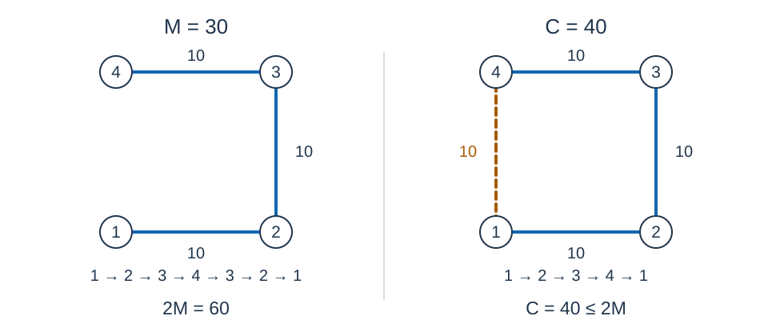

# Nomadism — Night — Solution

## Comparing solutions

The problem setter’s solution uses four coordinate transforms and directional scans. After sorting by horizontal coordinate, a Fenwick tree indexed by $y-x$ stores the minimum $x+y$ to find a candidate neighbor in each sector. Coincident points are linked with zero-weight edges; Kruskal builds a Manhattan MST. Recursive DFS first-visit order produces the tour. The candidate-edge exchange argument and shortcut proof for a doubled tree are inherited and explained below.

The problem setter’s program shifts bounded coordinates into direct Fenwick indices. The implementation used by Codex (GPT-6) compresses observed coordinates, unifies duplicate handling and traverses with an explicit stack. For direct index range $U$ , the direct-indexing bounds are $O(n\log(n+1)+n\log(U+1)+U)$ time and $O(n+U)$ space. The Codex implementation uses $O(n\log(n+1))$ time and $O(n)$ space. Working storage no longer depends on coordinate span, and traversal avoids deep recursion. Both coordinate representations use the same directional filtering and tour proof.

## Constructing a tour from a minimum spanning tree

Use farms as vertices and the prescribed distance as the weight of each undirected edge. The minimum connection cost $M$ is the weight of a minimum spanning tree (MST) of this complete graph: deleting cycle edges from any connected graph leaves a spanning tree without increasing its weight.

Compute an MST $T$ , root it at farm $1$ , and traverse it in depth-first order. Append each vertex when it is first visited, then append $1$ again at the end. The implementation uses an explicit stack so that a long path cannot overflow the call stack.

### Why the cost is at most twice the tree weight

A full walk along the tree, returning along every edge, traverses each edge twice and costs exactly $2M$ . Remove repeat visits from this walk, keeping the first occurrence of each vertex and the final return to the start. By the triangle inequality, replacing a path segment by a direct edge never increases its cost. The resulting tour therefore satisfies:

$$C\le2M$$



The full walk on the left is $1,2,3,4,3,2,1$ and costs $60$ . Skipping repeated visits produces the tour $1,2,3,4,1$ on the right, costing $40$ .

If the shortest tour has length $OPT$ , removing one edge from it leaves a spanning tree, so $M\le OPT$ . The reference construction satisfies $C\le2OPT$ . The judging tolerance permits $C\le2.001M+0.001$ , so not every accepted tour is necessarily a strict 2-approximation.

## Coincident points and boundary cases

Sort farms by coordinates and keep one representative of each distinct position. Join every other farm at that position to its representative by a zero-weight edge. Compute a tree only on the distinct positions, then include these zero-weight edges. This preserves $M$ and ensures that every original farm number appears in the tour.

For a single farm, print `1 1` . If all farms coincide, $M=C=0$ . General position is not assumed, and no random perturbation changes coordinates or weights.

## Manhattan distance and the triangle inequality

The absolute differences in each coordinate satisfy the triangle inequality. Adding the two inequalities gives $d(a,c)\le d(a,b)+d(b,c)$ , so the tour shortcutting argument applies.

## Computing a Manhattan MST with directional sweeps

Do not construct the complete graph explicitly. The directional sparsification property of Manhattan MSTs lets us keep one nearest neighbor per point in each $45^\circ$ region and find an MST among this linear number of edges. The distance between two points in one such region is no larger than the larger of their distances to its apex, allowing tree-edge exchanges to discard unnecessary farther neighbors. Distance ties can be resolved deterministically, and region boundaries are included by the implementation.

Because edges are undirected, it suffices to cover four regions in the right half-plane. Consider the region defined by:

$$x_j\ge x_i,\qquad y_j-x_j\ge y_i-x_i$$

These conditions also imply $y_j\ge y_i$ , so:

$$d(i,j)=(x_j+y_j)-(x_i+y_i)$$

For fixed $i$ , find a qualifying point with minimum $x_j+y_j$ .

1. Sweep points in descending horizontal coordinate, breaking ties by descending vertical coordinate. Previously processed qualifying points satisfy the horizontal condition.
2. Compress all values of $y-x$ and reverse their ranks. A Fenwick tree stores the point of minimum $x+y$ for each prefix, breaking ties by original farm number.
3. Query the suffix beginning at $y_i-x_i$ , add the resulting nearest-neighbor edge if one exists, then insert the current point.
4. Repeat for the transformations $(x,y)$ , $(y,x)$ , $(-y,x)$ , and $(x,-y)$ . These cover the four upper-right and lower-right regions; undirected edges also cover their opposite directions.
5. Sort the linear number of candidate edges and run Kruskal, also joining the zero-weight edges between coincident farms.

Coordinate compression makes the Fenwick tree depend on the number of distinct positions rather than the coordinate range. Sorting, querying, and inserting take $O(n\log n)$ per sweep; four sweeps still take $O(n\log n)$ .

## Integer arithmetic and implementation details

The transformations preserve Manhattan distance. A candidate edge's weight is the difference between the transformed coordinate sums, while its endpoints retain their original farm numbers.

An edge costs at most $40000$ . Store total tour lengths and the judging products with $1000$ or $2001$ in signed 64-bit integers. All distances and decisions use integer arithmetic.

## Complexity

Let $n$ be the number of farms. Deduplication, candidate generation, and Kruskal take $O(n\log(n+1))$ time in total; traversing the tree takes $O(n)$ time. Total space is $O(n)$ . Writing $\log(n+1)$ also covers the single-farm case. The independent complete-graph Prim oracle takes $O(n^2)$ time and $O(n)$ space and is only intended for small tests.

## Special judging and reproduction

Both $C$ and $M$ are integers, so use the exactly equivalent condition:

$$1000C\le2001M+1$$

The checker requires exactly $n+1$ integers, verifies that both endpoints are $1$ and the first $n$ numbers form a permutation, and recomputes $C$ edge by edge. It then recomputes $M$ from the input. It neither interprets the first farm number of a reference tour as a length nor treats that tour's length as an optimum. The reference output file must exist for interface compatibility, but its contents do not affect the verdict.

Keep the local `mst.hpp` when compiling. The reference program and checker share this implementation, which is tested against an independent oracle. The reference program prints only the tour.

```text
g++ -std=c++17 -O2 std.cpp -o std
g++ -std=c++17 -O2 tests/checker.cpp -o checker
g++ -std=c++17 -O2 brute.cpp -o brute
g++ -std=c++17 -O2 tests/mst_weight.cpp -o mst_weight
python tests/generate.py --out-dir ../../../build/data/nomadism-night --std ./std
checker input.in reference.out contestant.out
```

Checker exit codes are `0` for accepted, `1` for wrong answer, and `2` for invocation or input-material errors. Recomputing $M$ is checker work; allocate enough checker time and memory when deploying. The independent complete-graph Prim program `brute.cpp` prints only $M$ . The diagnostic program `tests/mst_weight.cpp` prints $M$ and the sum of squared lengths of its selected tree edges. Both diagnostic programs can read consecutive inputs until EOF.

Official inputs use fixed SplitMix64 seeds and include random points, regular grids, narrow strips, equal horizontal coordinates, collinear and cocircular sites, coincident farms, separated clusters, and maximum-size cases. See [environment and measurements](../../../docs/评测环境与性能.md) for performance measurements.
