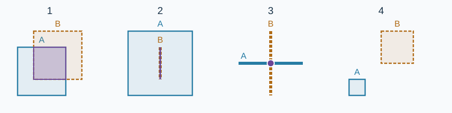

# Interstellar Orders: Intersection Types

Estimated time limit: 0.5 seconds. Memory limit: 128 MB.

On the target judge, use twice the largest per-case median runtime of the reference program, rounded up to a multiple of $0.5$ seconds. See the [reference environment](../../../docs/评测环境与性能.md).

## Story

The geometry exercises also need labels describing the shared region. The computing center must distinguish an area, a segment, a point, and an empty intersection.

## Formal Problem Statement

Given two closed axis-aligned rectangles $A,B$ in the plane, classify $A\cap B$ . Each rectangle includes its boundary and is specified by a pair of opposite corners in either order. It may degenerate into a segment or point.

Use these mutually exclusive cases:

1. A common region with positive area: output `Area` .
2. A common segment of positive length: output `Edge` .
3. Exactly one common point: output `Point` .
4. No common point: output `None` .

`Edge` includes a segment lying entirely inside the other rectangle; it need not lie on the boundaries of both shapes. Two segments crossing at one point give `Point` .



Solid outlines represent $A$ and dashed outlines represent $B$ . From left to right, the answers are `Area` , `Edge` , `Point` , and `None` .

## Input

The first line contains $T$ . Each of the next $T$ lines contains eight integers:

```text
x1 y1 x2 y2 x3 y3 x4 y4
```

The first four numbers specify the opposite corners of $A$ , and the last four those of $B$ .

## Output

Output $T$ lines, each containing one of `Area` , `Edge` , `Point` , or `None` . For $T=0$ , the output is empty.

## Samples

### Sample 1

### Input

```text
12
0 0 1 1 2 2 3 3
-1 2 2 -1 0 0 1 1
0 0 0 0 0 0 0 0
0 1 0 5 0 2 0 3
0 0 5 5 2 -5 3 0
0 0 5 0 2 -1 2 2
0 0 2 2 -1 -1 1 1
0 0 0 0 5 0 -1 0
-1 -1 -5 -5 -5 0 -5 -2
-1 -1 -5 -5 -2 -1 -2 -2
-2 1 2 -1 1 2 -1 -2
0 0 2 2 0 1 -1 1
```

### Output

```text
None
Area
Point
Edge
Edge
Point
Area
Point
Edge
Edge
Area
Point
```

### Sample 2

### Input

```text
4
0 0 4 4 2 1 2 3
0 2 4 2 2 0 2 4
0 0 1 1 2 2 3 3
4 4 0 0 3 3 1 1
```

### Output

```text
Edge
Point
None
Area
```

### Sample 3

### Input

```text
0
```

### Output

```text

```

## Sample Explanation

In the tenth pair of sample 1, the rectangle is $[-5,-1]\times[-5,-1]$ , while the other shape is the segment from $(-2,-1)$ to $(-2,-2)$ . Their intersection has length $1$ , so the answer is `Edge` .

Sample 2 illustrates a contained segment, crossing segments, disjoint shapes, and containment with positive area.

## Constraints and Guarantees

For 100% of the data: $0\le T\le1000$ and $|x_i|,|y_i|\le10^9$ for $1\le i\le4$ . Each shape may be a positive-area rectangle, a positive-length segment, or a point. In the table, “rectangle” means positive area and “segment” means positive length.

| Score | Additional conditions |
| --- | --- |
| 40% | Both shapes are rectangles |
| 10% | Both shapes are segments |
| 10% | Both shapes are points |
| 10% | Each shape is a point or segment |
| 10% | Each shape is a point or rectangle |
| 10% | Each shape is a segment or rectangle |
| 10% | None |
