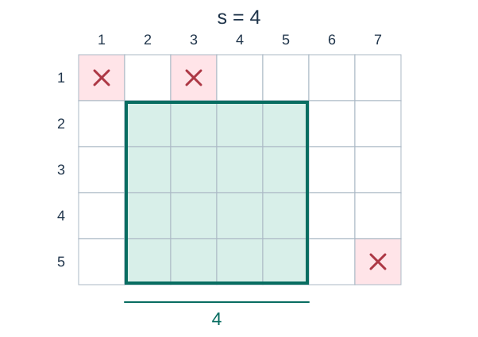

# Wheat Field

- Indicative time limit: 0.5 seconds (reference environment: [environment and measurements](../../../docs/评测环境与性能.md))
- Actual time limit: twice the reference program's baseline time on the slowest official test file in the target environment, rounded up to a multiple of 0.5 seconds; round up further if the platform requires a coarser unit.
- Memory limit: 128 MB

## Story

The village chief wants to create a square wheat field as a feature of the village. Some cells in the candidate area already contain buildings and cannot be used. Find the largest square available for planting.

## Formal Problem Statement

You are given an $n$-row, $m$-column grid and $k$ building records $(x_i,y_i)$ . Records may repeat; repeated records still describe one blocked cell.

Choose $s$ consecutive rows and $s$ consecutive columns containing no building. Find the largest integer side length $s$ . If no cell is available, output $0$ .

## Input Format

The first line contains $n,m,k$ . Each of the next $k$ lines contains $x_i,y_i$ , indicating a building in row $x_i$ , column $y_i$ .

## Output Format

Print the maximum side length.

## Sample 1

### Input

```text
5 7 3
1 1
1 3
5 7
```

### Output

```text
4
```

### Explanation

Rows $2$ through $5$ and columns $2$ through $5$ form a square of side $4$ . A side-$5$ square must include all five rows, and every choice of five consecutive columns contains a building.



Figure 1: Crosses mark buildings. The outline and shaded area mark one valid wheat field.

## Sample 2

### Input

```text
2 2 4
1 1
1 2
2 1
1 2
```

### Output

```text
1
```

### Explanation

Position $(1,2)$ is listed twice. Only three distinct cells are blocked, leaving one usable cell.

## Sample 3

### Input

```text
2 2 4
1 1
1 2
2 1
2 2
```

### Output

```text
0
```

### Explanation

All four cells contain buildings, so the answer is zero.

## Constraints and Guarantees

- $1\le n,m\le100000$ and $0\le k\le200$ .
- $1\le x_i\le n$ and $1\le y_i\le m$ ; repeated building records are allowed.

### Test Groups

| Score share | Additional conditions |
| --- | --- |
| 100% | No additional conditions |
