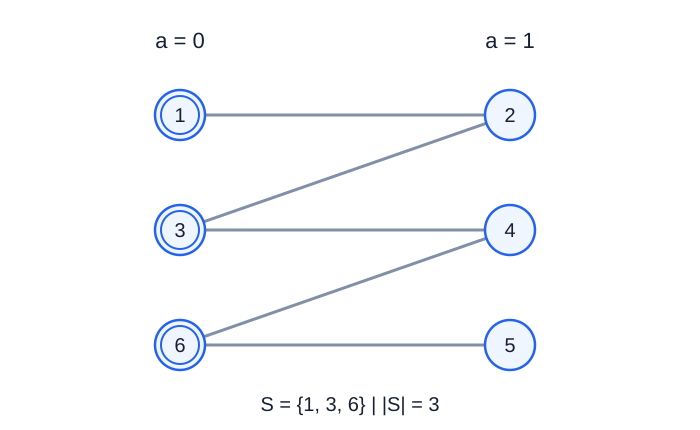

# 自动接线器

- 参考时间限制：**0.5 秒**（[评测环境与性能](../../../docs/评测环境与性能.md)）。
- 实际时限：在目标环境实测标准程序最慢测试文件的中位时间，乘以 2，再按 0.5 秒向上取整。
- 内存限制：**128 MB**。

## 背景故事

装机工坊准备给电脑和工作台之间的线路安装自动接线器。只要一条线路的任意一端装有接线器，就能自动接通；同一端口上的接线器可以照顾与它相连的全部线路。

接线器既可以装在电脑端，也可以装在工作台端。请用尽量少的接线器完成全部连接。

## 形式化问题描述

共有 $n$ 个端口，编号为 $1,\ldots,n$ . 端口 $i$ 的类型为 $a_i$ ：$0$ 表示工作台端口，$1$ 表示电脑端口。

有 $m$ 条线路，每条线路连接一个工作台端口和一个电脑端口。选择一个端口集合 $S$ ，使每条线路至少有一个端点属于 $S$ ，并使 $\lvert S\rvert$ 最小。输出任意一个最优集合即可。

## 输入格式

第一行两个整数 $n,m$ .

第二行 $n$ 个整数 $a_1,\ldots,a_n$ .

接下来 $m$ 行，每行两个整数 $u,v$ ，表示连接端口 $u$ 和 $v$ 的一条线路。

## 输出格式

第一行输出最少接线器数量 $c$ .

第二行输出 $c$ 个互不相同的端口编号，顺序任意。评测器检查数量最优且全部线路被覆盖，不要求与样例选择相同。

## 样例 1

### 输入

```text
6 5
0 1 0 1 1 0
1 2
2 3
3 4
6 4
5 6
```

### 输出

```text
3
1 3 6
```

## 样例 2

### 输入

```text
4 3
0 1 1 1
1 2
1 3
1 4
```

### 输出

```text
1
1
```

## 样例 3

### 输入

```text
4 2
0 0 1 1
1 3
2 3
```

### 输出

```text
1
3
```

## 样例解释

样例 1 选择端口 $1,3,6$ 可以覆盖所有线路。线路 $(1,2)$ 、$(3,4)$ 、$(5,6)$ 两两没有公共端点，因此至少需要三个接线器。



双圆圈表示已安装接线器的端口，左侧为工作台，右侧为电脑。

样例 2 只需选择星形中心端口 $1$ . 样例 3 只需选择电脑端口 $3$ ；孤立端口 $4$ 不需要安装接线器。

## 数据范围与保证

对 100% 的数据：$1\le n\le100000$ ，$1\le m\le200000$ ，$a_i\in\{0,1\}$ ，$1\le u,v\le n$ ，且每条线路满足 $a_u\ne a_v$ . 允许孤立端口，也允许同一对端口间存在多条线路。

| 分值比例 | 额外条件 |
| --- | --- |
| 100% | 无额外条件 |
