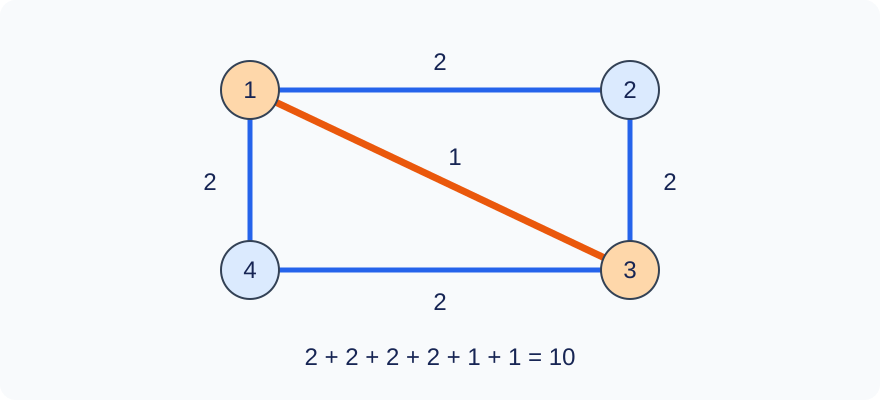

# A Closed Survey of Every Road

Time limit: 1.5 seconds. Memory limit: 256 MiB. Recalibrate as twice the slowest standard median in the target environment, rounded up to 0.5 seconds; see the [environment](../../../docs/评测环境与性能.md).

## Story

A road surveyor must traverse every road at least once and return to the starting point. Roads may be repeated, and any vertex may be chosen as the start. Plan a survey of minimum total length.

(This story was rewritten by GPT-6.)

## Formal Problem Statement

You are given a connected undirected weighted multigraph with $n$ vertices and $m$ edges. Parallel edges between different vertices are allowed; self-loops are forbidden. Every input edge is a separate road, so parallel edges must each be covered.

Choose a start vertex and walk along edges, traversing every edge at least once and returning to the start. Edges may be repeated, and the cost is the sum of weights over all traversals. Find the minimum cost and the smallest-numbered start vertex attaining it. Vertex degree counts edge occurrences, including parallel edges separately.

## Input Format

The first line contains `n m` . Each of the next $m$ lines contains `u v w` , describing an undirected edge of weight $w$ between $u$ and $v$ .

## Output Format

Print two lines: the smallest valid start vertex, followed by the minimum cost. Do not print the route.

## Sample 1

### Input

```text
3 3
1 2 1
2 3 2
3 1 3
```

### Output

```text
1
6
```

## Sample 2

### Input

```text
3 2
1 2 4
2 3 5
```

### Output

```text
1
18
```

## Sample 3

### Input

```text
4 5
1 2 2
2 3 2
3 4 2
4 1 2
1 3 1
```

### Output

```text
1
10
```

## Sample 4

### Input

```text
5 5
1 2 2
2 3 3
2 4 7
2 5 5
3 4 2
```

### Output

```text
1
26
```

## Sample Explanation

Sample 1 is an Euler circuit of cost 6. Sample 2 is a tree, so every edge must be traversed twice, costing 18. In Sample 3, repeat the weight-1 edge once for a total of 10. Sample 4 has minimum cost 26.



Sample 3: vertices 1 and 3 have odd degree. Repeating the diagonal once makes every degree even.

## Constraints and Scoring

$2\le n\le10^5$ , $n-1\le m\le2\cdot10^5$ , $1\le u,v\le n$ , $u\ne v$ , and $0\le w\le1000$ . The graph is connected. A non-tree input has at most 20 odd-degree vertices; tree inputs have no bound on the number of odd-degree vertices.

| Score | Additional constraints |
| --- | --- |
| 20% | $m=n-1$ |
| 30% | $m\ge n,\ \deg(v)\equiv0\pmod2$ |
| 50% | $m\ge n,\ |\{v:\deg(v)\equiv1\pmod2\}|\le20$ |

There are 10 tests worth 10% each. See the [test recipes](tests/README.md).
