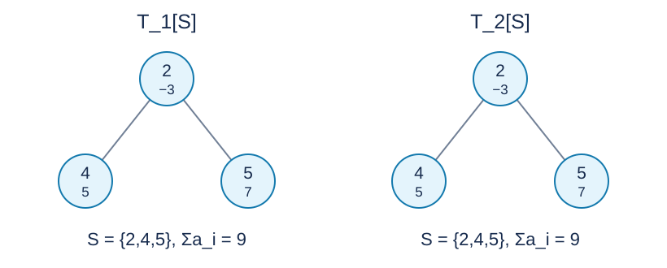

# 多棵树中的共同连通集：题解

**出题人解法：在第一棵树上点分治，将经过分治点的选择转成最大权闭合子图。GPT-6 补充剪枝与最小割证明、64 位容量及显式栈实现。**

## 1. 按是否包含分治点分类

在第一棵树的当前连通分量 $U$ 中选重心 $c$ .一个可行非空集合：

- 若包含 $c$ ，在这一层求解；
- 若不包含 $c$ ，因它在第一棵树中连通，必然完整落在删去 $c$ 后的某个分量中。

因此求出本层最优值后，删除 $c$ ，递归处理各分量，取所有层答案和零的最大值。重心保证递归深度为 $O(\log n)$ .

## 2. 只保留可能与根共同选择的点

其他树限制为 $U$ 后可能不连通。对每棵树，从 $c$ 出发，仅经过 $U$ 内的点，记录到达点及父亲。

没有被某棵树到达的点不可能属于任何包含 $c$ 的可行集合，先标记删除。再反复执行：如果一个点被删除，它在任意一棵已定根树中的所有后代也必须删除。实现时将删除点加入队列，并沿各树的父子边传播到固定点。

剩余集合 $V$ 在每棵树中都含有到 $c$ 的完整祖先链，因而连通。任何包含 $c$ 的可行集合都不会被此过程删去：初始删除有必要性，后续删除也来自不能缺失祖先。故剪枝既安全又充分。

## 3. 最大权闭合子图

对 $V$ 中每个非根点 $u$ ，向它在每棵树中的父亲连一条有向边。选择 $u$ 就必须选择这些父亲，这正是闭合约束。沿祖先链可知，每个非空闭合集都会包含 $c$ ；空集仍然允许。

令 $P=\sum_{u\in V}\max(a_u,0)$ .建立网络：

- $a_u>0$ 时连源点到 $u$ ，容量为 $a_u$ ；
- $a_u<0$ 时连 $u$ 到汇点，容量为 $-a_u$ ；
- 每条闭合约束边的容量为 $P+1$ .

空集对应容量为 $P$ 的割，因此最优割不会切断容量为 $P+1$ 的约束边。若源点侧所选集合为 $S$ ，割容量为
$$
\sum_{u\notin S,\ a_u>0}a_u+\sum_{u\in S,\ a_u<0}(-a_u)
=P-\sum_{u\in S}a_u.
$$
所以本层答案恰为 $P-\operatorname{maxflow}$ .无需强制把 $c$ 放在源点侧；非空闭合集自动包含它，而全负输入可以选择空集。

若本层 $P$ 已不超过目前答案，可以跳过最大流，因为任何集合的收益都不超过 $P$ .

## 4. 实现与正确性

重心遍历、各树遍历、删除传播和 Dinic 的阻塞流均使用显式队列或栈，避免长链导致调用栈溢出。阻塞流栈记录当前点、可推流上限、已推流量和进入边；子调用返回时按相同流量更新正反残量。

容量与返回流量全程使用 64 位整数。$P$ 最大为 $20000\cdot10^9$ ，源点总流量和总收益必须保存在 64 位变量中。有限无穷 $P+1$ 已足够，不需要接近整数上界。

第二节保证本层没有漏掉可行集合；第三节精确求出经过 $c$ 的最优集合；第一节又将其他集合完整分配到后续分量。因此全部层的最大值就是全局最优值。

## 5. 复杂度与使用范围

每点参与 $O(\log n)$ 层。即使其他树中有高阶点，各层扫描原邻接表的总量仍可按每点出现次数计为 $O(mn\log n)$ .

对大小为 $s$ 的分量，网络点数 $O(s)$ 、边数 $O(ms)$ .一般 Dinic 的保守上界为 $O(ms^3)$ ；重心分量大小几何下降，所有层合计的保守界为 $O(mn^3)$ ，另加图准备时间。这里没有将最大流时间误写成对数复杂度。实际性能依赖网络结构，完整范围测试和目标环境校准仍然必要。

空间为 $O(mn)$ .一次只保留当前网络，避免同时保存所有层的流图。单树时还可用树形最大连通子图 DP，但它不能直接处理多树约束，因而不作为完整范围的另一解法。

[参考程序](std.cpp)。

## 图示

图只画样例二在选中集合 $S=\{2,4,5\}$ 上的两张诱导子图 $T_1[S],T_2[S]$ .圆中上行为编号、下行为权值。两张图均连通，权值和为九。

## 数据与复现

三个样例见题面。[生成配方](tests/plan.json)包含十份计分输入；[生成器](tests/generate.py)只依赖 Python 标准库，支持 --plan、--out-dir、--case 和 --std。正式大输入及可执行文件不放入发布包。时间和内存的参考测量见[性能记录](../../../docs/benchmark-R29.json)。
