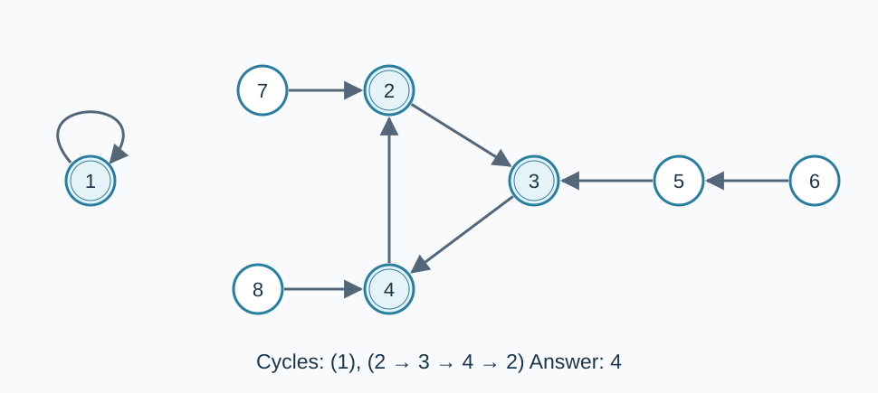

# Didu Hia's Signifier Cycles

Estimated time limit: 0.5 seconds. Memory limit: 128 MB.

The deployed limit is twice the largest per-input median runtime of the reference program on the target judge, rounded up to a multiple of $0.5$ seconds. See the [reference measurements](../../../docs/评测环境与性能.md).

## Story

“Little bro! How are you supposed to eat like that?”

There are $n$ Didu Hia, numbered $1,\ldots,n$ . Each Didu Hia points to exactly one Didu Hia. Following these pointers may lead around a cycle.

Count all the Didu Hia that lie on cycles, counting each one only once.

## Formal Problem Statement

There are $n$ vertices labeled $1,\ldots,n$ . Every vertex $i$ has exactly one outgoing edge, pointing to $d_i$ .

A cycle consists of distinct vertices $v_1,\ldots,v_k$ with $d_{v_i}=v_{i+1}$ for $1\le i<k$ , and $d_{v_k}=v_1$ . The case $k=1$ is allowed and is a self-loop.

Count the vertices that lie on at least one cycle, counting each vertex once. A vertex that can reach a cycle but does not itself belong to one is excluded. The answer is zero when $n=0$ .



The double circles mark exactly the cycle vertices.

## Input

The first line contains $n$ . The next $n$ lines contain one integer each; line $i$ gives $d_i$ .

## Output

Print one integer: the total number of cycle vertices.

## Samples

### Sample 1

### Input

```text
8
1
3
4
2
3
5
2
4
```

### Output

```text
4
```

### Sample 2

### Input

```text
4
1
2
3
4
```

### Output

```text
4
```

### Sample 3

### Input

```text
0
```

### Output

```text
0
```

## Sample explanations

Sample 1 has the self-loop $1\to1$ and cycle $2\to3\to4\to2$ , containing $4$ vertices in total. The remaining vertices only lead into a cycle. Every vertex in Sample 2 has a self-loop. Sample 3 is empty.

## Constraints and guarantees

For all inputs: $0\le n\le10^5$ ; for every existing vertex, $1\le d_i\le n$ .

| Score | Additional conditions |
| --- | --- |
| 100% | No additional conditions |
