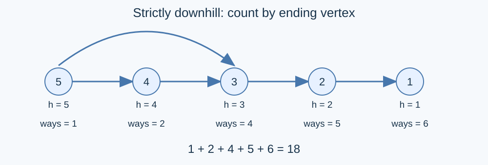

# Counting Downhill Routes: Topological Dynamic Programming

## Build a directed acyclic graph

Orient every unequal-height road from its higher endpoint to its lower endpoint. Discard equal-height roads, which cannot be used. Every directed edge strictly decreases height, so a directed cycle is impossible. Retain parallel roads as separate edges because route sequences contain road identifiers.

Let $F(v)$ count routes ending at $v$ . The vertex itself contributes one zero-move route. Every other route has a unique last road, giving

$$F(v)=1+\sum_{(u,v)\text{ is a directed edge}}F(u)\pmod{998246353}.$$

Sum $F(v)$ over all vertices; routes with different endpoints are distinct.

## Evaluation order and correctness

Compute indegrees and enqueue every zero-indegree vertex. Initialize every $F(v)=1$ . When removing $u$ from the queue, add $F(u)$ to $F(v)$ for each outgoing edge $(u,v)$ and decrement the indegree of $v$ . Enqueue $v$ when it reaches zero.

All incoming edges have been processed when a vertex leaves the queue. Induction in queue order therefore proves the recurrence at every vertex. The unique last edge and preceding route identify every nonempty route exactly once. The final sum counts all routes. With no vertices, both the queue and sum are empty, yielding zero.

## Implementation and complexity

Each vertex enters the queue at most once and each edge receives constant work. Time and space are $O(n+m)$ . An explicit queue handles long chains without recursion of depth $n$ . The modulus is $998246353$ . Reduce after each addition; two residues sum to less than $2^{31}$ , so signed 32-bit integers suffice.

The reference [std.cpp](std.cpp) retains the setter's topological ordering and route-count DP. GPT-6 supplies the proof, queue implementation and boundary checks. Sorting by height evaluates the same recurrence while adding a sorting step; it is not listed as a separate algorithm. Validation uses successor-route counts in increasing height order, independently of the program's predecessor propagation. Tests cover empty graphs, long chains, parallel roads, self-loops, equal heights and modular wraparound. See the [measurements](../../../docs/benchmark-R25.json).
