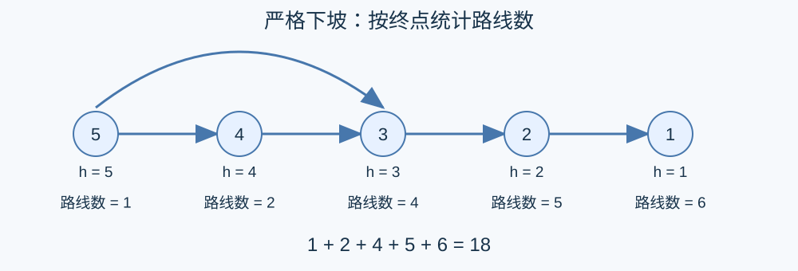

# 下坡路线计数

预估时间限制：0.5 秒。内存限制：128 MB。

实际时限以标准程序在目标环境的最慢用例中位时间乘以 $2$ ，按 $0.5$ 秒向上取整。参考环境见[评测说明](../../../docs/评测环境与性能.md)。

## 背景故事

山地勘察队记录了各个路口的高度和连接它们的道路。队员只沿下坡方向移动，需要统计所有可以选择的路线。

(本故事由GPT-6重写)

## 形式化问题描述

有 $n$ 个编号为 $1,\ldots,n$ 的顶点，第 $i$ 个顶点的高度为 $h_i$ .有 $m$ 条无向道路，第 $i$ 条的编号为 $i$ ，连接 $u_i,v_i$ .

可以从任意顶点出发，每次通过恰好一条道路，到达高度**严格小于**当前顶点的另一个顶点。可以在任意时刻结束，也可以不移动。

一条路线用“起点编号，依次经过的道路编号”组成的序列表示，两个序列不同即视为不同路线。因此，连接相同顶点的不同道路分别计数；等高道路和自环不能用于移动。不移动的路线也按起点区分。

求路线总数对 $998246353$ 取模的非负最小剩余。$n=0$ 时没有路线。

## 输入格式

第一行两个整数 $n,m$ .第二行 $n$ 个整数 $h_1,\ldots,h_n$ .接下来 $m$ 行，第 $i$ 行两个整数 $u_i,v_i$ ，描述第 $i$ 条道路。$n=0$ 时高度一行为空，且 $m=0$ .

## 输出格式

输出一行一个整数，表示取模后的路线数。

## 样例

### 样例 1

### 输入

```text
5 5
1 2 3 4 5
5 4
5 3
4 3
3 2
2 1
```

### 输出

```text
18
```

### 样例 2

### 输入

```text
2 3
2 1
1 2
1 2
1 1
```

### 输出

```text
4
```

### 样例 3

### 输入

```text
0 0
```

### 输出

```text
0
```

## 样例解释

第一组按终点统计，结束于顶点一到五的路线数分别为 $6,5,4,2,1$ ，合计十八。第二组有两条不移动的路线，以及分别经过道路一或道路二的两条路线；自环不能用于下坡移动。第三组没有起点。



## 数据范围与保证

$0\le n,m\le10^5$ , $-10^5\le h_i\le10^5$ , $1\le u_i,v_i\le n$ .

| 分值比例 | 额外条件 |
| --- | --- |
| 50% | $n,m\le300$ |
| 50% | 无额外条件 |
