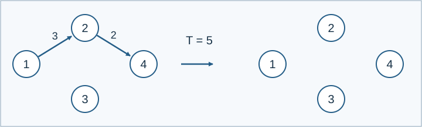

# 加密数据包与网络清空

参考时间限制：1.5 秒；内存限制：512 MiB。实际时限取目标环境中最慢正式文件的标程中位耗时乘2，再按0.5秒向上取整。见[评测环境](../../../docs/评测环境与性能.md)。

## 背景故事

中继站收到加密数据包后，会把指定链路加入网络。某条路线足够短时，系统清空链路并开始下一轮。请重现每个数据包带来的变化。

(本故事由GPT-6重写)

## 形式化问题描述

维护一个有 $n$ 个顶点的带权有向多重图，允许平行边，禁止自环。每条**逻辑边**用四元组 $(u,v,x,y)$ 表示：$y=0$ 时只有从 $u$ 到 $v$ 、权值为 $x$ 的弧；$y=1$ 时可以沿两个方向通行，两个方向权值均为 $x$ .双向逻辑边在计数时仍只算一条边。

先加入 $m$ 条未加密的初始逻辑边。这一步不触发清空，即使顶点1到顶点 $n$ 的最短距离已经不超过阈值 $T$ .

之后按顺序处理 $k$ 个加密数据包。第 $c$ 个数据包的四个字段均按下式解密：

$$a=a'\mathbin{\mathrm{XOR}}\left(((b+3)(c+37))\bmod998244353\right)$$

其中 $a'$ 是输入字段，$a$ 是解密值，$c$ 从1开始编号，$b$ 是此前所有清空操作累计删除的逻辑边数量，初始为零。使用同一个密钥解密该包的四个字段，得到 $(u,v,x,y)$ 并加入该逻辑边。

加入后，若顶点1到顶点 $n$ 的最短路长度不超过 $T$ ，删除当前全部逻辑边，包括刚加入的边，累计增加 $b$ ，并输出1；否则保留网络并输出0。没有路径时距离视为无穷大。初始边若在某次清空中被删除，也计入 $b$ .



样例1的第一个包补上长度为2的链路，形成长度 $3+2=5$ 的路线；阈值为5，故清空网络。

## 输入格式

第一行四个整数 `n m k T` .接下来 $m$ 行是未加密的 `u v x y` ；再接下来 $k$ 行是加密后的四个字段，按数据包顺序排列。

## 输出格式

输出一行 $k$ 个0或1，用空格分隔，分别表示每个包是否触发清空。

## 样例 1

### 输入

```text
4 1 5 5
1 2 3 0
112 118 112 114
194 199 197 194
201 203 200 200
206 201 200 205
337 340 336 337
```

### 输出

```text
1 0 0 1 1
```


## 样例 2

### 输入

```text
2 1 2 0
1 2 0 0
112 115 10082 114
194 193 195 194
```

### 输出

```text
1 1
```

## 数据范围与保证

$2\le n\le10^5$ ，$1\le m\le10^5$ ，$1\le k\le50000$ ，$0\le T\le100$ .初始边及解密后的边均满足 $1\le u,v\le n$ ，$u\ne v$ ，$0\le x\le10000$ ，$y\in\{0,1\}$ .加密字段在 $[0,2^{30}-1]$ 内，保证按规则解密后合法。

由 Codex（GPT-6）补齐并记录为重新设计：第一行加入阈值 $T$ ，规定 $0\le T\le100$ ，明确双向边和初始边的累计删除计数。

| 分值比例 | 额外条件 |
| --- | --- |
| 100% | 无额外条件 |

共有10个正式文件，每个10%。

[生成说明](tests/README.md)。
