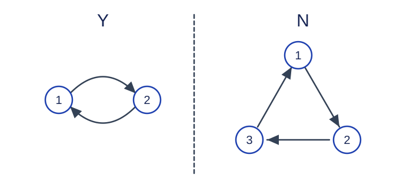

# Completing Dial Relations

Estimated time limit: 0.5 seconds. Memory limit: 128 MB.

The actual time limit is twice the slowest-case median runtime of the reference solution on the target judge, rounded up to a multiple of $0.5$ seconds. See the [benchmark environment](../../../docs/评测环境与性能.md).

## Story

A dial device uses numbers to represent elements, and several numbers may name the same element. Some directed relations have already been recorded. The device wants to complete them into a lattice without introducing forbidden reversals of existing relations.

## Formal Problem Statement

A partial order $\le$ is reflexive, antisymmetric, and transitive: $x\le x$ ; if $x\le y$ and $y\le x$ , then $x=y$ ; if $x\le y$ and $y\le z$ , then $x\le z$ .

An upper bound $u$ of $x,y$ satisfies $x\le u$ and $y\le u$ . An upper bound that is at most every other upper bound is their least upper bound, or join. Lower bounds and the greatest lower bound, or meet, reverse these comparisons. A nonempty partially ordered set is a lattice if every pair has both a join and a meet.

Symbols are different from elements: several symbols may represent the same element. Let $f$ map each symbol to one element, with every element represented by at least one symbol. A symbol relation represents the partial order when a relation between symbols $i,j$ exists exactly when $f(i)\le f(j)$ . The element set and the mapping $f$ may be chosen; they are not supplied as input.

There are $N$ symbols numbered $1,\ldots,N$ . The input gives one symbol $a_i$ for each symbol $i$ , defining

$$R=\{(i,a_i)\mid1\le i\le N\}$$

Determine whether relations can be added to obtain $R'\supseteq R$ that represents a lattice and satisfies this restriction: for every initial relation $(i,j)\in R$ , its reverse $(j,i)$ cannot be newly added. A reverse already present in $R$ may remain. Formally, $(j,i)\notin R'\setminus R$ is required.

Only decide whether a completion exists; do not output the mapping or the completed relation.

## Input Format

The first line contains the test-case count $T$ . Each case starts with $N$ , followed by $N$ lines. The $i$-th such line contains $a_i$ , representing the initial relation $(i,a_i)$ .

## Output Format

For each test case, print `Y` if a valid completion exists, or `N` otherwise, on its own line.

## Samples

### Sample 1

### Input

```text
4
2
2
1
3
2
1
3
3
2
3
1
3
1
2
3
```

### Output

```text
Y
Y
N
Y
```

### Sample 2

### Input

```text
3
1
1
5
2
3
4
5
5
4
2
3
4
2
```

### Output

```text
Y
Y
N
```

## Sample Explanation

In the first sample, the two opposite relations between symbols one and two already exist, so they may represent one element. A directed cycle of three symbols cannot be completed legally, giving `N` for the third case in that input. When every symbol only relates to itself, extra relations can order the elements in a chain, which is a lattice.



Arrows are initial relations; the left and right diagrams give `Y` and `N` , respectively. The second sample also covers one symbol, a chain, and a three-cycle with an attached chain.

## Constraints and Guarantees

Each test case satisfies $1\le N\le2\times10^5$ and $1\le a_i\le N$ . The sum of $N$ over the input file is at most $4\times10^5$ . Self-loops and multiple symbols representing one element are allowed.

| Score share | Additional conditions |
| --- | --- |
| 100% | None |
