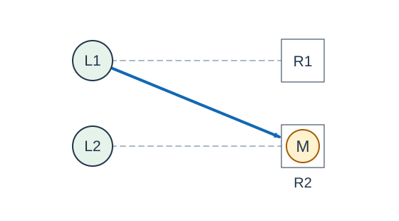

# 种西瓜 2

- 参考时间限制：1.0 秒（参考环境：[评测环境与性能](../../../docs/评测环境与性能.md)；仅供预估）
- 实际时间限制：标准程序在目标评测环境中处理最慢正式测试文件的基准时间的 2 倍，按 0.5 秒的倍数向上取整；若平台仅支持更粗的粒度，再向上取整到平台可设置值。
- 内存限制：128 MB

## 背景故事

农夫给瓜藤搭起了导向架，让每株瓜藤可以向事先选好的几块空地伸展。架子准备好了，瓜藤却仍会按照无法控制的顺序生长。农夫想知道：等所有瓜藤都无法再结瓜时，收成最少会有多少？

(本故事由GPT-6重写)

## 形式化问题描述

有 $p$ 株瓜藤和 $q$ 块初始为空的地块，分别编号为 $1$ 到 $p$ 、$1$ 到 $q$ .瓜藤 $i$ 可以向指定集合 $A_i$ 中的地块结瓜，且 $|A_i|\le4$ .指定关系不受平面位置限制，导向架之间互不干扰。

每株瓜藤至多结一个瓜，每块地至多容纳一个瓜。一次生长选择一株尚未结瓜的瓜藤 $i$ ，再选择 $A_i$ 中一块仍为空的地，在那里生成一个瓜。瓜藤随后不能再次结瓜，该地块也一直保持占用。瓜藤与地块是两类不同的对象。

生长持续进行，直到不存在合法的一次生长。求所有可能的终止状态中，瓜的数量的最小值。必须达到上述终止条件，不能在仍有生长机会时提前停止。

## 输入格式

第一行两个整数 $p,q$ .

接下来 $p$ 行。第 $i$ 行先给出整数 $d_i$ ，再给出 $d_i$ 个互不相同的地块编号，表示集合 $A_i$ .当 $d_i=0$ 时，该行只有一个整数 $0$ .当 $p=0$ 时，没有后续行。

## 输出格式

输出一个整数，表示终止时可能达到的最少结瓜数。

## 样例 1

### 输入

```text
2 2
2 1 2
1 2
```

### 输出

```text
1
```

## 样例 2

### 输入

```text
4 4
1 1
1 2
1 3
1 4
```

### 输出

```text
4
```

## 样例 3

### 输入

```text
0 3
```

### 输出

```text
0
```

## 样例解释

第一组可以让瓜藤 $1$ 向地块 $2$ 结瓜。瓜藤 $2$ 唯一能使用的地块已经被占用，因此生长终止，只有一个瓜。若让瓜藤 $1$ 先向地块 $1$ 结瓜，还会继续长出第二个瓜；生长顺序与选择确实会影响结果。



图中 `L1` 、`L2` 为瓜藤，`R1` 、`R2` 为地块。虚线表示可用的指定关系，实线箭头表示本次实际结瓜；带圈的 `M` 表示已生成的瓜。

第二组中每株瓜藤都有独享的地块，必须四株都结瓜后才能终止。第三组没有瓜藤，答案为零。

## 数据范围与保证

本题数据范围由 Codex（GPT-6）加强并重新设计：瓜藤数上限由 $18$ 提高到 $24$ ，并采用每株至多指定四块地的一般连接关系。

所有数据满足 $0\le p\le24$ 、$1\le q\le96$ 、$0\le d_i\le\min(4,q)$ .每行给出的地块编号都在 $[1,q]$ 内且互不相同。允许瓜藤没有指定地块，也允许地块不在任何指定集合中。

| 分值比例 | 额外条件 |
| --- | --- |
| 20% | $p\le10$ |
| 30% | $p\le18$ |
| 50% | 无额外条件 |
