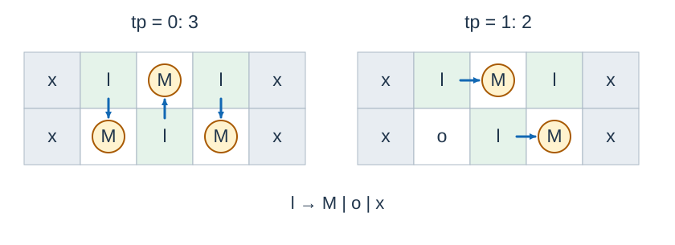

# Melon Planting

- Indicative time limit: 0.5 s (reference environment: [environment and measurements](../../../docs/评测环境与性能.md); for estimation only)
- Actual time limit: twice the reference program's benchmark time on its slowest official test file in the target environment, rounded up to a multiple of 0.5 seconds, then to the platform's supported granularity if coarser.
- Memory limit: 128 MB

## Story

The village head plants melons in straight rows, but a new farmer has designed an irregular field. Vines compete for nearby empty cells, and neither their growth order nor their growth direction can be controlled. Find the largest or smallest possible final harvest.

## Formal Problem Statement

The field is an $n$ by $m$ grid. Each cell initially contains a vine `l` , empty land `o` , or an obstacle `x` . Cells outside the grid are obstacles.

Each vine produces at most one melon. A growth step chooses any vine that has not produced a melon and has an empty cell immediately above, below, left, or right. It produces one melon in one such cell. That cell becomes occupied permanently. A vine cell remains a vine and cannot receive a melon.

Growth continues until no vine can produce another melon. If $tp=0$ , find the maximum number of melons among all possible terminal states. If $tp=1$ , find the minimum.

## Input Format

The first line contains $n,m,tp$ . Each of the next $n$ lines contains a string of length $m$ describing a row of the field.

## Output Format

Print the requested maximum or minimum as one integer.

## Example 1

### Input

```text
2 5 0
xlolx
xolox
```

### Output

```text
3
```

## Example 2

### Input

```text
2 5 1
xlolx
xolox
```

### Output

```text
2
```

## Example 3

### Input

```text
1 3 1
lxl
```

### Output

```text
0
```

## Example Explanation

The first two examples use the same field. In the left panel, all three vines produce a melon. In the right panel, two melons occupy all neighboring empty cells of the remaining unproductive vine, so growth stops. The third example has no empty cells and produces no melons.



Here `l` denotes a vine, `o` empty land, `x` an obstacle, and a circled `M` a melon. Arrows show which vine produced each melon.

## Constraints and Guarantees

All inputs satisfy $n,m\ge1$ and $tp\in\{0,1\}$ . If $tp=0$ , then $nm\le1000$ . If $tp=1$ , then $nm\le100$ and there are at most $18$ vines. The field may contain no vines or no empty cells.

| Score share | Additional conditions |
| --- | --- |
| 20% | $tp=0$ , $n=1$ |
| 30% | $tp=0$ |
| 20% | $tp=1$ , $n=1$ |
| 30% | $tp=1$ |
