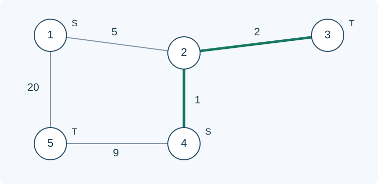

# Starts and Destinations

Estimated time limit: 1.5 seconds. Memory limit: 128 MB.

The actual time limit is twice the slowest-case median runtime of the reference solution on the target judge, rounded up to a multiple of $0.5$ seconds. See the [benchmark environment](../../../docs/评测环境与性能.md).

## Story

A transport network has several possible departure stations and several receiving stations. Choose one of each and find the minimum total travel cost.

(This story was rewritten by GPT-6.)

## Formal Problem Statement

An undirected graph has $n$ vertices numbered $1,\ldots,n$ and $m$ edges with nonnegative weights. Labels define two disjoint sets: vertex $i$ belongs to the source set $S$ if $b_i=0$ , to the destination set $T$ if $b_i=1$ , and to neither if $b_i=2$ .

Choose any source in $S$ and any destination in $T$ . Find the minimum sum of edge weights among all paths with such endpoints. If no such path exists, including when either set is empty, output $-1$ . Parallel edges, self-loops, and zero-weight edges are allowed.

## Input Format

The first line contains $n,m$ . The second contains $b_1,\ldots,b_n$ . Each of the next $m$ lines contains $u,v,c$ , describing an undirected edge of weight $c$ between vertices $u$ and $v$ .

## Output Format

Print one integer: the minimum path weight, or $-1$ if no eligible path exists.

## Samples

### Sample 1

### Input

```text
5 5
0 2 1 0 1
1 2 5
2 3 2
4 2 1
4 5 9
1 5 20
```

### Output

```text
3
```

### Sample 2

### Input

```text
3 2
0 2 1
1 2 0
1 1 5
```

### Output

```text
-1
```

### Sample 3

### Input

```text
2 1
0 1
1 2 0
```

### Output

```text
0
```

## Sample Explanation

In the first sample, choose source $4$ and destination $3$ . The path $4\to2\to3$ costs $1+2=3$ . In the second, destination $3$ cannot be reached. The third has a zero-weight edge between a source and a destination, so its answer is zero.



Letters $S,T$ mark set membership, and edge labels are weights. The two emphasized edges form an optimal path.

## Constraints and Guarantees

For all inputs, $1\le n,m\le5\times10^5$ , $b_i\in\{0,1,2\}$ , $1\le u,v\le n$ , and $0\le c\le10^9$ . Either set may be empty, and the graph need not be connected.

| Score share | Additional conditions |
| --- | --- |
| 40% | $n\le500$ and $\lvert S\rvert,\lvert T\rvert\le1$ |
| 20% | $\lvert S\rvert,\lvert T\rvert\le1$ |
| 40% | None |
