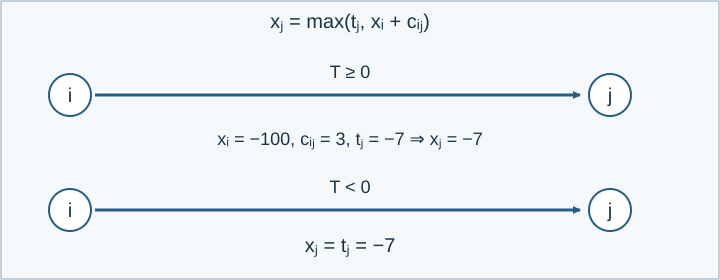

# 地狱门

参考时间限制：0.5秒；内存限制：128 MiB。实际时限取目标环境中最慢正式文件的标程中位耗时乘2，再按0.5秒向上取整。见[评测环境](../../../docs/评测环境与性能.md)。

## 背景故事

溪湾村长小B是工务署的得力干将。他对轨道交通有着深入的了解，但在传送门方面还是个初学者，所以想请你帮 Steve 算一算：从起点出发，最早能在什么时刻到达终点？

青枫镇所在的服务器中有 $N$ 个传送门入口。由于一个区块（chunk）很大，同一区块内可能有多个入口。服务器管理员还建造了一些单向传送门，因此出口所在的区块不一定有传送门。

如果 Steve 所在的区块有传送门，他可以任选一个进入，也可以不进入。他还可以向上、下、左、右移动到相邻区块，每移动一次，当前时刻就增加所在世界规定的 $T_w$；也可以留在原地等待任意非负时长。传送门各有建立时刻和通过时带来的时间变化。

时刻零，Steve 出现在世界 $w_0$ 的 $(x_0,y_0)$ 区块。他希望尽早到达世界 $w_1$ 的 $(x_1,y_1)$ 区块。

## 形式化问题描述

有 $M$ 个世界，每个世界都是无限整数网格。在世界 $w$ 中，每次向上、下、左或右移动一格，会使当前时刻增加 $T_w$ ；该数可以为负，也可以为零。可以原地等待任意非负时长。

初始状态为时刻零、世界 $w_0$ 的 $(x_0,y_0)$ .目标是世界 $w_1$ 的 $(x_1,y_1)$ ，求最早到达时刻。即使起点与终点相同，也允许先离开再回来。

第 $i$ 个传送门的入口是世界 $w_i$ 的 $(x_i,y_i)$ ，出口是世界 $w'_i$ 的 $(x'_i,y'_i)$ .它从时刻 $t_i$ 开始永久存在。站在入口且当前时刻不早于 $t_i$ 时，可以使用它，使当前时刻增加 $\delta_i$ 并到达出口。该门仅能沿给定方向使用；出口不一定有传送门。同一格可以有多个入口，每次可任选一个使用，也可以步行离开。

如果目标不可达，输出 `YouNeedOpPermission` .如果能在任意早的时刻到达目标，输出 `NegativeInfinity` .否则输出有限的最早到达时刻。



图对应样例4：负时间世界中可以反复走动，但通过门前仍须等到时刻 $-7$ ，故最早在 $-4$ 到达目标。

## 输入格式

第一行 `N M` ，表示传送门数量和世界数量。

第二行 `w_0 x_0 y_0 w_1 x_1 y_1` .

第三行 $M$ 个整数 $T_1,\ldots,T_M$ .

接下来 $N$ 行，每行八个整数 `w_i x_i y_i w'_i x'_i y'_i t_i delta_i` .

## 输出格式

输出一行，内容为上述两个字符串之一，或最早到达时刻的整数。


## 样例 1

### 输入

```text
2 2
1 0 0 1 1000 1000
1 1
1 995 1000 2 505 505 -1000 2
2 505 500 1 1000 1000 -990 -50
```

### 输出

```text
-1040
```

## 样例 2

### 输入

```text
2 2
1 0 0 2 1000 1000
1 -1
1 995 1000 1 505 505 -1000 2
2 505 500 1 1000 1000 -990 -50
```

### 输出

```text
YouNeedOpPermission
```

## 样例 3

### 输入

```text
2 2
1 0 0 1 1000 1000
-1 -1
1 995 1000 2 505 505 -1000 2
2 505 500 1 1000 1000 -990 -50
```

### 输出

```text
NegativeInfinity
```

## 样例 4

### 输入

```text
1 2
1 0 0 2 0 0
-1 0
1 0 0 2 0 0 -7 3
```

### 输出

```text
-4
```


## 数据范围与保证

$0\le N\le3000$ ，$1\le M\le200$ ，$-10\le T_w\le10$ .每个世界至多有50个传送门入口。所有世界编号在 $1,\ldots,M$ 中；输入中的所有横、纵坐标、开放时间和传送时间变化均在 $[-10000,10000]$ 中。

由 Codex（GPT-6）补齐并记录为重新设计：补足传送门数量下界和起终点、出口的范围，统一为单行输出并允许行末换行，明确起终点相同时仍可绕行。保留原有移动、等待和开放时间规则。

| 分值比例 | 额外条件 |
| --- | --- |
| 100% | 无额外条件 |

共10个正式文件，每个10%。[生成说明](tests/README.md)。
