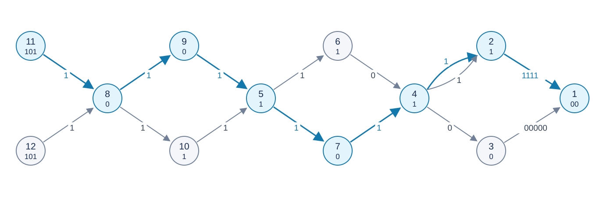

# Rotating Bytes

Estimated time limit: 4 seconds. Memory limit: 4096 MB.

The actual limit is the reference program's slowest median runtime on the target platform multiplied by $2$ , rounded up to a multiple of $0.5$ seconds. See the [evaluation environment](../../../docs/评测环境与性能.md).

## Story

The bytes turning on your gears are the faith I will hold for a lifetime.

Babbage never completed his Analytical Engine. Later, electromechanical computers built with electromagnetic relays, followed by electronic computers using vacuum tubes, transistors, and semiconductor devices, fulfilled his lifelong dream in another form.

## Formal Problem Statement

A directed graph has $n$ vertices numbered $1,\ldots,n$ and $m$ edges. Every vertex and edge has a nonempty binary string label. Vertex one is the destination. There are $k$ distinct allowed starting vertices, none equal to one. Parallel edges and self-loops are allowed.

A path string concatenates the starting vertex label, the first edge label, the next vertex label, and so on through the destination label. Select a path by these priorities:

1. Among paths from any allowed start to vertex one, minimize the path-string length.
2. Among shortest strings, minimize the forward path string lexicographically, with `0` smaller than `1` .
3. Among paths tied on the first two criteria, minimize the vertex-number sequence read **from destination to start** lexicographically. Compare each vertex number as an integer, not as decimal characters.

Lexicographic comparison is decided at the first differing position; a proper prefix is smaller than the longer sequence. Print the selected string and vertex sequence in the forward direction. Parallel edges giving identical outputs need not be distinguished. At least one feasible path exists.

## Input Format

The first line contains $n,m,k$ . The second contains the $n$ vertex labels in vertex order. The third contains the $k$ starting vertices. Each of the next $m$ lines contains integers $u,v$ and a string $s$ , specifying a directed edge from $u$ to $v$ with label $s$ .

## Output Format

Print the forward path string on the first line. On the second, print the visited vertex numbers from start to destination, separated by spaces.

## Samples

### Sample 1

### Input

```text
12 15 2
00 1 0 1 1 1 0 0 0 1 101 101
11 12
3 1 00000
2 1 1111
4 3 0
4 2 1
6 4 0
7 4 1
5 6 1
5 7 1
9 5 1
10 5 1
8 9 1
8 10 1
12 8 1
11 8 1
4 2 1
```

### Output

```text
101101011101111111100
11 8 9 5 7 4 2 1
```

### Sample 2

### Input

```text
4 4 1
0 0 0 0
4
4 3 0
3 1 0
4 2 0
2 1 0
```

### Output

```text
00000
4 2 1
```

### Sample 3

### Input

```text
3 3 2
01 1 0
2 3
2 1 0
3 1 1
3 3 0
```

### Output

```text
0101
3 1
```

## Sample Explanation

The full directed graph of sample one appears below. Each circle shows “vertex number / vertex label”; edges show edge labels, including both parallel edges $4\to2$ . The highlighted route is the output route. Both routes in sample two produce five zeros, but reverse sequence $(1,2,4)$ is smaller than $(1,3,4)$ . In sample three, the direct routes have equal length; starting at vertex three gives the smaller string. The self-loop adds characters.



## Constraints and Guarantees

$2\le n\le2\times10^6$ , $1\le m\le3\times10^6$ , $1\le k\le n-1$ . Every vertex and edge label has length one through five and contains only `0` and `1` . All vertex numbers are valid, and at least one allowed start can reach the destination.

| Score | Additional constraints |
| --- | --- |
| 20% | $n,m\le10$ |
| 30% | $n\le1000$ , $m\le2000$ |
| 20% | $n\le300000$ , $m\le500000$ |
| 30% | None |
