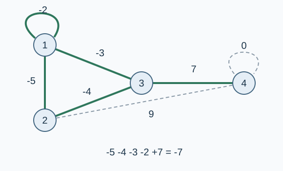

# 异星工厂：简单火车

预估时间限制：1.5 秒。内存限制：128 MB。

实际时限以标准程序在目标评测环境的最慢用例中位时间乘以 $2$ ，按 $0.5$ 秒向上取整。参考环境见[评测说明](../../../docs/评测环境与性能.md)。

## 背景故事

你在异星工厂中建成了若干生产和采掘集群。现在要从备选双向铁路中选择一些，使所有集群连通，并让总建设费用尽可能小。

## 形式化问题描述

有 $n$ 个顶点，编号为 $1$ 到 $n$ ，以及 $m$ 条备选无向边。第 $i$ 条边连接 $a_i,b_i$ ，费用为整数 $w_i$ .每条边只能选择零次或一次。

选择的边需要使全部顶点连通，目标是最小化所选边的费用总和。费用可以为负数或零；允许自环和连接同一对顶点的多条不同边。所选子图可以包含环。

如果不存在连通方案，报告无法完成。只有一个顶点时，无须选择边也满足连通要求，但仍应最小化总费用。

## 输入格式

第一行两个整数 $n,m$ .接下来 $m$ 行，每行三个整数 $a_i,b_i,w_i$ ，描述一条备选边。

## 输出格式

若无法使所有顶点连通，输出一行 `bad idea` .否则输出一行一个整数，表示最小总费用。

## 样例

### 样例 1

### 输入

```text
4 7
1 2 -5
2 3 -4
1 3 -3
1 1 -2
3 4 7
2 4 9
4 4 0
```

### 输出

```text
-7
```

### 样例 2

### 输入

```text
1 2
1 1 -9
1 1 6
```

### 输出

```text
-9
```

### 样例 3

### 输入

```text
3 1
1 2 0
```

### 输出

```text
bad idea
```

## 样例解释

第一组应选全部四条负费用边，它们的费用和为 $-14$ ，其中包含一个环和一个自环；再选费用为 $7$ 的边连接顶点 $4$ ，总费用为 $-7$ .



实线表示图示方案选用的边，虚线表示未选边。零费用自环选与不选都不影响最优值。

第二组只有一个顶点，选择费用为 $-9$ 的自环可降低总费用。第三组的顶点 $3$ 无法与其他顶点连通。

## 数据范围与保证

$1\le n\le10^6$ ，$0\le m\le2\times10^6$ ，$1\le a_i,b_i\le n$ ，$|w_i|\le10^9$ .

| 分值比例 | 额外条件 |
| --- | --- |
| 100% | 无额外条件 |
