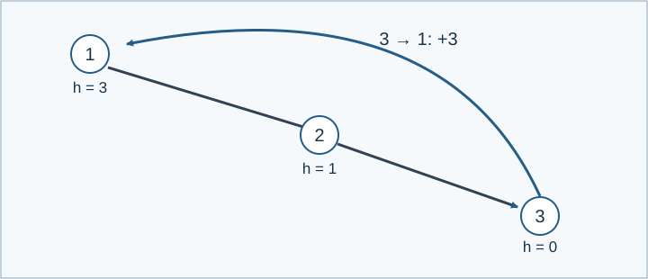

# 白雪公主

参考时限：2.5秒；内存限制：512 MiB. 目标平台按正式文件最慢中位数的两倍、向上取整到0.5秒校准，见[评测环境](../../../docs/评测环境与性能.md).

## 背景故事

白雪公主请你帮她改造滑雪道。

这里的滑雪道连接着不同高度的地点，每条滑雪道只能沿指定方向通往同样高或更低的地点。你需要修建一些电梯，电梯也只能单向运行，但可以通往同样高或更高的地点。

白雪公主希望从任意地点出发，都能通过滑雪道和电梯到达其他所有地点。你要先让电梯的总提升高度尽可能小，再在此前提下尽量少修电梯。

## 形式化问题描述

有 $n$ 个点和 $m$ 条有向边，点 $u$ 的高度为 $h_u$ . 每条已有边 $u\to v$ 均满足 $h_u\ge h_v$ . 高度相等时，边仍只允许沿给定方向通行。已有边可以重复，也可以是自环。

你可以增加任意条有向边 $s\to t$ ，但必须满足 $s\ne t$ 且 $h_s\le h_t$ . 每条新增边的代价是 $h_t-h_s$ . 让最终的图强连通，即任意点都可以沿有向边到达任意其他点。

按以下优先级优化：先最小化新增边的总代价，再在最小总代价下最小化新增边数。输出任意最优方案；若不存在方案，输出 `-1` .



图中黑色边为已有滑雪道，蓝色边为新增电梯。总代价为 $3-0=3$ ，只需一条新增边。

## 输入格式

第一行两个整数 $n,m$ . 第二行 $n$ 个整数 $h_1,\ldots,h_n$ . 接下来 $m$ 行，每行两个整数 $u,v$ ，表示已有边 $u\to v$ .

## 输出格式

无解时只输出一行 `-1` . 否则第一行输出最小总代价，第二行输出该代价下的最少新增边数 $k$ ，接下来 $k$ 行各输出两个点 $s,t$ ，表示新增边 $s\to t$ . $k=0$ 时不再输出边。

## 样例 1

### 输入

```text
3 2
3 1 0
1 2
2 3
```

### 输出

```text
3
1
3 1
```

## 样例 2

### 输入

```text
3 1
2 1 0
1 2
```

### 输出

```text
-1
```

## 样例 3

### 输入

```text
3 2
5 5 5
1 2
1 3
```

### 输出

```text
0
2
2 3
3 1
```

## 样例 4

### 输入

```text
7 3
4 5 1 0 5 4 4
5 1
7 1
7 4
```

### 输出

```text
5
5
1 6
6 7
2 5
4 3
3 2
```

## 数据范围与保证

$1\le n\le500000$ , $1\le m\le2000000$ , $-10^9\le h_u\le10^9$ , $1\le u,v\le n$ . 已有边满足 $h_u\ge h_v$ .

由 Codex（GPT-6）补齐无解输出与自环、重边约定，记录为重新设计；点数、边数、高度范围和两级优化目标保持一致。

| 分值比例 | 额外条件 |
| --- | --- |
| 100% | 无额外条件 |

共10个正式文件，每个10%。[生成说明](tests/README.md)。
