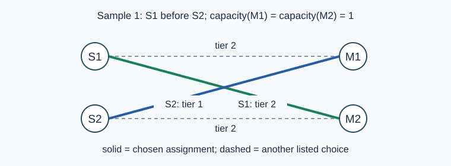

# Spode经学院

- 参考时间限制：0.5 秒。
- 实际时限：标准程序在目标环境的最慢用例中位耗时乘以 2，再按 0.5 秒向上取整。
- 内存限制：128 MB。
- [参考评测环境与测量](../../../docs/评测环境与性能.md)

## 背景故事

> 只有Spode知道答案。遵循Spode规则，一切都会明朗。
>
> ——信仰卷轴2（《Spore》，[英文资料](https://spore.fandom.com/wiki/Scrolls_of_Faith)）

Spode 经学院又迎来了一 Spore 年一度的招生考试。许多学生报名，希望拜入经学导师门下；每位导师都有自己的招生名额。学生按照喜好分档填报导师，每档最多三位，也可以留空，并各自设定能够接受的志愿档次。

考试成绩没有并列。录取时先照顾成绩更高的学生，在保住此前学生录取档次的前提下，再让当前学生获得尽可能满意的结果；无法被任何所填导师录取的学生不占用名额。

现在成绩排名尚未确定，学院希望你评估多种排名下的录取档次，并告诉每位学生至少要提高多少名，才能达到自己的满意标准。

## 形式化问题描述

有 $n$ 名学生和 $m$ 位导师，编号分别为 $1,\ldots,n$ 与 $1,\ldots,m$ .导师 $j$ 最多录取 $b_j$ 人。学生 $i$ 对导师 $j$ 的志愿档次为 $c_{i,j}$ ；$-1$ 表示未填报，否则为 $1$ 到 $m$ 的整数，越小越优先。每名学生每档至多填报三位导师。每名学生至多被一位填报过的导师录取。

一次排名按成绩从高到低列出全部学生。依次确定每名学生的录取档次：在所有更高排名学生的已确定档次保持不变的前提下，取当前学生能够被录取的最小档次；若不能被任何填报导师录取，则记为未录取。为了满足这些档次，可以调整学生在同档导师之间的分配。未录取学生不占名额。

学生 $i$ 被录取且录取档次不大于 $a_i$ 时满意。对每次排名，回答：

1. 每名学生的录取档次；未录取用 $-1$ 表示。
2. 单独把该学生向前移动，其他学生的相对顺序不变，再按上述规则重新录取，至少提高多少名能使他满意。已经满意输出 $0$ ；即使升到第一名也不能满意，输出 $-1$ .

每次排名、每名学生的提升询问均独立计算。

## 输入格式

第一行三个整数 $n,m,q$ .

第二行 $n$ 个整数 $a_1,\ldots,a_n$ .第三行 $m$ 个整数 $b_1,\ldots,b_m$ .

接下来 $n$ 行，每行 $m$ 个整数，第 $i$ 行为 $c_{i,1},\ldots,c_{i,m}$ .

最后 $q$ 行，每行一个 $1,\ldots,n$ 的排列，按成绩从高到低给出学生编号。

## 输出格式

每次排名输出两行，每行 $n$ 个整数，均按**学生编号**排序。第一行为录取档次，第二行为最少提升名次数。共输出 $2q$ 行。

## 样例 1

### 输入

```text
2 2 1
1 1
1 1
2 2
1 2
1 2
```

### 输出

```text
2 1
-1 0
```

## 样例 2

### 输入

```text
2 2 1
2 1
1 1
1 2
1 2
1 2
```

### 输出

```text
1 2
0 1
```

## 样例 3

### 输入

```text
2 2 1
2 2
1 1
-1 1
-1 1
1 2
```

### 输出

```text
1 -1
0 1
```

## 样例解释

样例一中，学生 $1$ 可在第二档的两位导师中调整分配，从而让学生 $2$ 被第一档导师录取；学生 $1$ 没有第一档志愿，提升排名也不能满意。样例二中，学生 $2$ 向前移动一名即可获得第一档。样例三中，两人只填报同一位导师，只有排名靠前者被录取。



图中 $S_i$ 表示学生，$M_j$ 表示导师；实线给出同时满足两名学生录取档次的分配。

## 数据范围与保证

$1\le n,m\le1000$ ；$1\le q\le10$ ；$0\le a_i\le m$ ；$0\le b_j\le1000$ ；$c_{i,j}\in\{-1,1,\ldots,m\}$ .每名学生每档至多三位导师。每次排名均为合法排列。

| 分值比例 | 额外条件 |
| --- | --- |
| 100% | 无额外条件 |
