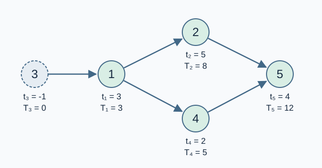

# 异星工厂：科技树

预估时间限制：1.0 秒。内存限制：128 MB。

实际时限以标准程序在目标评测环境的最慢用例中位时间乘以 $2$ ，按 $0.5$ 秒向上取整。参考环境与测量见[评测说明](../../../docs/评测环境与性能.md)。

## 背景故事

在《异星工厂》中，科技虽然称作“科技树”，研发依赖却可能构成一张图。有些科技已经解锁，你想安排剩余研发，尽早完成全部科技。

## 形式化问题描述

共有 $n$ 项科技，编号为 $1$ 到 $n$ .若 $t_i=-1$ ，则科技 $i$ 在时刻零已经完成；否则，它的研发耗时为 $t_i$ .

每条依赖 $(u,v)$ 表示科技 $u$ 只有在科技 $v$ 已完成后才能开始。未完成的科技必须等全部依赖完成后才可开始，完成时刻等于开始时刻加研发耗时。任意多项科技可以同时研发。

已经完成的科技无须再次研发，其输入依赖不会撤销已完成状态。自环和重复依赖都允许。即使一个依赖环中的耗时全为零，环内科技仍不能彼此作为已完成的前提同时启动。

求完成全部科技所需的最短时间；若无法完成则报告无解。

## 输入格式

第一行两个整数 $n,m$ ，表示科技数与依赖条数。第二行 $n$ 个整数 $t_1,\ldots,t_n$ .接下来 $m$ 行，每行两个整数 $u,v$ ，表示 $u$ 依赖 $v$ .

## 输出格式

若可以完成全部科技，输出一行一个整数表示最短时间；全部已完成时答案为 $0$ .否则输出一行 `bad idea` .

## 样例

### 样例 1

### 输入

```text
5 5
3 5 -1 2 4
2 1
4 1
5 2
5 4
1 3
```

### 输出

```text
12
```

### 样例 2

### 输入

```text
2 2
0 0
1 2
2 1
```

### 输出

```text
bad idea
```

### 样例 3

### 输入

```text
3 3
-1 0 7
1 3
2 1
3 2
```

### 输出

```text
7
```

## 样例解释

第一组样例中，科技 $3$ 已完成。科技 $1$ 在时刻 $3$ 完成，科技 $2,4$ 分别在时刻 $8,5$ 完成，科技 $5$ 在时刻 $12$ 完成。第二组的零耗时环没有可启动的科技。第三组中科技 $1$ 已完成，因此科技 $2$ 可以在时刻零完成，随后科技 $3$ 花费七个时间单位。



箭头从前置科技指向依赖它的科技；$t_i$ 为输入耗时，$T_i$ 为完成时刻。虚线结点表示已经完成。

## 数据范围与保证

所有数据满足：$1\le n\le10^6$ ，$0\le m\le2\times10^6$ ，$-1\le t_i\le10^9$ ，$1\le u,v\le n$ .不保证依赖图无环。

| 分值比例 | 额外条件 |
| --- | --- |
| 100% | 无额外条件 |
