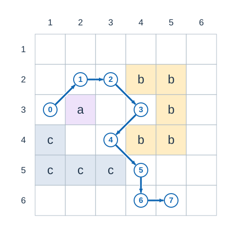
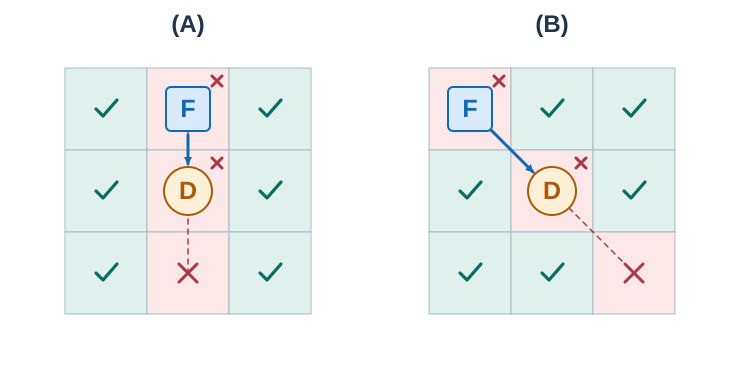
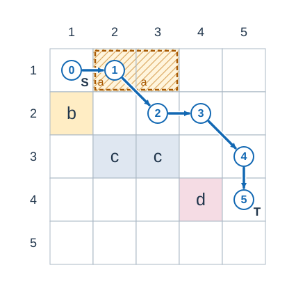

# Terror Drone

- Indicative time limit: 0.5 seconds (reference environment: [environment and measurements](../../../docs/评测环境与性能.md)).
- Actual time limit: twice the reference program's benchmark time on the slowest official input in the target environment, rounded up to a multiple of 0.5 seconds. Round up again if the platform requires a coarser unit.
- Memory limit: 128 MB

## Story

FutureTech is testing a remote-controlled Battle Fortress with no ranged weapons. A commander sends a disguised Terror Drone to lure it into a trap. The drone is no faster than the fortress, so it must keep changing direction to avoid being crushed.

Scouts have marked the obstacles, traps, and possible starting positions. Before each attempt, one entire obstacle may also be bombed away. Determine the result for every possible start.

## Formal Problem Statement

The map has $n$ rows and $m$ columns. `B` denotes an obstacle cell, `T` a trap, `S` a queried starting cell, and `E` ordinary open ground. Only one fortress is present in each attempt; all other `S` cells are open ground.

Obstacle cells connected through horizontal or vertical adjacency form one component. Before an attempt, you may remove at most one whole obstacle component, making all its cells open. Attempts for different starts are independent and may remove different components.

Both units occupy cells. Adjacency includes the eight horizontal, vertical, and diagonal neighbors. Diagonal movement only requires an open destination; the two cells beside the diagonal do not block it.



Figure 1: Equal letters denote one obstacle component. In this figure, differently labeled blocks touching at a corner do not merge. The blue arrows show part of a route that needs no bombing and has no collinear consecutive moves. Circled numbers give the visiting order; the numbers on the left and top are row and column indices.

A drone may be dropped into any traversable cell not occupied by the fortress, including a trap. Drops take no time. Once the drone is adjacent to the fortress, the following rules apply:

1. Let the fortress be at $u$ and the drone at an adjacent cell $v$ . The drone may stay at $v$ or try to move to a traversable neighbor $w$ of $v$ .
2. If it stays, or if $u,v,w$ are collinear, the drone is destroyed before moving. The case $w=u$ also counts as collinear.
3. Otherwise, the drone moves to $w$ . Whether or not the drone is destroyed, the fortress moves to the drone's previous cell $v$ . This counts as one move.
4. The attempt ends as soon as the fortress enters any trap. The drone may be sacrificed on this final move. If a drone is destroyed before capture, another drone may be dropped.

Without an adjacent drone, the fortress stays still. A drone can be dropped directly into an adjacent cell, so no time needs to be charged for approaching the fortress.

For each `S` cell, considering every permitted bombing choice:

- If one drone can capture the fortress, output the minimum number of fortress moves.
- Otherwise, if finitely many drones can capture it, output `-2` .
- Otherwise, output `-1` .

The next figure shows safe one-step destinations when the fortress is immediately above or diagonally above-left of the drone. All surrounding cells are assumed to be traversable.



Figure 2: The square `F` is the fortress and the circle `D` is the drone. Checks mark safe destinations. Crosses mark destruction, including staying still, moving toward the fortress, or moving forward on the same line. The dashed red line marks that line. The blue arrow shows that the fortress moves to the drone's previous cell in every case. On the actual map, destinations outside the grid or on remaining obstacles are also unavailable.

## Input Format

The first line contains two integers $n,m$ .

Each of the next $n$ lines contains a string of length $m$ describing one row.

## Output Format

Output one answer per `S` cell, in row order from top to bottom and left to right within each row.

## Sample 1

### Input

```text
5 5
SBBEE
BEEEE
EBBEE
EEEBT
EEEEE
```

### Output

```text
5
```

### Explanation

Remove the obstacle consisting of columns $2,3$ of row $1$ . The fortress can visit $(1,1),(1,2),(2,3),(2,4),(3,5),(4,5)$ . Consecutive moves are not collinear, giving $5$ moves; the drone stops on the trap at the end.



Figure 3: Remove the entire hatched component `a` inside the dashed outline. Components `b` , `c` , and `d` remain. Drop the drone at circled position $1$ , move it successively toward positions $2$ through $5$ , then let it stay at `T` . The fortress follows the blue arrows from `S` and reaches the trap after five moves.

## Sample 2

### Input

```text
1 4
STES
```

### Output

```text
1
-2
```

### Explanation

The left start is next to the trap and needs one move. The right start requires two moves on the same line, so more than one drone is needed.

## Sample 3

### Input

```text
1 5
SBBBT
```

### Output

```text
-2
```

### Explanation

The three obstacle cells form one component and can all be removed. Following the straight corridor requires several drones.

## Sample 4

### Input

```text
1 5
SBEBT
```

### Output

```text
-1
```

### Explanation

The two obstacle cells belong to different components. Removing either one still leaves the trap unreachable.


## Constraints and Guarantees

- $1\le n,m\le40$ .
- Each cell is one of `B` , `S` , `T` , `E` .
- Obstacles, starting cells, or traps may be absent. If there are no starts, produce no output. If there are no traps, the answer for every start is `-1` .

### Test Groups

| Score share | Additional conditions |
| --- | --- |
| 30% | $n,m\le5$ |
| 10% | Exactly one start and one trap |
| 20% | Exactly one trap |
| 40% | No additional conditions |
