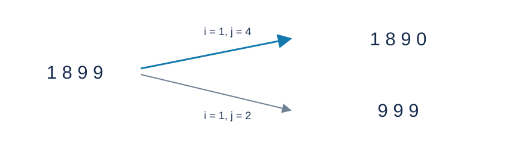

# 数位合并的最大值与最小值：题解

## 解法与贡献

首选出题人的线性贪心：根据进位与否选择高位，再选择对应低位。Codex（GPT-6）补充下面的比较证明、边界分析及标准 C++17 实现。数位的字典序比较是通常的位置记数法性质。

下图为样例一，基数为十；两条箭头分别表示产生最大值和最小值的选位。

## 比较结果

去掉前导零后，先比较位数，再比较同长度数位串的字典序。原数为正，操作后仍为正：不进位时数位总和不变，进位时保留一个一。

进位保留全部 $n$ 位；不进位最多剩 $n-1$ 位。因此最大值优先进位，最小值优先不进位。以下位置均按原串编号。

固定左位置 $i$ 后，不进位会增大右位置的数字，故求最小时取最靠右的可行 $j$ ；进位会减小右位置数字，故求最大时也取最靠右的可行 $j$ .改变发生得越晚，前面的有利数位就保留得越久。若加数为零而没有实际变化，选择更靠右仍不劣。

## 最大值

从右向左维护后缀最大值，找到最靠右的、能与右侧某位进位的位置 $i$ .

若 $a_i\ge2$ ，进位后该位变成一，是结果的第一个下降位置。因此在这类操作中，越靠右越好；固定该位后，选最靠右的可行 $j$ .

还需单独比较 $a_i=1$ 的情形。它只能与 $k-1$ 进位，且高位不变，唯一变化是低位从 $k-1$ 变为零。取最左的一和最右的 $k-1$ ，要求前者确实在后者之前。设后者位置为 $q$ .如果 $q>i$ ，这项方案比普通候选更晚下降，应当采用；如果 $q=i$ ，普通候选在该位得到一，而它得到零，普通候选更好；如果 $q<i$ ，也不采用。若普通候选本身左值为一，这项比较仍涵盖其最优选择。

如果完全不能进位，合并前两位。合并第一位与更后位置，会把原第二位移到最高位，而前两位合并的最高位更大。若选择的左位置不是第一位，最高位至多保持 $a_1$ ；前两位合并得到 $a_1+a_2\ge a_1$ .等号时 $a_2=0$ ，删除这个更靠前的零也不劣于在更后面删除一位，按第一个非零差异即可比较。

## 最小值

首先处理多删前导零的情况：若 $a_2=0$ ，而第一位能与某个 $j>2$ 不进位地合并，那么删除第一位后至少再删一个前导零。这比任何保留 $n-1$ 位的操作都小。使用最靠右的可行 $j$ 即可。

排除上述情况后，可行的不进位结果均有 $n-1$ 位。若存在

$$a_i>a_{i+1},\qquad j\ge i+2,\qquad a_i+a_j<k$$

就能把较小的 $a_{i+1}$ 左移到位置 $i$ ，而把加法带来的增大推迟。取最靠左的这种下降位置，再取最靠右的可行 $j$ .

为什么只检查严格下降？删除一位会使它与右合并位置之间的数字左移。如果先遇到上升，结果就在该处变大；如果先遇到相等数字，删除位置可以右移一格，结果与可行性不变，直到遇到首个不等位置。如果首个有利变化是下降，那么这处下降本身也满足上述条件。因此最早的可行下降决定最优前缀。

若没有这样的下降，取最靠右的可不进位左位置，并配上最靠右的可行右位置。可用逐步右移论证：

- 左移后的第一对数字上升时，保留该位、在更后面操作更好。
- 相等时，可以把删除位置右移而不改变结果。
- 若是下降，但没有隔开的可行右位置，就只能合并相邻两位；该位变成两者之和，不会减小。若右位为零而恰好不变，这相当于删除该零，仍可把删除位置右移。

反复应用，最靠右的可行左位置至少同样好。最后，如果根本没有不进位数位对，则所有数字均非零，合并前两位最小：优先把最高位降为一，再尽早让第二位下降；最高位本来就是一时，同样是让第二位最早变成零。

## 实现与复杂度

后缀最大值判断可否进位，后缀最小值判断可否不进位。寻找下降时，后缀必须从 $i+2$ 开始，不能误用相邻右位。每个分支只做常数次线性扫描；输出时直接跳过删除位置及前导零，不修改数组。

时间 $O(n)$ ，空间 $O(n)$ .两数位之和不超过 $2(k-1)<2\times10^9$ ，有符号三十二位整数足够；输出的整体整数不需要装入任何整数类型。[参考程序](std.cpp)采用缓冲输入输出。

枚举左位置并用区间查询选择右位置也能核验答案，但需要更复杂的结果串比较及 $O(n\log n)$ 时间，因此本题采用线性贪心。
