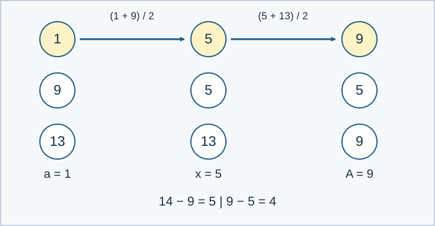

# 编辑城镇与模拟币

参考时限：1.5秒；内存限制：128 MiB. 目标平台按正式文件最慢中位数的两倍、向上取整到0.5秒校准，见[评测环境](../../../docs/评测环境与性能.md)。

## 背景故事

《模拟人生》中的“编辑城镇”允许玩家不投入自己的模拟币就改变城镇的样貌，当然，装修自己家仍然需要花钱。除了建筑和内设，这个模式还可以编辑家庭成员。成员离开时，会带走原家庭按人数等分的一份模拟币。

发现这一机制后，小A想到了一个问题：城镇中有若干家庭，1号家庭只有一名成员。可以反复编辑家庭，最后让1号家庭恢复初始的成员组成，并使它拥有的模拟币尽可能多。在此前提下，小A还想知道各家庭的贫富差距，以及1号家庭能否成为最富有的家庭。

## 形式化问题描述

初始有 $n$ 个家庭。家庭 $i$ 有 $p_i$ 名不同的居民和 $m_i$ 单位财富。家庭1只有一名居民，称为目标居民。

一次编辑选择一名居民，从其当前家庭搬出，再加入另一个非空家庭，或建立一个新的单人家庭。若搬出前家庭有 $p$ 人、财富为 $m$ ，该居民带走 $m/p$ ；原家庭剩下 $p-1$ 人和 $m-m/p$ 财富。加入另一个家庭时，所带财富全部加入该家庭。空家庭立即删除。财富按精确有理数计算；居民和财富都不能凭空增减。

可以进行任意有限次编辑。最终目标居民必须独自组成一个家庭，将这个家庭称为目标家庭。其他居民的分组不限，编辑期间及最终每个家庭的人数也不限。

先最大化目标家庭的财富，记最优值为 $A$ . 在达到 $A$ 的方案中，分别求：

1. 目标家庭财富 $A$ ；
2. 最大的家庭财富差距：所有非空家庭的最大财富减去最小财富；
3. 最大的人均财富差距：所有非空家庭的最大人均财富减去最小人均财富；
4. 是否存在方案使目标家庭财富不少于任何其他家庭；
5. 是否存在方案使目标家庭财富严格大于每个其他家庭；
6. 是否存在方案使目标家庭人均财富不少于任何其他家庭；
7. 是否存在方案使目标家庭人均财富严格大于每个其他家庭。

第2至7项分别独立优化或判断，允许使用不同的最终分组。只有一个家庭时，两种差距都为0，四项判断都为真。

前三项输出对 $P=1000000007$ 取模的结果。对精确有理数 $x=r/s$ ，约分后定义模值为 $r\cdot s^{-1}\bmod P$ ，输出 $[0,P-1]$ 内的代表元。本题要求的三个最优值的分母均与 $P$ 互素。



图中目标初始财富为1，依次与财富9、13的居民平均后得到5、9。最终另外两人的财富为5、9；把他们合成一个财富14的家庭，家庭财富差距为5.

## 输入格式

第一行一个整数 $n$ . 接下来 $n$ 行，每行两个整数 $p_i,m_i$ ，表示一个初始家庭。

## 输出格式

输出七行，依次回答上述七项。前三行为有理数的模值；后四行真输出1，假输出0.

## 样例 1

### 输入

```text
1
1 7
```

### 输出

```text
7
0
0
1
1
1
1
```

## 样例 2

### 输入

```text
2
1 2
1 10
```

### 输出

```text
6
0
0
1
0
1
0
```

## 样例 3

### 输入

```text
3
1 1
1 9
1 13
```

### 输出

```text
9
5
4
1
1
1
1
```

## 样例 4

### 输入

```text
3
1 3
1 2
1 5
```

### 输出

```text
4
2
2
1
1
1
1
```

## 样例 5

### 输入

```text
3
1 10
2 6
1 2
```

### 输出

```text
10
8
8
1
1
1
1
```

## 样例 6

### 输入

```text
4
1 2
1 2
2 4
1 2
```

### 输出

```text
2
6
0
1
0
1
0
```

## 样例 7

### 输入

```text
2
1 1
3 4
```

### 输出

```text
291666670
416666672
125000001
1
1
1
1
```

## 数据范围与保证

$1\le n\le1000000$ , $p_1=1$ , $1\le p_i\le20$ , $1\le m_i\le1000000$ .

本题由 Codex（GPT-6）重新设计：目标家庭初始人数限定为1，其他家庭初始人数上限设为20；保留百万家庭规模、任意编辑规则及七项输出。补齐空家庭、有理数取模和各项独立优化的约定。

| 分值比例 | 额外条件 |
| --- | --- |
| 100% | 无额外条件 |

共10个正式文件，每个10%。[数据生成与检验](tests/README.md)。

多成员版本见[编辑城镇与模拟币2](../town-editing-simoleons-2/statement.zh.md)。
