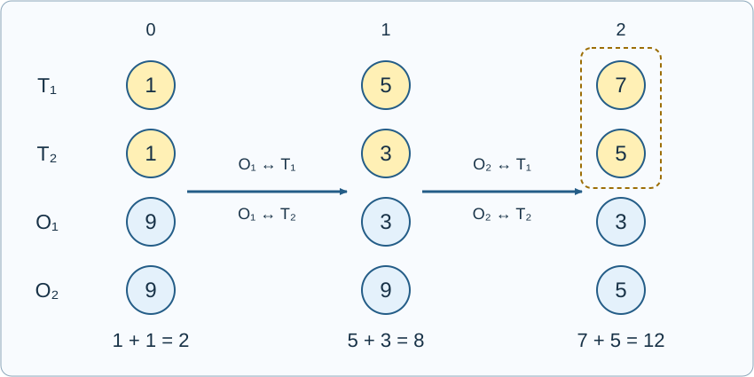

# 编辑城镇与模拟币2

参考时限：2秒；内存限制：128 MiB. 目标平台按正式文件最慢中位数的两倍、向上取整到0.5秒校准，见[评测环境](../../../docs/评测环境与性能.md)。

## 背景故事

《模拟人生》中的“编辑城镇”允许玩家不投入自己的模拟币就改变城镇的样貌，当然，装修自己家仍然需要花钱。除了建筑和内设，这个模式还可以编辑家庭成员。成员离开时，会带走原家庭按人数等分的一份模拟币。

发现这一机制后，小A想到了一个问题：可以反复编辑城镇中的家庭，最后让1号家庭恢复初始的成员组成，并使它拥有的模拟币尽可能多。

这一次，1号家庭可以有多名成员。小A只想知道，它最终最多能拥有多少模拟币？

## 形式化问题描述

初始有 $n$ 个家庭。家庭 $i$ 有 $p_i$ 名不同的居民和 $m_i$ 单位模拟币。初始属于1号家庭的 $p_1$ 名居民称为目标成员，他们的身份始终不变。

一次编辑选择一名居民，从其当前家庭搬出，再加入另一个非空家庭，或建立一个新的单人家庭。若搬出前家庭有 $p$ 人、模拟币总数为 $m$ ，该居民带走 $m/p$ ；原家庭剩下 $p-1$ 人和 $m-m/p$ 单位模拟币。加入另一个家庭时，所带模拟币全部加入该家庭。空家庭立即删除。模拟币按精确有理数计算，居民和模拟币都不能凭空增减。

可以进行任意有限次编辑，也可以不编辑。家庭数量可以增加或减少，编辑期间及最终家庭的人数没有上限。最后必须将全部目标成员组成一个家庭，称为最终的1号家庭；该家庭不能包含其他居民。目标成员在编辑期间可以分开，其他居民的最终分组不限。

求最终1号家庭能够拥有的最大模拟币总数 $A$ ，输出它对 $P=1000000007$ 取模的结果。应先在精确有理数意义下最大化，再取模。若约分后 $A=r/s$ ，其模值定义为 $r\cdot s^{-1}\bmod P$ ，输出 $[0,P-1]$ 内的代表元。此最大值可以用有限次编辑达到，且分母与 $P$ 互素。



图中 $T_1,T_2$ 是目标成员，$O_1,O_2$ 是外部居民。两组初始分别属于同一家庭。先让 $O_1$ 依次与 $T_1,T_2$ 两两合并再分开，再对 $O_2$ 做同样的操作。最后将两名目标成员合为一家，得到 $7+5=12$ 单位模拟币。

## 输入格式

第一行一个整数 $n$ .

接下来 $n$ 行，每行两个整数 $p_i,m_i$ ，表示一个初始家庭的人数和模拟币总数。

## 输出格式

输出一行一个整数，表示最大模拟币总数 $A$ 的模值。

## 样例 1

### 输入

```text
1
3 7
```

### 输出

```text
7
```

## 样例 2

### 输入

```text
2
2 2
1 9
```

### 输出

```text
8
```

目标两人先分别拥有5和3，合为一家得到8。若直接把三人合为一家再移走外部成员，只能得到 $22/3$ .

## 样例 3

### 输入

```text
2
2 2
2 18
```

### 输出

```text
12
```

## 样例 4

### 输入

```text
3
3 6
2 4
1 1
```

### 输出

```text
6
```

## 样例 5

### 输入

```text
2
2 1
2 3
```

### 输出

```text
250000004
```

最大模拟币总数为 $9/4$ .

## 样例 6

### 输入

```text
2
20 1
1000000 1000000
```

### 输出

```text
538776497
```

## 数据范围与保证

$1\le n\le1000000$ ，$1\le p_1\le20$ ，对 $2\le i\le n$ 有 $1\le p_i\le1000000$ ，且 $1\le m_i\le1000000$ .

本题由 Codex（GPT-6）重新设计：只求目标家庭的最大模拟币总数，目标初始人数至多20，其他家庭初始人数至多100万；允许任意有限次家庭编辑，最终恢复目标成员组成。

| 分值比例 | 额外条件 |
| --- | --- |
| 100% | 无额外条件 |

共10个正式文件，每个10%。[数据生成与检验](tests/README.md)。另见[编辑城镇与模拟币](../single-member-household/statement.zh.md)。
