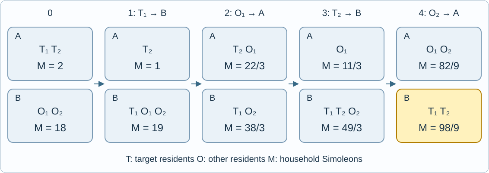

# Edit Town and Simoleons 3

Reference time limit: 0.5 seconds; memory limit: 64 MiB. On the target platform, use twice the slowest formal-input median, rounded up to 0.5 seconds; see the [evaluation environment](../../../docs/评测环境与性能.md).

## Story

In The Sims, Edit Town lets players reshape a town without spending their own Simoleons, although renovating their own home still costs money. The mode can also edit household members. A resident who leaves takes an equal per-person share of the household's Simoleons.

Little A is studying household wealth again. This time, the town has exactly two household slots. Residents may move between them, and an empty slot is retained. Little A wants the original members of household 1 to form a household again and own as many Simoleons as possible.

Little A has prepared several independent saved towns. Find the answer for each one.

## Formal Problem Statement

Each saved town always has exactly two household slots, A and B. Initially, the household in A has $p_1$ residents and $m_1$ Simoleons; the household in B has $p_2$ residents and $m_2$ Simoleons. The original residents of A are the target residents, whose identities never change. There is at least one target resident; B may be empty.

One edit moves one resident to the other household slot. If the source household has $p$ residents and $m$ Simoleons before the move, the resident takes $m/p$ Simoleons. The source loses one resident and $m/p$ Simoleons, and the destination gains one resident and the same amount. Its members then share the resulting household money; a resident leaving later takes the new per-person share.

Moving into an empty household is allowed. An empty household retains its slot and has zero Simoleons. No third household slot may be created. Intermediate and final household sizes are unrestricted. Money is an exact rational quantity and cannot be created or destroyed.

Any finite number of edits is allowed, including zero. At the end, all target residents must form one household containing no other residents. This household may occupy either A or B. Maximize its total Simoleons $W$ .

Maximize in exact rational arithmetic before taking the residue modulo $P=1000000007$ . If the reduced fraction is $W=u/v$ , its residue is $u\cdot v^{-1}\bmod P$ ; output the representative in $[0,P-1]$ . Within the constraints, the maximum is attainable in finitely many edits and its denominator is coprime to $P$ .



Here $T_1,T_2$ are target residents, $O_1,O_2$ are other residents, and $M$ is a household's total Simoleons. Each step moves exactly one resident, using only slots A and B.

## Input Format

The first line contains an integer $T$ , the number of saved towns.

Each town occupies two lines: $p_1,m_1$ on the first, and $p_2,m_2$ on the second.

## Output Format

For each town, print one integer on its own line: the residue of the maximum total Simoleons.

## Sample 1

### Input

```text
1
2 2
2 18
```

### Output

```text
888888906
```

The four moves shown are $T_1$ from A to B, $O_1$ from B to A, $T_2$ from A to B, and $O_2$ from B to A. B then contains exactly the two target residents and has $98/9$ Simoleons, whose residue is 888888906. This is optimal.

## Sample 2

### Input

```text
1
3 12
2 4
```

### Output

```text
12
```

The target household initially has greater per-person wealth. Doing nothing achieves the optimum of 12.

## Sample 3

### Input

```text
1
2 2
1 9
```

### Output

```text
8
```

The target residents can separate temporarily and finally form a household in B with 8 Simoleons.

## Sample 4

### Input

```text
1
1 0
1 1
```

### Output

```text
500000004
```

Merge the two residents, then move the target resident into the empty slot. The target has $1/2$ Simoleons.

## Sample 5

### Input

```text
1
7 25
0 0
```

### Output

```text
25
```

The other household is empty, so all 25 Simoleons already belong to target residents.

## Sample 6

### Input

```text
3
2 6
3 9
3 1
2 1
1000000 1000000000
1 1000000000
```

### Output

```text
6
930041160
286420940
```

The three towns are independent. In the first, both households have equal per-person wealth. The second has optimum $298/243$ .

## Constraints and Guarantees

$1\le T\le100000$ , $1\le p_1\le1000000$ , $0\le p_2\le1000000$ , and $0\le m_1,m_2\le10^9$ . If $p_2=0$ , then $m_2=0$ .

Redesigned by Codex (GPT-6): exactly two fixed household slots, empty households and multiple target residents are allowed, and only the maximum wealth after regrouping the target residents is requested. Either final slot is allowed. The input contains independent saved towns.

| Score share | Additional restrictions |
| --- | --- |
| 100% | None |

There are 10 formal files, each worth 10%. See [data generation and validation](tests/README.md) and [Edit Town and Simoleons 2](../town-editing-simoleons-2/statement.en.md).
