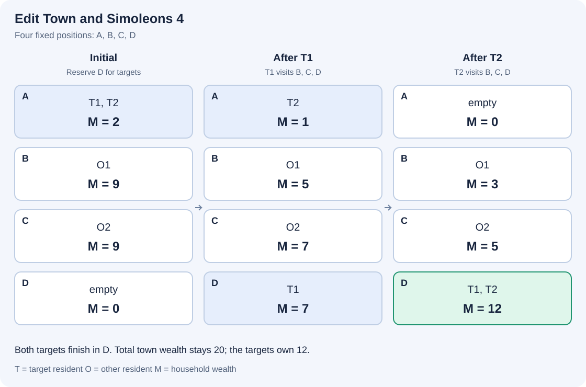

# 编辑城镇与模拟币4

参考时限：0.5秒；内存限制：64 MiB. 按正式文件最慢中位数的两倍、向上取整到0.5秒校准，见[评测环境](../../../docs/评测环境与性能.md)。

## 背景故事

《模拟人生》中的“编辑城镇”允许玩家不投入自己的模拟币就改变城镇的样貌，当然，装修自己家仍然需要花钱。除了建筑和内设，这个模式还可以编辑家庭成员。成员离开时，会带走原家庭按人数等分的一份模拟币。

发现这一机制后，小A又开始研究家庭的财富。这一次，城镇的家庭位置总数固定，空家庭的位置也会保留。小A希望让最初属于1号家庭的成员最终重新组成一个家庭，并使他们拥有的模拟币尽可能多。

## 形式化问题描述

城镇始终有 $n$ 个家庭位置，编号为 $1,2,\ldots,n$ .初始第 $i$ 个家庭有 $p_i$ 人、$m_i$ 单位模拟币。初始属于1号家庭的所有居民称为目标成员，他们的身份始终不变。记目标人数 $k=p_1$ ，目标成员至少有一人。

一次编辑选择一名居民，将其从当前家庭搬到另一个位置的家庭。若搬出前其家庭有 $p$ 人、$m$ 单位模拟币，该居民带走 $m/p$ ；原家庭减少一人和 $m/p$ 单位模拟币，另一个家庭增加一人和同样多的模拟币。加入后的模拟币由新家庭全体成员共同拥有，之后搬出的居民按新的人均财富带走模拟币。

允许搬入空家庭。家庭变空后，其位置仍然保留，模拟币为0；不能建立新的家庭位置。编辑期间及最终的家庭人数没有上限。模拟币按精确有理数计算，不能凭空增减。

可以进行任意有限次编辑，也可以不编辑。最终，全部目标成员必须共同组成一个家庭，且该家庭不含其他居民。这个家庭可以使用任意位置。求其模拟币总数的最大值 $W$ .

应先在精确有理数意义下最大化，再输出 $W$ 对 $P=1000000007$ 取模的结果。若约分后 $W=u/v$ ，其模值为 $u\cdot v^{-1}\bmod P$ ，输出 $[0,P-1]$ 内的代表元。在给定保证下，最大值可以用有限次编辑达到，且分母与 $P$ 互素。

本题中，初始除1号家庭外，每个非空家庭都只有一人，而且至少有一个空家庭。1号家庭可以有多名成员。



图中 $T_1,T_2$ 是目标成员，$O_1,O_2$ 是其他居民，$M$ 表示家庭的模拟币总数。两名目标成员依次经过B、C，最后在D团聚。各阶段始终使用同样的四个位置。

## 输入格式

第一行一个整数 $n$ .接下来 $n$ 行，第 $i$ 行包含两个整数 $p_i,m_i$ .每个输入只包含一个城镇。

## 输出格式

输出一行一个整数，表示最大模拟币总数的模值。

## 样例 1

### 输入

```text
4
2 2
1 9
1 9
0 0
```

### 输出

```text
12
```

两名目标成员最终分别带着7和5进入D，目标家庭财富为12。

## 样例 2

### 输入

```text
4
3 1
1 1
1 2
0 0
```

### 输出

```text
916666676
```

最大财富为 $35/12$ ，其模值为916666676。

## 样例 3

### 输入

```text
4
1 5
1 3
1 5
0 0
```

### 输出

```text
5
```

其他居民都不比目标家庭富，不编辑即可取得最优值5。

## 样例 4

### 输入

```text
3
1000000 1
1 1
0 0
```

### 输出

```text
502232024
```

目标成员有一百万人，仍只需要三个家庭位置。

## 样例 5

### 输入

```text
3
4 7
0 0
0 0
```

### 输出

```text
7
```

没有外部居民，全部模拟币都属于目标成员。

## 样例 6

### 输入

```text
4
2 0
1 0
1 1
0 0
```

### 输出

```text
750000006
```

最大财富为 $3/4$ ，其模值为750000006。

## 数据范围与保证

$2\le n\le1000000$ ，$1\le p_1\le1000000$ ；对 $i\ge2$ ，$p_i\in\{0,1\}$ .至少存在一个 $p_i=0$ .

所有 $0\le m_i\le10^9$ .若 $p_i=0$ ，则 $m_i=0$ .上述人数与财富范围只限制初始输入。

本题由 Codex（GPT-6）重新设计：家庭位置总数固定，只求目标成员重新组成家庭后的最大财富；其他非空家庭初始均为单人家庭，并保证至少一个空位置。

| 分值比例 | 额外条件 |
| --- | --- |
| 100% | 无额外条件 |

共10个正式文件，每个10%。[数据生成与检验](tests/README.md)。
