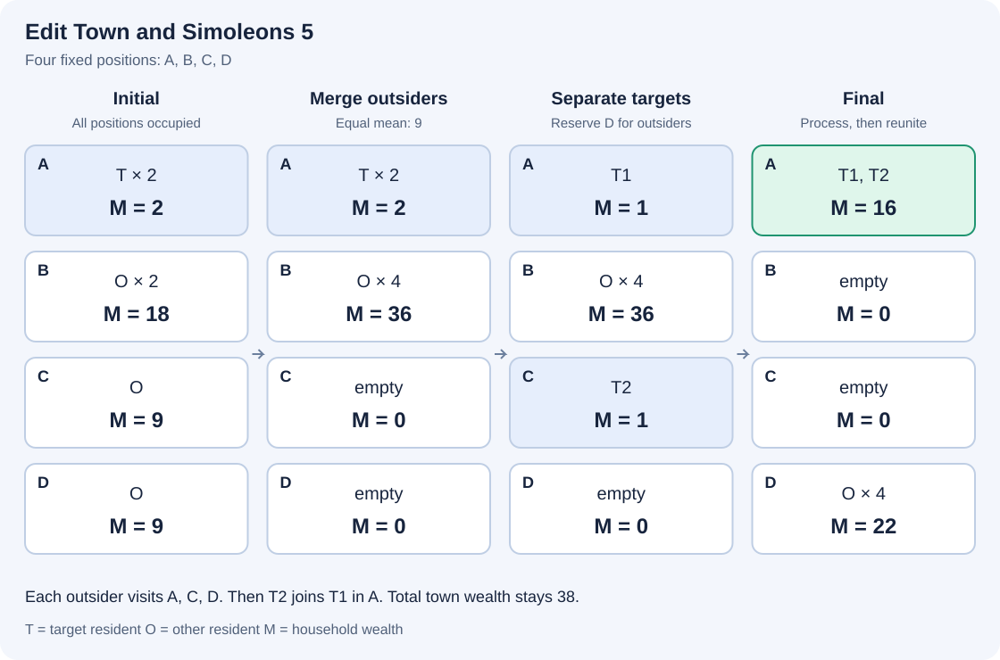

# 编辑城镇与模拟币5

参考时限：0.5秒；内存限制：64 MiB. 按正式文件最慢中位数的两倍、向上取整到0.5秒校准，见[评测环境](../../../docs/评测环境与性能.md)。

## 背景故事

《模拟人生》中的“编辑城镇”允许玩家不投入自己的模拟币就改变城镇的样貌，当然，装修自己家仍然需要花钱。除了建筑和内设，这个模式还可以编辑家庭成员。成员离开时，会带走原家庭按人数等分的一份模拟币。

发现这一机制后，小A又开始研究家庭的财富。这一次，城镇的家庭位置总数固定，空家庭的位置也会保留。小A希望让最初属于1号家庭的成员最终重新组成一个家庭，并使他们拥有的模拟币尽可能多。

## 形式化问题描述

城镇始终有 $n$ 个家庭位置，编号为 $1,2,\ldots,n$ .初始第 $i$ 个家庭有 $p_i$ 人、$m_i$ 单位模拟币。初始属于1号家庭的所有居民称为目标成员，他们的身份始终不变。记目标人数 $k=p_1$ ，目标成员至少有一人。

一次编辑选择一名居民，将其从当前家庭搬到另一个位置的家庭。若搬出前其家庭有 $p$ 人、$m$ 单位模拟币，该居民带走 $m/p$ ；原家庭减少一人和 $m/p$ 单位模拟币，另一个家庭增加一人和同样多的模拟币。加入后的模拟币由新家庭全体成员共同拥有，之后搬出的居民按新的人均财富带走模拟币。

允许搬入空家庭。家庭变空后，其位置仍然保留，模拟币为0；不能建立新的家庭位置。编辑期间及最终的家庭人数没有上限。模拟币按精确有理数计算，不能凭空增减。

可以进行任意有限次编辑，也可以不编辑。最终，全部目标成员必须共同组成一个家庭，且该家庭不含其他居民。这个家庭可以使用任意位置。求其模拟币总数的最大值 $W$ .

应先在精确有理数意义下最大化，再输出 $W$ 对 $P=1000000007$ 取模的结果。若约分后 $W=u/v$ ，其模值为 $u\cdot v^{-1}\bmod P$ ，输出 $[0,P-1]$ 内的代表元。在给定保证下，最大值可以用有限次编辑达到，且分母与 $P$ 互素。

本题对初始状态作如下保证。记 $a=m_1/k$ .考察所有满足 $p_i>0$ 且 $m_i/p_i>a$ 的外部家庭，即 $i\ge2$ 的家庭。它们的人均财富至多有三种不同的精确有理数值。记实际种类数为 $g$ ，保证

$$0\le g\le3,\qquad n\ge k+g+1.$$

例如 $1/3$ 与 $2/6$ 属于同一种人均财富。不比目标家庭富的外部家庭可以有任意多种人均财富，不计入 $g$ .输入不会单独给出 $g$ .初始可以没有空家庭。



图中 $T$ 是目标成员，$O$ 是其他居民，$M$ 表示家庭的模拟币总数。先合并人均财富同为9的外部家庭，再拆开目标成员。处理完外部居民后，目标成员在A团聚；始终只有四个位置。每个阶段之间可以包含多次单人搬家。

## 输入格式

第一行一个整数 $n$ .接下来 $n$ 行，第 $i$ 行包含两个整数 $p_i,m_i$ .每个输入只包含一个城镇。

## 输出格式

输出一行一个整数，表示最大模拟币总数的模值。

## 样例 1

### 输入

```text
4
2 2
2 18
1 9
1 9
```

### 输出

```text
16
```

此时 $k=2,g=1,n=4$ ，恰好满足位置数条件，初始没有空家庭。四名外部居民依次与两名目标成员平均后，目标财富分别为 $17/2$ 和 $15/2$ ，合计16。

## 样例 2

### 输入

```text
6
2 1
1 1
2 3
2 4
0 0
1 0
```

### 输出

```text
367187506
```

较富外部家庭的人均财富分别为 $1,3/2,2$ ，因此 $g=3$ ，且 $n=k+g+1=6$ .

## 样例 3

### 输入

```text
4
3 30
2 10
1 0
0 0
```

### 输出

```text
30
```

没有比目标家庭更富的外部家庭，故 $g=0$ ，不编辑即可取得最优值30。

## 样例 4

### 输入

```text
5
3 1
2 1
4 2
6 3
0 0
```

### 输出

```text
835021980
```

三个较富外部家庭的人均财富都为 $1/2$ ，所以 $g=1$ .

## 样例 5

### 输入

```text
2
1 7
0 0
```

### 输出

```text
7
```

另一个家庭为空，最优值为7。

## 样例 6

### 输入

```text
4
1 0
2 1
4 2
6 3
```

### 输出

```text
616088872
```

三个外部家庭的初始人均财富相等。最大财富为 $4095/8192$ .

## 数据范围与保证

$2\le n\le1000000$ ，$1\le p_1\le20$ ；对 $i\ge2$ ，$0\le p_i\le1000000$ .满足上文的 $g\le3$ 与 $n\ge p_1+g+1$ .

所有 $0\le m_i\le10^9$ .若 $p_i=0$ ，则 $m_i=0$ .上述人数与财富范围只限制初始输入。

本题由 Codex（GPT-6）重新设计：家庭位置总数固定，只求目标成员重新组成家庭后的最大财富；较富外部家庭至多有三种人均财富，并提供足够的固定位置。

| 分值比例 | 额外条件 |
| --- | --- |
| 100% | 无额外条件 |

共10个正式文件，每个10%。[数据生成与检验](tests/README.md)。
