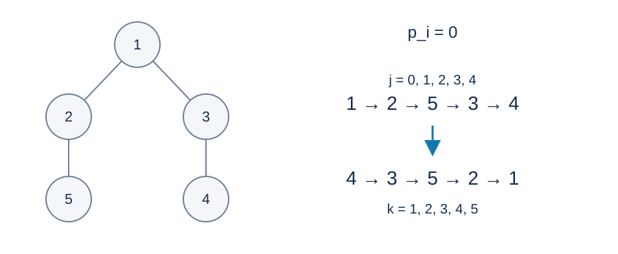

# 树上设备的拆除顺序：题解

## 解法与贡献

采用出题人的密度合并、优先队列和并查集思路。Codex（GPT-6）补充带负权时的交换证明、字典序规则、整块序列重建和标准 C++17 实现。密度调度与并查集均为经典方法。

## 反转拆除顺序

将拆除顺序反转，得到先父后子的构建顺序。构建位置从零开始记为 $j_v$ ，原目标等于
$$
(n-1)\sum_v p_v-\sum_v j_vp_v.
$$
第一项固定，所以应最小化构建顺序的加权位置和。负权也满足这个恒等式。

将已确定连续出现的节点序列称为块。块 $B$ 的长度为 $L_B$ ，权值和为 $W_B$ ，密度为 $W_B/L_B$ .块之间仍构成一棵树；每个非根块必须出现在其父块之后。开始时每个节点是一个块。

## 密度合并与字典序

重复选择密度最大的非根块 $B$ .若密度相同，选择构建序列中末尾节点编号最大的块。把整个 $B$ 接到父块序列末尾，合并长度和权值和。最终只有根块，反转其序列即为答案。

下图的所有权值均为零，合并过程仍须按块末尾编号处理平局。最后拆除顺序为 $4,3,5,2,1$ .

**交换证明。** 假设当前块划分存在一个达到全局最优值及最小拆除字典序的合法块顺序。在这个顺序中，将选中的 $B$ 移到父块之后。被跨过的块不可能是 $B$ 的祖先，因为它的父块已经出现；提前 $B$ 也不影响其后代。因此移动合法。

对于被跨过的一个块 $X$ ，将 $XB$ 换成 $BX$ 时，原加权位置和减去新值为
$$
L_XW_B-L_BW_X\ge0.
$$
不等式来自 $B$ 的最大密度，与权值是否非负无关。依次交换不会使最小化目标变差。

若某次交换严格改善，就与原顺序最优矛盾。否则所有跨过的块均与 $B$ 等密度。反转为拆除顺序后，首个差异出现在 $B$ 的末尾节点与最后一个被跨过块的末尾节点之间。各块互不相交，末尾编号不同；选择规则使 $B$ 的末尾编号最大。因此让其他块出现在构建顺序更后方，会使拆除顺序的首个不同编号更小。整个移动不会损害字典序目标。

于是存在最优方案将父块和 $B$ 连续放置，可以安全地把它们收缩成一个块。归纳可得全部合并后的顺序同时满足两个目标。根块不能作为候选，否则不存在可接入的父块。

## 实现细节

- 用交叉乘法比较密度，避免浮点舍入。两边乘积的绝对值不超过 $2.5\times10^{17}$ ，有符号六十四位整数足够。
- 每个块用单链表保存顺序，只需首节点、末节点和后继数组。合并时接上整个子块。不能只给原父亲添加一条边后做普通 DFS：最优块顺序可以交错经过不同的原子树。
- 并查集查找一个块的原父亲目前所在的块；用迭代路径压缩，避免深链递归。
- 堆保存密度、块末尾编号和版本快照。块被并入后，或版本已经变化时，丢弃旧条目。
- 树遍历、链表反转和输出均采用迭代方式。最后直接按拆除位置计算目标值。

每次合并插入至多一个新堆条目，总时间为 $O(n\log n)$ ，空间为 $O(n)$ .这里并查集只做路径压缩，不把它单独声称为按秩合并的反阿克曼界。目标值绝对值至多 $10^6n(n-1)/2$ ，使用六十四位整数。

[参考程序](std.cpp)。小规模枚举所有合法拆除顺序可以同时核验最优值和字典序；它不适用于完整范围。

## 数据与复现

三个样例见题面。[生成配方](tests/plan.json)包含十份计分输入；[生成器](tests/generate.py)只依赖 Python 标准库，支持 --plan、--out-dir、--case 和 --std。正式大输入及可执行文件不放入发布包。时间和内存的参考测量见[性能记录](../../../docs/benchmark-R28.json)。
