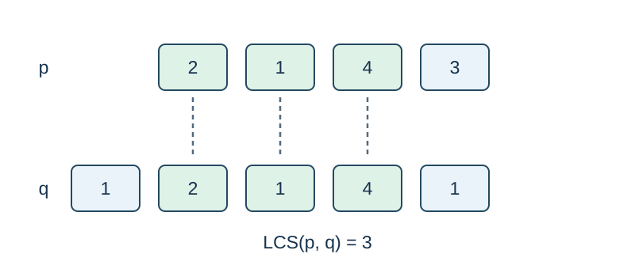

# Recover a Permutation with Substring Queries

Time limit: 0.5 seconds. Memory limit: 128 MiB. See the [reference environment and measurements](../../../docs/评测环境与性能.md).

## Story

An archive hides an ordered row of labels. A terminal compares a submitted label sequence with the hidden row and returns the longest contiguous match. Recover the row using a limited number of comparisons.

(This story was rewritten by GPT-6.)

## Formal Problem Statement

This is an interactive problem. Before interaction starts, the judge fixes a permutation $p$ of $1,\ldots,n$ , where $1\le n\le120$ .

You may query a sequence $q$ of length $1\le k\le100$ . Each entry lies in $[1,n]$ ; repetitions are allowed. The reply is the longest common **contiguous substring** length of $q$ and $p$ : the largest $d$ for which identical consecutive blocks of $d$ entries occur in both sequences. It is zero if there is no common element. Order matters, subsequences are not used, and the permutation is not cyclic.

Use at most 800 queries, then report the entire permutation. The final report does not count as a query.

## Input Format

Your program first reads $n$ . After each valid query and an output flush, read one integer reply. Exit immediately on $-1$ or end of input. The hidden permutation is never sent to the submitted program.

## Output Format

Print a query as ` ? k q_1 ... q_k` on one line. Print the final answer as ` ! p_1 ... p_n` and exit. Flush after each line. Invalid lengths, values, syntax, or query counts, and an incorrect final permutation, fail.

The samples below are local-judge fixtures: each input file contains $n$ and the hidden permutation, and its output block lists the permutation to recover. These are not interactive input streams for redirecting into `std.cpp` . See the [local testing guide](tests/README.md).

## Sample 1

### Input

```text
1
1
```

### Output

```text
1
```

## Sample 2

### Input

```text
4
2 1 4 3
```

### Output

```text
2 1 4 3
```

## Sample 3

### Input

```text
3
3 2 1
```

### Output

```text
3 2 1
```

## Sample Explanation

Sample 2 hides $[2,1,4,3]$ . Query ` ? 5 1 2 1 4 1` receives 3 because the contiguous block $[2,1,4]$ occurs in both sequences. The final report is ` ! 2 1 4 3` .



A query repeating pivot 1 tests whether candidate labels are adjacent to 1; matches are contiguous and directed.

## Constraints and Scoring

$1\le n\le120$ . Each query has length at most 100; at most 800 queries are allowed.

Specifications redesigned by Codex (GPT-6): the text protocol, flushing and termination rules, and the local hidden-data format.

| Score | Additional constraints |
| --- | --- |
| 20% | $n\le8$ |
| 30% | $n\le50$ |
| 50% | No additional constraints |
