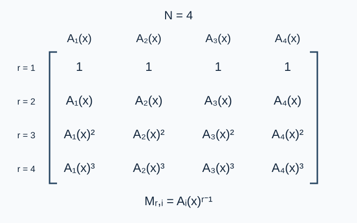

# Editorial for Grox's Sequence VII

**Problem setter’s solution: a Vandermonde determinant, roots-of-unity evaluation, and NTT.** Codex (GPT-6) repairs the bit-reversal permutation and twiddle-factor implementation, normalizes residues, and handles the one-by-one matrix. The algorithm and principal modeling follow the setter’s method.

## Replacing the determinant by a product

Let $N=2^k$ . Column $i$ consists of $1,A_i,A_i^2,\ldots,A_i^{N-1}$ , giving a Vandermonde matrix over a polynomial ring. Its determinant is

$$B(x)=\prod_{1\le i<j\le N}(A_j(x)-A_i(x))$$

The identity holds in every commutative ring. First regard the $A_i$ as independent variables. Swapping columns changes the determinant’s sign, and equal variables make it zero, so every difference is a factor. The determinant and the product have the same total degree. Comparing the coefficient of $A_2A_3^2\cdots A_N^{N-1}$ makes the proportionality constant $1$ . Substitution of polynomials preserves the identity.

The figure shows $N=4$ . One input row describes one polynomial, while its successive powers form a matrix column.

## Folding exponents and evaluating roots of unity

The output is the remainder of $B(x)$ modulo $x^N-1$ : since $x^N\equiv1$ , every exponent folds into its residue modulo $N$ . The potentially high-degree determinant need not be expanded.

The prime modulus is $P=1004535809=479\times2^{21}+1$ , with primitive root $3$ . Set

$$\omega=3^{(P-1)/N}\bmod P$$

The values $1,\omega,\ldots,\omega^{N-1}$ are $N$ distinct roots of unity. Apply a length-$N$ NTT to every input polynomial, obtaining values at all these roots. At each root compute

$$B(\omega^t)=\prod_{i<j}(A_j(\omega^t)-A_i(\omega^t))$$

Finally, inverse-transform these values to recover the remainder coefficients of degree less than $N$ .

## Correctness and implementation details

The Vandermonde identity expresses the determinant exactly as the product of differences. At a root of unity, $x^N-1$ vanishes, so the original polynomial and its remainder agree. The length-$N$ NTT is invertible and uniquely recovers the required remainder. For $N=1$ , the difference product is empty and equals the constant $1$ , matching the one-by-one matrix.

Bit reversal compares indices $i<j$ , never the values stored at those positions. Generate each layer’s twiddle factors by successive multiplication by the corresponding root. The inverse uses inverse roots and multiplies by the inverse of $N$ . Normalize negative differences before multiplication.

## Complexity

The $N$ input transforms take $O(N^2\log N)$ time. Each root needs $\binom N2$ differences, totaling $O(N^3)$ multiplications. The inverse transform takes $O(N\log N)$ . Total time is $O(N^3+N^2\log N)$ and space is $O(N^2)$ . Direct multiplication in the coefficient domain is also correct, but each naive cyclic convolution costs $O(N^2)$ , for $O(N^4)$ total time; it is useful for independent small-instance validation.

## Supplementary solution

Ordered divide and conquer, product trees and multipoint evaluation compute the difference products in $O(N^2(1+\log N)^3)$ total time, with lower asymptotic growth than pairwise multiplication. Small transforms and divisions have larger constants: it is slower for the measured $N\le512$ inputs, but meets their 1.0-second limit. It is a parallel algorithm with an asymptotic advantage; pairwise multiplication remains the reference.

[Complete editorial and measurements](solution-alternative-product-tree.en.md) · [Program](alternative-product-tree.cpp)
