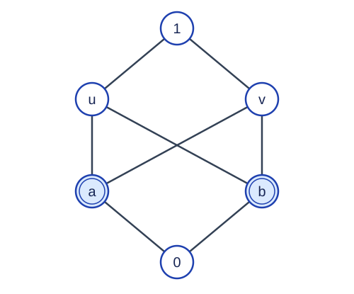

# 识别符号格

预估时间限制：2 秒。内存限制：128 MB。

实际时限以标准程序在目标评测环境的最慢用例中位时间乘以 $2$ ，按 $0.5$ 秒向上取整。参考环境见[评测说明](../../../docs/评测环境与性能.md)。

## 背景故事

一份目录允许多个符号代表同一个对象，并用一张关系表描述对象之间的顺序。请判断这张表能否准确表示一个格。

(本故事由GPT-6重写)

## 形式化问题描述

偏序 $\le$ 是满足反身性、反对称性和传递性的关系：$x\le x$ ；若 $x\le y$ 且 $y\le x$ ，则 $x=y$ ；若 $x\le y$ 且 $y\le z$ ，则 $x\le z$ .

元素 $u$ 是 $x,y$ 的上界，指 $x\le u$ 且 $y\le u$ .若某个上界不大于任何其他上界，它称为上确界。下界和下确界按相反方向定义。非空偏序集中的任意两个元素都有上确界与下确界时，称这个偏序集为格。

符号与元素不同：允许多个符号表示同一个元素。设 $f$ 把每个符号映射到一个元素，并且每个元素至少有一个符号表示。符号关系表示偏序，指对所有符号 $i,j$ ，关系存在当且仅当 $f(i)\le f(j)$ .元素集合及映射 $f$ 都可以选择，不作为输入给出。

给定 $n$ 个符号和一个 $n\times n$ 的矩阵 $A$ .若 $A_{i,j}=1$ ，表示关系 $(i,j)$ 存在；否则不存在。判断是否存在元素集合、满射映射 $f$ 及该集合上的格，使

$$A_{i,j}=1\quad\Longleftrightarrow\quad f(i)\le f(j)$$

不能修改矩阵，也不能遗漏任何符号。允许相同元素由多个符号表示，因此不同符号之间同时存在双向关系不一定非法。

## 输入格式

第一行一个整数 $T$ ，表示数据组数。每组先输入整数 $n$ ，再输入 $n$ 行，每行 $n$ 个整数，依次给出矩阵 $A$ 的各行。

## 输出格式

每组输出一行一个字符。能够表示某个格时输出 `Y` ，否则输出 `N` .

## 样例

### 样例 1

### 输入

```text
5
6
1 1 1 1 1 1
0 1 0 1 1 1
0 0 1 1 1 1
0 0 0 1 0 1
0 0 0 0 1 1
0 0 0 0 0 1
5
1 1 1 1 1
0 1 0 0 1
0 0 1 0 1
0 0 0 1 1
0 0 0 0 1
5
0 1 1 1 1
0 1 0 0 1
0 0 1 0 1
0 0 0 1 1
0 0 0 0 1
5
1 1 0 1 1
0 1 0 0 1
0 0 1 1 1
0 0 0 1 1
0 0 0 0 1
5
1 1 1 1 1
1 1 1 1 1
1 1 1 1 1
1 1 1 1 1
1 1 1 1 1
```

### 输出

```text
N
Y
N
N
Y
```

### 样例 2

### 输入

```text
3
1
0
1
1
2
1 1
1 1
```

### 输出

```text
N
Y
Y
```

## 样例解释

第一组输入的第二个测试由最小元、三个互不比较的中间元素和最大元构成，能够形成格。第三个测试缺少反身关系，因此不合法。第五个测试的关系全部为一，可让所有符号表示同一个元素，所以合法。



图另举一个不合法偏序：较低的元素小于较高且有向上路径可达的元素。$a,b$ 的两个最小上界 $u,v$ 互不比较，因此找不到不大于所有上界的那个上界。

## 数据范围与保证

每组满足 $1\le n\le50$ ，$A_{i,j}\in\{0,1\}$ .同一文件所有 $n$ 的和不超过 $50000$ .

| 分值比例 | 额外条件 |
| --- | --- |
| 100% | 无额外条件 |
