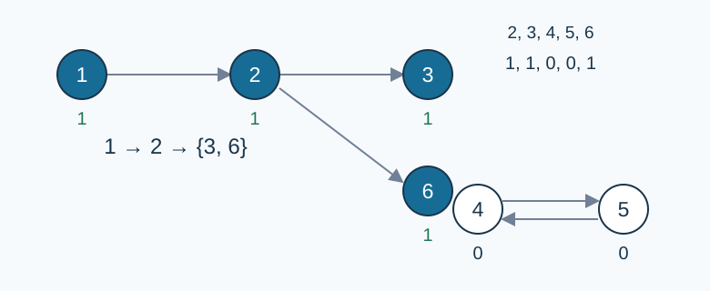

# Crop Unlock Conditions

- Reference time limit: 0.5 seconds (environment R30; estimate only).
- Actual time limit: twice the standard program’s baseline time on the slowest official test file in the target environment, rounded up to a multiple of 0.5 seconds.
- Memory limit: 128 MB

## Story

An expansion for a farming game provides base crops and derived crops. Recipes may depend on other recipes, even cyclically. Determine which crops can actually be obtained from the base crops.

## Formal Problem Statement

There are $N+M$ crops numbered $1,\ldots,N+M$ . Initially only the first $N$ are available. Each of the remaining $M$ crops has a condition consisting of crop identifiers, logical AND `&&` , logical OR `||` , and parentheses.

An identifier is true exactly when that crop is available. AND has higher precedence than OR; equal-precedence operators associate left to right. Parentheses take precedence. Spaces or tabs may occur between tokens, but never inside an integer or a two-character operator. Integers have no leading zero.

Repeatedly make an unavailable crop available if its condition is true. Available crops are never lost. Stop when no further crop can be obtained. A cycle depending only on unavailable crops does not unlock itself; repeated identifiers retain their usual logical meaning. Determine the final availability of every derived crop.

## Input Format

The first line contains $N,M$ . The next $M$ lines give, in order, the conditions for crops $N+i$ for $1\le i\le M$ . Each expression is syntactically valid and contains at least one identifier.

## Output Format

Print $M$ lines. Line $i$ is `1` if crop $N+i$ becomes available, or `0` otherwise. Print no lines if $M=0$ .

## Sample 1

### Input

```text
1 5
3 || 1
2 && 2
5
4
2 || 4 && 5
```

### Output

```text
1
1
0
0
1
```

### Explanation

Base crop one unlocks two, then three and six. Crops four and five wait for each other.



Arrows show one unlocking sequence and the inactive cycle between four and five. Numbers below nodes give final availability; not all expression references are drawn.

## Sample 2

### Input

```text
0 2
2
1
```

### Output

```text
0
0
```

### Explanation

There is no base crop, so the dependency cycle cannot start.

## Sample 3

### Input

```text
2 2
1||3&&2
3&&3
```

### Output

```text
1
1
```

### Explanation

AND binds more tightly: crop three requires $1\lor(3\land2)$ . Base crop one unlocks it, after which four is also available.

## Constraints and Guarantees

$N,M\ge0$ , $1\le N+M\le2\times10^5$ . The sum $S$ of expression lengths is at most $10^6$ , including spaces and tabs but excluding line endings. Every identifier lies in $[1,N+M]$ .

Codex (GPT-6) completed the specification: one expression per line, size limits, iterative availability starting only from base crops, empty-set boundaries, and test groups.

### Test Groups

| Score | Additional restriction |
| --- | --- |
| 20% | $N+M\le20,\ S\le1000$ |
| 30% | $N+M\le1000,\ S\le10000$ |
| 50% | No additional restriction |

[Reference environment and measurements](../../../docs/评测环境与性能.md)
