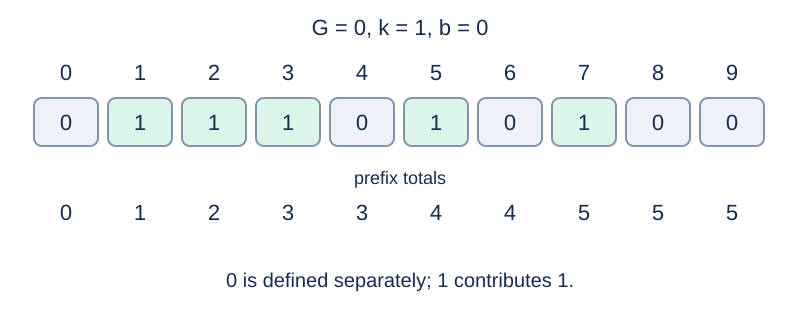

# Apostle Luke's Password

## Story

After defeating Apostle Luke, adventurers seized many treasures, including a safe. Its password resets every morning at 6:00, and it can be opened once each day to collect treasure.

The event was meant to make players puzzle out the passwords, but most simply search online for a guide. As an editor for a website, you need to calculate the passwords for all $N$ days of the event and prepare a guide. The password on day $i$ is $A_i$ , as defined below.

## Formal Problem Statement

Given integers $N,G,k,b$ , compute, for every $1\le i\le N$ ,

$$A_i=\sum_{j=G}^{G+i-1}H(kj+b).$$

For $p\ge1$ , define

$$H(p)=\left\lfloor\sqrt{\frac{p!((p-1)!+2)+p}{p^3}}-\left\lfloor\frac{(p-1)!}{p}\right\rfloor\right\rfloor.$$

Factorials, the square root, and floors have their exact mathematical meanings, and $0!=1$ . Separately define $H(0)=0$ .

## Input Format

One line containing four integers `N G k b` .

## Output Format

Print $N$ lines, with $A_i$ on line $i$ .

## Sample 1

### Input

```text
10 0 1 0
```

### Output

```text
0
1
2
3
3
4
4
5
5
5
```

## Sample 2

### Input

```text
5 1 2 0
```

### Output

```text
1
1
1
1
1
```

## Sample 3

### Input

```text
3 1 1 0
```

### Output

```text
1
2
3
```

## Sample Explanation

In sample 1, the arguments are 0 through 9; nonzero contributions come from 1, 2, 3, 5, and 7. Only argument 2 contributes in sample 2. Sample 3 explicitly includes the contribution of 1.



Arguments, individual contributions, and prefix totals.

## Constraints and Scoring

$1\le N\le5000$ , $0\le G\le10^5$ , $1\le k\le10^9$ , and $0\le b\le10^{14}$ .

Specifications redesigned by Codex (GPT-6): the definition at $p=0$ and exact arithmetic semantics.

| Score | Additional constraints |
| --- | --- |
| 20% | $k(G+N-1)\le60-b$ |
| 30% | $k(G+N-1)\le10^7-b$ |
| 50% | No additional constraints |

## Resource Limits

Time: 0.5 seconds. Memory: 128 MiB.

The limit is 2 times the slowest standard-program median across five runs per formal input, rounded up to 0.5 seconds.

[Measurement environment](../../../docs/评测环境与性能.md) · [Measurements](../../../docs/benchmark-R32.json) · [Solution](solution.en.md)
