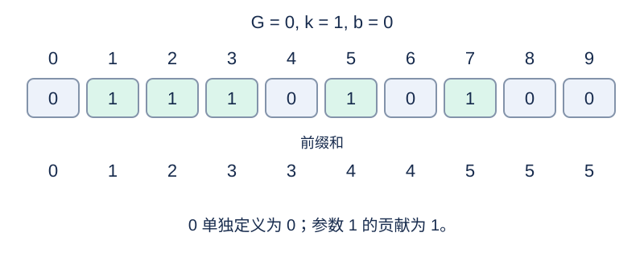

# 使徒卢克的密码

## 背景故事

冒险家击败使徒卢克后，缴获了许多宝物，其中有一个保险箱。保险箱每天早晨 6:00 重置密码，每天可以打开一次，从中获得宝物。

活动原本希望玩家开动脑筋解开密码，但大家往往直接上网搜索攻略。作为一家网站的编辑，你需要算出活动期间 $N$ 天的密码，为玩家准备攻略。第 $i$ 天的密码为下文定义的 $A_i$ .

## 形式化问题描述

给定整数 $N,G,k,b$ ，对 $1\le i\le N$ 求

$$A_i=\sum_{j=G}^{G+i-1}H(kj+b).$$

当 $p\ge1$ 时，定义

$$H(p)=\left\lfloor\sqrt{\frac{p!((p-1)!+2)+p}{p^3}}-\left\lfloor\frac{(p-1)!}{p}\right\rfloor\right\rfloor.$$

阶乘、根号和取整均按精确数学意义解释，且 $0!=1$ .另行定义 $H(0)=0$ .

## 输入格式

一行四个整数 `N G k b` .

## 输出格式

输出 $N$ 行，第 $i$ 行为 $A_i$ .

## 样例 1

### 输入

```text
10 0 1 0
```

### 输出

```text
0
1
2
3
3
4
4
5
5
5
```

## 样例 2

### 输入

```text
5 1 2 0
```

### 输出

```text
1
1
1
1
1
```

## 样例 3

### 输入

```text
3 1 1 0
```

### 输出

```text
1
2
3
```

## 样例说明

样例 1 中，参数依次为 0 到 9；非零贡献来自 1、2、3、5、7。样例 2 只有参数 2 产生贡献。样例 3 特别展示参数 1 的贡献也为 1。



参数、单项贡献与前缀和。

## 数据范围与分组

$1\le N\le5000$ ，$0\le G\le10^5$ ，$1\le k\le10^9$ ，$0\le b\le10^{14}$ .

规格由 Codex（GPT-6）重新设计：补充 $p=0$ 的定义，明确精确运算语义。

| 分值 | 额外限制 |
| --- | --- |
| 20% | $k(G+N-1)\le60-b$ |
| 30% | $k(G+N-1)\le10^7-b$ |
| 50% | 无额外限制 |

## 资源限制

时间 0.5 秒；内存 128 MiB。

时限取标准程序正式数据五次运行的最慢中位数的 2 倍，向上取整到 0.5 秒。

[测量环境与方法](../../../docs/评测环境与性能.md) · [测量记录](../../../docs/benchmark-R32.json) · [题解](solution.zh.md)
