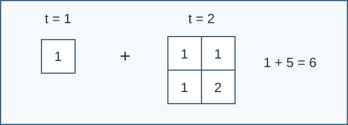

# 某不科学的立方盒中的最大公约数累计

参考时间限制：2 秒；内存限制：128 MiB。实际时限取目标环境中最慢正式文件的标程中位耗时乘 2，再按 0.5 秒向上取整。见[评测环境](../../../docs/评测环境与性能.md)。

## 背景故事

小A在做学园都市第零次高中模拟考试试卷时，发现了一道有意思的数学题，于是他决定结合算法知识进行数据范围加强。

## 形式化问题描述

给定正整数 $n,m$ ，计算

$$
\sum_{t=1}^{n}\ \sum_{x_1=1}^{t}\cdots\sum_{x_m=1}^{t}\gcd(x_1,\ldots,x_m)\pmod P
$$

其中 $P=10^9+7$ .对每个上界 $t$ ，分别枚举 $m$ 个坐标；坐标有顺序、可以相等。同一个元组可能出现在多个不同的 $t$ 中，每次出现都计入答案。



当 $n=m=2$ 时，边长一的盒子贡献 1，边长二的盒子贡献 $1+1+1+2=5$ ，合计 6。

## 输入格式

一行两个整数 `n m` .

## 输出格式

输出一行，包含答案在 $[0,P-1]$ 内的余数。
## 样例 1

### 输入

```text
2 2
```

### 输出

```text
6
```


## 样例 2

### 输入

```text
3 1
```

### 输出

```text
10
```


## 样例 3

### 输入

```text
1 100000
```

### 输出

```text
1
```


## 数据范围与保证

$1\le n\le10^9$ ，$1\le m\le10^5$ .

| 分值比例 | 额外条件 |
| --- | --- |
| 100% | 无额外条件 |

共有 10 个正式文件，每个 10%。 [生成说明](tests/README.md)。
