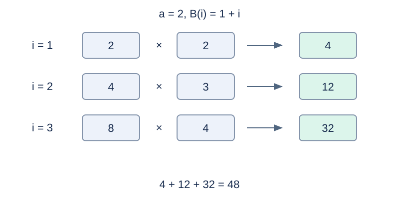

# 某不科学的多项式加权几何和的修改

## 背景故事

小A在做学园都市第零次高中模拟考试试卷时，发现了一道有意思的数学题，于是他决定结合算法知识进行数据范围加强。

## 形式化问题描述

设模数 $P=10^9+7$ .给定固定底数 $a$ 和系数 $b_0,\ldots,b_k$ ，维护

$$F(n)=\sum_{i=1}^{n}a^i\left(\sum_{j=0}^{k}b_j i^j\right)\pmod P.$$

先输出初始值，然后依次执行 $m$ 次操作，每次操作后输出当前值：

- `1 n` ：把求和上界替换为新的 $n$ .
- `2 j b` ：把系数 $b_j$ 替换为 $b$ .

底数 $a$ 与最高允许次数 $k$ 始终不变。系数可以为零。所有指数 $i$ 均为正，因此 $a=0$ 时每个权重都为零；$i^0=1$ .输出使用模 $P$ 的非负最小剩余。

## 输入格式

第一行四个整数 `n m k a` .第二行 $k+1$ 个整数，依次为 $b_0,\ldots,b_k$ .接下来 $m$ 行按上述格式给出操作。

## 输出格式

输出 $m+1$ 行，依次表示初始值和每次修改后的值。

## 样例 1

### 输入

```text
3 3 1 2
1 1
1 2
2 0 0
1 1
```

### 输出

```text
48
16
10
2
```

## 样例 2

### 输入

```text
3 2 2 1
0 0 1
1 4
2 2 0
```

### 输出

```text
14
30
0
```

## 样例 3

### 输入

```text
1000000000 2 1 0
1000000006 1000000006
1 1
2 0 7
```

### 输出

```text
0
0
0
```

## 样例说明

样例 1 初始值为 $2(1+1)+4(1+2)+8(1+3)=48$ ；上界改为 2 得 16，常数项改为 0 得 10，最后上界为 1 得 2。样例 2 是平方和，样例 3 展示零底数。



样例 1 的三项权重与多项式值相乘，总和为 48。

## 数据范围与分组

初始及修改后的 $1\le n\le10^9$ ，$1\le m\le10000$ ，$1\le k\le200$ ；$0\le a,b_j,b<P$ ，系数修改下标 $0\le j\le k$ .

规格由 Codex（GPT-6）重新设计：补充固定底数 $a$ 的输入、系数范围和更新下标，明确输出初始值。

| 分值 | 额外条件 |
| --- | --- |
| 20% | $k\le4,\ m\le30$ ，所有 $n\le20$ |
| 30% | $k\le30,\ m\le300$ ，所有 $n\le1000$ |
| 50% | 无额外条件 |

## 资源限制

时间 0.5 秒；内存 128 MiB。时限为标准程序每例五次测量的最慢中位数乘以 2，向上取整到 0.5 秒。

[题解](solution.zh.md) · [测量环境](../../../docs/评测环境与性能.md) · [测量记录](../../../docs/benchmark-R33.json)
