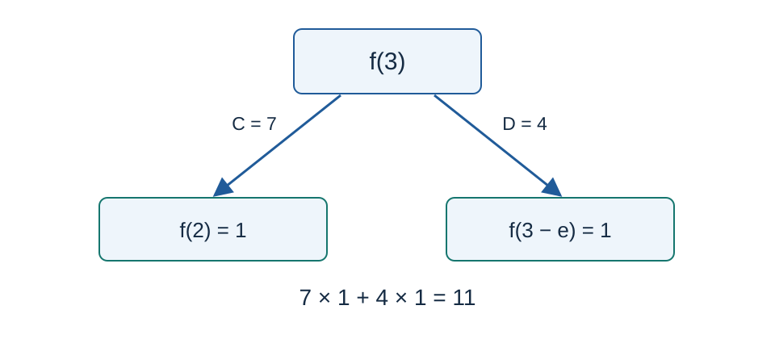

# Old yd and Disjoint Sets: Solution

Problem setter's solution: enumerate the two step counts of terminating paths and count their orderings with binomial coefficients. Codex (GPT-6) contributed exact rational bounds, smaller modular tables, proofs and the standard C++17 implementation. Binomial counting, factorial inverses and the neighboring-fraction denominator lemma are classical methods.

## Expand until the threshold is first crossed

For one query, write $t=n-B\ge0$ . A path with $a$ unit steps and $b$ steps of length $e$ contributes $A C^aD^b$ at its leaf. It terminates exactly when

$$a+eb>t,$$

while removing its last step leaves a total decrement at most $t$ . Since every step is positive, validity of this penultimate position also makes all earlier positions valid.

The diagram shows $n=3$ in the first sample. Both leaves have value one, with weights seven and four.

For $b=0$ , only $a=t+1$ is possible, contributing $C^{t+1}$ before the final multiplication by $A$ .

For $b\ge1$ , define

$$L_b=\max(0,t-\lfloor eb\rfloor),\qquad R_b=\begin{cases}t,&b=1,\\t-\lfloor e(b-1)\rfloor-1,&b>1.\end{cases}$$

The terminal condition gives $a\ge L_b$ . If the final step has length $e$ , the penultimate condition $a+e(b-1)\le t$ gives $a\le R_b$ . The case $b=1$ needs its integer boundary handled separately. Once $R_b<0$ , larger $b$ cannot contribute and enumeration stops.

For $a=L_b>0$ , either kind of final step is possible. Their counts sum to

$$\binom{a+b-1}{a-1}+\binom{a+b-1}{a}=\binom{a+b}{a}.$$

When $L_b=0$ , the final step must have length $e$ , but its count is still $\binom b0=1$ . For $a>L_b$ , only a final step of length $e$ is valid, giving $\binom{a+b-1}{a}$ orderings. Hence the answer is

$$A\left(C^{t+1}+\sum_{b\ge1:R_b\ge0}D^b\left[\binom{L_b+b}{L_b}C^{L_b}+\sum_{a=L_b+1}^{R_b}\binom{a+b-1}{a}C^a\right]\right)\pmod{10^9+7}.$$

Successive values of $\lfloor eb\rfloor$ differ by two or three, so each $b$ needs at most three values of $a$ .

## Compute floors exactly with integers

Floating-point rounding should not determine whether a leaf has crossed the threshold. Use the strict bounds

$$\frac{410105312}{150869313}<e<\frac{28245729}{10391023}.$$

They can be checked entirely with integers. Let $S=\sum_{j=0}^{30}1/j!$ . The series remainder satisfies

$$S<e<S+\frac1{30\cdot30!}.$$

Starting from the thirty-first term, every further factor is at least thirty-one, so the tail is smaller than the corresponding geometric series. Cross-multiplication verifies that the lower fraction is below $S$ and the upper fraction is above this tail bound. Also,

$$28245729\cdot150869313-410105312\cdot10391023=1.$$

If a reduced fraction $a/b$ lies strictly between $p/q<P/Q$ with $Pq-pQ=1$ , the positive integers $aq-bp$ and $bP-aQ$ are at least one. The identity

$$b=(aq-bp)Q+(bP-aQ)q$$

therefore implies $b\ge q+Q$ . No rational with denominator at most $10^7$ lies between our bounds, and both endpoint denominators exceed $10^7$ as well. For $0\le b\le10^7$ , no integer boundary separates the two products, so

$$\lfloor eb\rfloor=\left\lfloor\frac{410105312\,b}{150869313}\right\rfloor.$$

The largest product $410105312\times10^7$ fits in a signed sixty-four-bit integer. The program uses only integer multiplication and division.

## Binomial coefficients and complexity

Let $T=\max(n-B+1)$ . Precompute factorials, inverse factorials, powers of $C$ and powers of $D$ in four thirty-two-bit arrays of length $T+1$ . The modulus $p=10^9+7$ is prime and every factorial index is below $p$ , so the factorials are invertible. One modular exponentiation obtains the largest inverse factorial, followed by a backward recurrence. Each binomial coefficient then takes constant time. Promote operands to sixty-four bits before modular multiplication.

Preprocessing takes $O(T+\log p)$ time, and all queries take $O(\sum(n-B+1))$ time. Space is $O(T)$ , with about one hundred sixty million bytes for the largest arrays. Every binomial index is at most $t+1\le T$ .

## Correctness and method choice

Every recursion branch belongs to exactly one class of step counts and final-step type. The inequalities characterize its first termination, and the binomial counts enumerate exactly those valid orderings. Distinct paths are distinct terms in the recursive expansion, so their weighted sum equals the function value. Exact floors and modular arithmetic preserve this result.

The primary [std.cpp](std.cpp) retains the setter's terminal-path counting and factorial-table organization. The [single-inverse-table recurrence](solution-alternative.en.md), implemented in [alternative.cpp](alternative.cpp), supports the same full range. It uses more modular multiplications but only one linear array, providing a clear space advantage as a parallel option. Small inputs use independent two-dimensional recursive expansion. Every formal case is compared across both published programs and the setter's program; quadratic recursive checking is not claimed at maximum size.

See the [plan](tests/plan.json), [generator](tests/generate.py) and [measurements](../../../docs/benchmark-R26.json).
