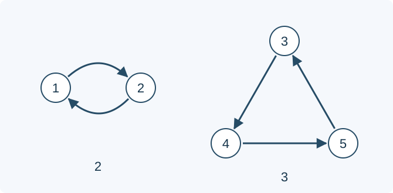

# 烤墨鱼的置换

预估时间限制：0.5 秒。内存限制：128 MB。

实际时限以标准程序在目标评测环境的最慢用例中位时间乘以 $2$ ，按 $0.5$ 秒向上取整。参考环境见[评测说明](../../../docs/评测环境与性能.md)。

## 背景故事

厨师把一串烤墨鱼反复按同一规则调整位置。所有墨鱼互不相同，他想知道最少调整多少次，整串才会回到最初的顺序。

## 形式化问题描述

给定 $1,\ldots,N$ 的排列 $a$ .对任意排列 $b$ 做一次操作，得到排列 $b'$ ，满足

$$b'_{a_i}=b_i\qquad(1\le i\le N)$$

也就是原来位于 $i$ 的元素移到 $a_i$ .反复使用同一个排列 $a$ ，求使排列恢复初始状态的最小正操作次数，输出该次数对 $998244353$ 取模的结果。元素互不相同，因此答案与初始排列 $b$ 的具体顺序无关。

## 输入格式

第一行一个整数 $N$ .第二行 $N$ 个整数 $a_1,\ldots,a_N$ .输入仅包含一组数据。

## 输出格式

输出一行一个整数，表示最小正操作次数对 $998244353$ 取模的结果。

## 样例

### 样例 1

### 输入

```text
5
2 1 4 5 3
```

### 输出

```text
6
```

### 样例 2

### 输入

```text
1
1
```

### 输出

```text
1
```

### 样例 3

### 输入

```text
6
2 3 4 1 6 5
```

### 输出

```text
4
```

## 样例解释

第一组样例中，位置 $1,2$ 每两次复原，位置 $3,4,5$ 每三次复原，因此整串最早在六次后复原。第二组没有位置变化，但要求正操作次数，所以答案是一。



箭头表示一次操作后元素移动的方向，下方数字是环长。第三组环长为四和二，四次即可同时复原。

## 数据范围与保证

对所有数据，$1\le N\le10^6$ ，$a$ 恰好是 $1,\ldots,N$ 的一个排列。

| 分值比例 | 额外条件 |
| --- | --- |
| 100% | 无额外条件 |
