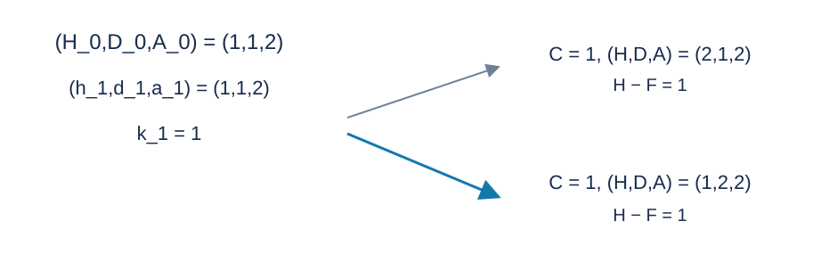

# An Upgrade Plan for Battles: Solution

**Problem setter’s solution: quotient-change events and a monotone defence pointer. GPT-6 adds the convexity, tie-breaking, and integer-safety proofs, a standard C++17 implementation, and a heap-scheduled alternative.**

## 1. Fix attack and defence

With $x,y$ attack and defence upgrades,
$$
A=A_0+xV_A,\qquad D=D_0+yV_D.
$$
We need $A>d_i$ . One enemy of type $i$ takes
$$
t_i(x)=\left\lceil\frac{h_i}{A-d_i}\right\rceil
$$
rounds. Simultaneous attacks mean that the enemy also deals damage in its final round. Total damage is
$$
F_x(y)=\sum_i k_it_i(x)\max(a_i-D_0-yV_D,0).
$$
All damage is nonnegative and there is no healing, so enemy order does not affect survival. The least upgraded health is
$$
H=\max(H_0,F_x(y)+1),
$$
and cost is $xC_A+yC_D+(H-H_0)C_H$ .

It suffices to consider attack counts
$$
L=\max\left(0,\max_i\left\lceil\frac{d_i+1-A_0}{V_A}\right\rceil\right),
\quad
R=\max\left(0,\max_i\left\lceil\frac{d_i+h_i-A_0}{V_A}\right\rceil\right).
$$
Below $L$ , some enemy cannot be defeated. Above $R$ , every enemy already takes one round. Defence counts need not exceed
$$
Y=\max\left(0,\max_i\left\lceil\frac{a_i-D_0}{V_D}\right\rceil\right),
$$
which prevents all damage. Even harmless enemies must contribute to the required attack lower bound.

## 2. Convexity and a monotone defence pointer

For fixed $x$ , $F_x(y)$ is a sum of nonnegative piecewise-linear functions, hence discretely convex and nonincreasing in integer $y$ . Required extra health $\max(F_x(y)+1-H_0,0)$ remains convex. Adding the linear defence price preserves convexity.

Start at $Y$ and decrease defence only when doing so **strictly** reduces cost. This stops at the largest defence count attaining minimum cost. If adjacent defence counts have equal cost, the larger defence count requires less health: its positive defence price must otherwise be compensated by extra health. Keeping the larger defence count therefore respects the health-first tie rule.

As attack increases, every enemy’s round count decreases or stays fixed. For adjacent defence counts $y-1,y$ , both their damage difference and the damage at the lower defence are nonincreasing. Their extra-health difference equals
$$
\min\left(F_x(y-1)-F_x(y),\ \max(F_x(y-1)+1-H_0,0)\right).
$$
It too is nonincreasing. Thus the benefit of more defence never increases with attack, and the largest optimal defence count never moves right. One pointer makes at most $Y$ left moves throughout the attack sweep.

## 3. Events when round counts change

The expression $\lceil h/d\rceil=\lfloor(h-1)/d\rfloor+1$ has only $O(\sqrt h)$ distinct values. If the current round count is $t>1$ , the smallest damage causing a decrease is
$$
d'=\left\lceil\frac{h}{t-1}\right\rceil.
$$
The next attack-upgrade count is therefore
$$
x'=\left\lceil\frac{d_i+d'-A_0}{V_A}\right\rceil.
$$
It is strictly larger than the current count and may skip several quotient values. Repeating this process lists all changes for an enemy.

The setter’s method stores events in linked lists indexed by attack-upgrade count and scans them in order. Between events, the damage function is unchanged while attack cost increases, so evaluate only $L$ and event positions. The reference program sizes the index array from $R$ . The total event count is $E=O(\sum_i\sqrt{h_i})$ .

## 4. Defence buckets

For an enemy that can cause damage, write
$$
a_i-D_0=p_iV_D+r_i,\qquad 0\le r_i<V_D,
$$
and set $w_i=k_it_i$ . At current defence count $y$ , enemies with $p_i\ge y$ form the active part. Maintain their total $T=\sum w_i$ and current damage $F$ . Store the others in buckets indexed by $p_i$ , keeping their round-count sums and $B_p=\sum_{p_i=p}w_ir_i$ .

Moving defence from $y$ to $y-1$ adds
$$
\Delta=T V_D+B_{y-1}.
$$
After accepting the move, merge that bucket’s count into $T$ . An attack event decreases one $w_i$ : update $T,F$ if the enemy is active, or its bucket otherwise. Apply every event at the current attack before moving the defence pointer.

## 5. Exact integer comparisons

Intermediate damage may reach $6.25\cdot10^{20}$ , beyond 64-bit integers. Floating-point comparisons are also unsuitable for exact cost ties. The program stores each bucket value in two integer limbs with base $10^9$ . One enemy’s update is at most $1.25\cdot10^{17}$ , allowing safe incremental addition and subtraction.

Let current extra health be $z=\max(F+1-H_0,0)$ . Decreasing defence strictly improves cost exactly when
$$
\max(F+\Delta+1-H_0,0)
\le z+\left\lfloor\frac{C_D-1}{C_H}\right\rfloor.
$$
The allowed damage increment is
$$
B=H_0-1+z+\left\lfloor\frac{C_D-1}{C_H}\right\rfloor-F.
$$
First compare the wide bucket value exactly with $B$ . Then test
$$
T\le\left\lfloor\frac{B-B_{y-1}}{V_D}\right\rfloor,
$$
avoiding an overflowing multiplication.

For every attack value, buying enough defence to prevent all damage costs at most $YC_D\le5\cdot10^{15}$ . The pointer accepts only cheaper defence/health combinations, so the actual stored damage and health fit in 64 bits. Attack cost is at most about $10^{16}$ , and total cost also fits. A wide bucket is converted to a single integer only after passing the range comparison.

Compare complete tuples $(\text{cost},H,D,A)$ so the final attack tie is handled too. Positive upgrade steps always allow a feasible, damage-free solution, making the impossible-output branch unreachable in the stated range.

## 6. Correctness, complexity, and alternatives

The combat formula gives the minimum health for each attack/defence pair. Convexity and monotonicity make the pointer choose the best defence and health tie at every attack. Events cover every damage-function change, and increasing attack between them only raises cost. Comparing the candidate tuples therefore produces the required global optimum.

Let $R$ be the maximum attack-upgrade count and $Y$ the maximum defence count. The event-table program takes $O(n+R+Y+E)$ time and space, with $E=O(\sum_i\sqrt{h_i})$ . Both index limits are calculated from input, rather than assuming they equal the initial attribute bound.

The [reference program](std.cpp) uses the setter’s event table. The coequal [heap-scheduled solution](solution-alternative-heap.en.md) retains only each enemy type’s next event, reducing event storage to $O(n)$ and total space to $O(n+Y)$ at a cost of $O(\log n)$ per scheduled event. Both pass the full range. Measured peak memory is about $120$ MiB for the heap and $329$ MiB for the table; see the [measurements](../../../docs/benchmark-R29.json) and recalibrate on the target environment.

## Illustration

This is sample two, where all prices and upgrade steps equal one. $C$ denotes total cost, $F$ total combat damage, and $H-F$ remaining health. Both choices cost one; the blue choice has smaller upgraded health and therefore the smaller lexicographic tuple.

## Data and reproduction

The statement contains three samples. The [test plan](tests/plan.json) defines ten scored inputs. The [generator](tests/generate.py) uses only the Python standard library and accepts --plan, --out-dir, --case and --std. Large generated inputs and executables stay outside the published package. See the [reference measurements](../../../docs/benchmark-R29.json) for runtime and memory.
