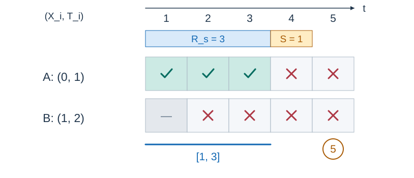

# 力场护盾

- 参考时间限制：1.0 秒（参考环境：[评测环境与性能](../../../docs/评测环境与性能.md)；仅供预估）
- 实际时间限制：标准程序在目标评测环境中处理最慢正式测试文件的基准时间的 2 倍，按 0.5 秒的倍数向上取整；若平台仅支持更粗的粒度，再向上取整到平台可设置值。
- 内存限制：128 MB

## 背景故事

盟军正在一条漫长的防线上部署防御工事。轰炸不断造成损失，工程师同时修复受损设施。新式力场护盾能保护一段防线，却也会挡住工程师的维修。指挥部已掌握所有施工、轰炸和维修安排，请决定何时、何处开启护盾，使总损失尽可能小。

## 形式化问题描述

防线是一条数轴，共有 $n$ 座工事。工事 $i$ 位于整数坐标 $X_i$ ，在整数时刻 $T_i$ 开始时建成，初始损失为 $0$ .同一位置可以有多座工事，它们分别累计损失，不会因损失过大而消失。

一次轰炸或维修由 $(L,R,T,K,H)$ 描述：在每个整数时刻 $T,T+1,\ldots,T+K-1$ ，对位置在闭区间 $[L,R]$ 中、已经建成且未受护盾保护的每座工事，轰炸使损失增加 $H$ ，维修使损失减少 $H$ .多个事件的效果相加，损失可以为负。工事不受建成前的时刻影响，但会受到仍在持续的事件在建成时及之后的影响。

只有一套护盾设备，可以使用任意多次，也可以不用。在整数时刻 $C$ 开启时，选择一个端点为整数的闭区间 $[l,r]$ ，满足 $r-l\le M$ .它保护该区间中在 $C$ 时刻开始时已建成的工事：

- 在 $[C,C+R_s-1]$ 的各整数时刻，这些工事同时免受轰炸和维修影响。
- 护盾开启之后才建成的工事不受这次护盾保护。
- 下一次最早可在 $C+R_s+S$ 时刻开启护盾，并可重新选择区间。

同一时刻先建成工事，再决定是否开启护盾，最后结算事件。$M=0$ 时仍可保护某一个坐标处的工事。护盾可以在任意正整数时刻开启。



图 1：本例选择空间区间 $[0,1]$ ，且 $M=1$ 、$R_s=3$ 、$S=1$ .工事 A 在坐标 $0$ 、时刻 $1$ 建成，工事 B 在坐标 $1$ 、时刻 $2$ 建成。带勾的格表示受到此次护盾保护，叉号表示已建成但未受此次护盾保护；时刻 $5$ 仅表示可以再次开启，尚未选择新的护盾。

求所有已知轰炸和维修结束后的最小总损失。没有事件时答案为 $0$ .

## 输入格式

第一行包含 $n,M,R_s,S,A,B$ ，其中 $A$ 为轰炸次数，$B$ 为维修次数。

接下来 $n$ 行，每行两个整数 $X_i,T_i$ .再接下来 $A$ 行描述轰炸，之后 $B$ 行描述维修；每行按 $L,R,T,K,H$ 的顺序给出。

## 输出格式

输出一行一个整数，表示最小总损失。

## 样例 1

### 输入

```text
5 5 1 0 2 3
1 1
2 1
3 1
4 5
5 5
1 1 1 5 10
3 4 1 5 10
1 1 2 4 5
1 2 2 4 7
3 5 5 1 1
```

### 输出

```text
-37
```

### 解释

时刻 $1$ 保护坐标 $1$ 到 $3$ ；时刻 $2,3,4$ 只保护坐标 $3$ ；时刻 $5$ 保护坐标 $3$ 到 $4$ .未被挡住的维修使总损失为 $-37$ .

## 样例 2

### 输入

```text
1 0 1 0 1 0
0 1
0 0 1 1 5
```

### 输出

```text
0
```

### 解释

$M=0$ 仍允许选择闭区间 $[0,0]$ ，完全挡住这次轰炸。

## 样例 3

### 输入

```text
2 0 3 1 1 0
0 1
0 2
0 0 1 3 5
```

### 输出

```text
5
```

### 解释

等到时刻 $2$ 再开启护盾，可同时保护两座工事；只留下第一座工事在时刻 $1$ 受到的 $5$ 点损失。

## 数据范围与保证

- $1\le n\le500000$ ，$0\le A,B\le200000$ .
- $-1499\le X_i\le1500$ ，$-1499\le L\le R\le1500$ .
- $1\le T_i,T\le3000$ ，$K\ge1$ ，$T+K-1\le3000$ .
- $0\le M<3000$ ，$1\le R_s\le3000$ ，$0\le S\le3000$ ，$0\le H\le1000$ .
- 所有输入量均为整数。

### 数据分组

| 分值比例 | 额外条件 |
| --- | --- |
| 30% | $n\le2000$ ，$A,B\le1000$ ；坐标在 $[-14,15]$ 内；建成时刻、事件结束时刻和 $R_s,S$ 均不超过 $30$ ，$M\le30$ |
| 70% | 无额外条件 |
