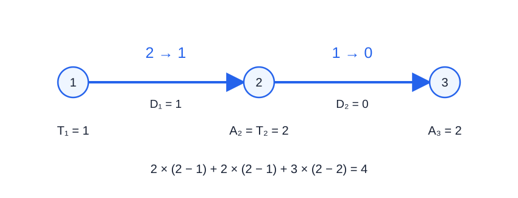

# 坐地铁

- 参考时间限制：**0.5 秒**（[评测环境与性能](../../../docs/评测环境与性能.md)）。
- 实际时限：在目标环境实测标准程序最慢测试文件的中位时间，乘以 2，再按 0.5 秒向上取整。
- 内存限制：**512 MB**。

## 背景故事

晴川镇的三号地铁线正在建设。溪谷村的村长兼任路务署的工程规划员，如今接下了这条线路的资源运输工作。

各站会生产供后续站点使用的建设资源。货运列车不便调头，只能沿线路向前行驶；自动装卸几乎不耗时。村长还可以使用命令方块缩短相邻站点间的行驶时间，希望让资源尽早送达。

## 形式化问题描述

一条线路上依次有 $n$ 个站点，编号为 $1,2,\ldots,n$ . 一列容量无限的货运列车在时刻 $0$ 位于站点 $1$ ，只能从站点 $i$ 驶向站点 $i+1$ ，不能返回。

对于每个 $1\le i<n$ ，站点 $i$ 会为每个站点 $j>i$ 分别生产 $\mathrm{Num}_i$ 份资源。这些资源全部在时刻 $T_i$ 生产完成，在此之前不能装车。站点 $i$ 共生产 $(n-i)\mathrm{Num}_i$ 份资源，每份资源的目的地在生产时就已确定。

列车可以在站点等待，装卸资源不耗时。从站点 $i$ 到站点 $i+1$ 原本需要 $D_i$ 个时间单位。你可以使用至多 $K$ 次命令方块；每次选择一段相邻站点间的线路，使其行驶时间减少 $1$ . 同一段可以选择多次，但任何一段的行驶时间都不能变为负数。

运输任务的完成条件是：**将全部资源运抵各自的目的地**。每份资源的耗时为它抵达目的地的时刻减去生产完成的时刻。请合理分配命令方块并安排运输，使所有资源的耗时之和最小。

先求上述总耗时的最小值，再将它对 $10^9+9$ 取模。没有资源时，总耗时为 $0$ .

## 输入格式

第一行两个整数 $n,K$ .

接下来 $n-1$ 行，第 $i$ 行三个整数 $\mathrm{Num}_i,T_i,D_i$ ，依次表示站点 $i$ 为每个后续站点提供的资源数量、生产完成时刻，以及到站点 $i+1$ 的原行驶时间。

## 输出格式

输出一行一个整数，表示最小总耗时对 $10^9+9$ 取模的结果。

## 样例 1

### 输入

```text
3 2
2 1 2
3 2 1
```

### 输出

```text
4
```

## 样例 2

### 输入

```text
5 7
2 1 2
3 2 1
5 5 3
1 4 3
```

### 输出

```text
44
```

## 样例 3

### 输入

```text
10 17
2 1 2
3 2 1
5 5 3
1 4 3
3 3 3
4 4 4
6 6 6
3 1 4
4 5 2
```

### 输出

```text
669
```

## 样例 4

### 输入

```text
3 0
1 0 1
0 100 1
```

### 输出

```text
3
```

## 样例解释

样例 1 中，将两段线路的行驶时间分别从 $2,1$ 缩短为 $1,0$ . 列车在时刻 $1$ 从站点 $1$ 出发，在时刻 $2$ 抵达站点 $2$ 和站点 $3$ . 站点 $1$ 生产的四份资源各耗时 $1$ ，站点 $2$ 生产的三份资源各耗时 $0$ ，总耗时为 $4$ .



图中 $D$ 表示缩短后的行驶时间，$A$ 表示抵达时刻；蓝色数字为该方案中的实际行驶时间。

样例 4 中，共有两份资源需要交付，总耗时的最小值为 $3$ .

## 数据范围与保证

对 100% 的数据：$1\le n\le10^5$ ，$0\le K\le5\times10^8$ ；对每个 $1\le i<n$ ，有 $0\le\mathrm{Num}_i,D_i\le10^5$ 、$0\le T_i\le10^9$ . 所有输入量均为整数。

| 分值比例 | 额外条件 |
| --- | --- |
| 10% | $K=0$ |
| 20% | $K\le1$ |
| 10% | $n\le50$ ，$\mathrm{Num}_i\le50$ ，$T_i\le500$ ，$K\le50$ ，$D_i\le100$ |
| 20% | $n\le2000$ ，$K\le2000$ |
| 40% | 无额外条件 |
