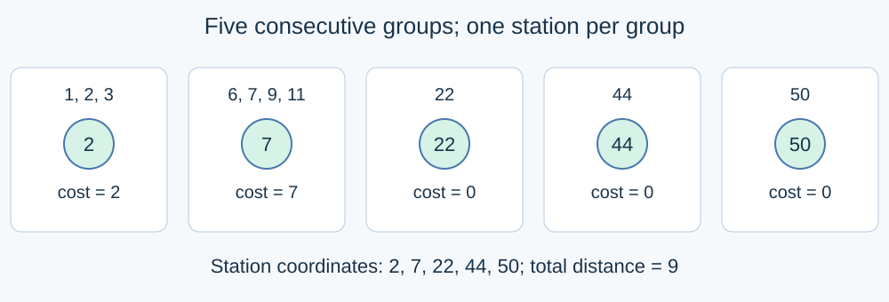

# Service Stations on a Line

Estimated time limit: 0.5 seconds. Memory limit: 128 MB.

The limit is twice the slowest median runtime of the reference program on the target platform, rounded up to a multiple of $0.5$ seconds. See the [evaluation environment](../../../docs/评测环境与性能.md).

## Story

Homes lie along a straight road. Planners want to place service stations so that the total distance from every home to its nearest station is as small as possible.

(This story was rewritten by GPT-6.)

## Formal Problem Statement

There are $N$ homes on a number line, with home $i$ at coordinate $X_i$ . Place exactly $M$ service stations on the line. A station may share a coordinate with a home. Each home uses its nearest station, with arbitrary tie-breaking.

Find the minimum sum of these distances. Homes at the same coordinate still contribute separately. The input coordinates are not necessarily sorted.

## Input Format

The first line contains $N,M$ . The second contains $X_1,\ldots,X_N$ .

## Output Format

Print one integer: the minimum total distance.

## Samples

### Sample 1

### Input

```text
10 5
1 2 3 6 7 9 11 22 44 50
```

### Output

```text
9
```

### Sample 2

### Input

```text
4 1
100000000 0 100000000 0
```

### Output

```text
200000000
```

### Sample 3

### Input

```text
3 3
8 2 8
```

### Output

```text
0
```

## Sample Explanation

In the first sample, stations at $2,7,22,44,50$ give a total distance of nine. The second minimum is $200000000$ . In the third, every home can have a station, giving zero.



## Constraints and Guarantees

$1\le N\le2000$ , $1\le M\le\min(1000,N)$ , $0\le X_i\le10^8$ .

| Score | Additional constraints |
| --- | --- |
| 100% | None |
