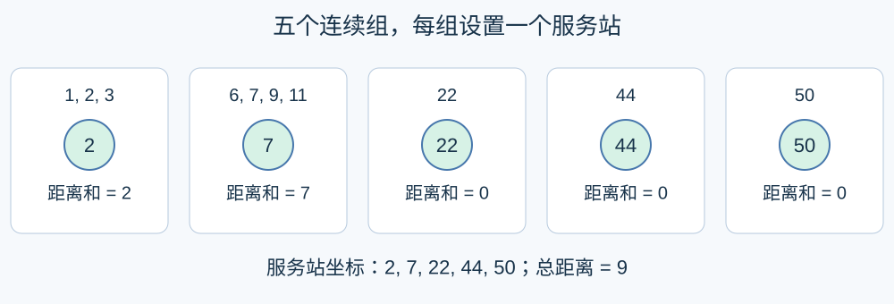

# 直线上的服务站

预估时间限制：0.5 秒。内存限制：128 MB。

实际时限以标准程序在目标环境的最慢用例中位时间乘以 $2$ ，按 $0.5$ 秒向上取整。参考环境见[评测说明](../../../docs/评测环境与性能.md)。

## 背景故事

一条直路旁分布着若干住户。规划人员希望设置一些服务站，让所有住户前往最近服务站的路程之和尽可能短。

(本故事由GPT-6重写)

## 形式化问题描述

数轴上有 $N$ 个房屋，第 $i$ 个房屋的坐标为 $X_i$ .在数轴上设置恰好 $M$ 个服务站，服务站可以与房屋同坐标。每个房屋关联距离它最近的服务站；若有多个并列最近的站，任选一个。

求所有房屋到所关联服务站的距离之和的最小值。坐标相同的房屋仍分别计入距离和。输入坐标不保证有序。

## 输入格式

第一行两个整数 $N,M$ .第二行 $N$ 个整数 $X_1,\ldots,X_N$ .

## 输出格式

输出一行一个整数，表示最小距离和。

## 样例

### 样例 1

### 输入

```text
10 5
1 2 3 6 7 9 11 22 44 50
```

### 输出

```text
9
```

### 样例 2

### 输入

```text
4 1
100000000 0 100000000 0
```

### 输出

```text
200000000
```

### 样例 3

### 输入

```text
3 3
8 2 8
```

### 输出

```text
0
```

## 样例解释

第一组可在坐标 $2,7,22,44,50$ 设置服务站，总距离为九。第二组的最小距离和为 $200000000$ .第三组给每个房屋设置服务站，总距离为零。



## 数据范围与保证

$1\le N\le2000$ , $1\le M\le\min(1000,N)$ , $0\le X_i\le10^8$ .

| 分值比例 | 额外条件 |
| --- | --- |
| 100% | 无额外条件 |
