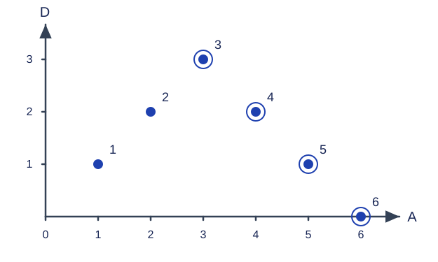

# 红心女王的扑克士兵

预估时间限制：1 秒。内存限制：128 MB。

实际时限以标准程序在目标评测环境的最慢用例中位时间乘以 $2$ ，按 $0.5$ 秒向上取整。参考环境见[评测说明](../../../docs/评测环境与性能.md)。

## 背景故事

红心女王罗丽娜并不喜欢被叫作心脏女王。

她有许多扑克士兵，只有黑桃、红心、方片和草花四种花色，没有大小王，也没有广告牌。每个士兵都有攻击和防御两个整数属性。如果士兵 $B$ 的攻击和防御分别不小于士兵 $A$ 的对应属性，就称 $B$ 不弱于 $A$。

女王打算把士兵安排在若干级台阶上。最上面一级是她的宝座，士兵只能站在从上往下数第二级及以下。然而，第二级台阶是所有士兵都想占据的位置。

一个士兵会对不弱于自己的其他士兵感到威胁。如果士兵 $A$ 发现同一级台阶上的士兵 $B$ 不弱于自己，他就会通过“市场竞争”让 $B$ 出局。这显然不利于整个台阶的利益。如果第二级台阶上没有士兵会因此出局，就称它达到了稳定。女王希望精心挑选尽可能多的士兵，组成稳定的第二级台阶。

四种花色让她联想到四个象限：若干半平面的交可以形成凸包，而若干朝向相同的四分之一平面的并会形成台阶状轮廓，并把各自的直角顶点包括在内。平面上两点的切比雪夫距离是 $\max(|x_i-x_j|,|y_i-y_j|)$。虽然它与这个问题关系不大，女王仍把这种台阶状结构命名为“切比雪夫凸包”。

台阶的划分让女王很为难，于是她请来了大魔法师 Dilworth。

## 形式化问题描述

有 $n$ 个士兵，每个士兵有整数攻击力 $Attack$ 和防御力 $Armor$ .若士兵 $B$ 的两个属性分别不小于士兵 $A$ 的对应属性，就称 $B$ 不弱于 $A$ .

选择一个士兵子集，要求任意两个不同士兵之间，都不存在一方不弱于另一方的情况。求可选士兵数的最大值。两个士兵即使属性完全相同，仍是不同士兵，不能同时选入。允许选择空集。

## 输入格式

第一行一个整数 $n$ .接下来 $n$ 行，每行两个整数 $Attack,Armor$ ，依次描述每个士兵。

## 输出格式

输出一行一个整数，表示稳定阵容的最大人数。

## 样例

### 样例 1

### 输入

```text
6
1 1
2 2
3 3
4 2
5 1
6 0
```

### 输出

```text
4
```

### 样例 2

### 输入

```text
0
```

### 输出

```text
0
```

### 样例 3

### 输入

```text
5
-1 3
-1 2
0 2
1 1
1 1
```

### 输出

```text
3
```

## 样例解释

第一组可以选择输入中的第 $3,4,5,6$ 个士兵。他们的攻击力严格递增，防御力严格递减，彼此都不会同时在两个属性上占优。第二组没有士兵，答案为零。第三组可选 $(-1,3),(0,2),(1,1)$ ，答案为三。



横轴 $A$ 为攻击力，纵轴 $D$ 为防御力；外圈标出一个最优阵容，点旁数字是输入编号。

## 数据范围与保证

对所有数据，$0\le n\le10^6$ ，$|Attack|,|Armor|\le10^9$ .属性可为负数，士兵的属性也可相同。

| 分值比例 | 额外条件 |
| --- | --- |
| 30% | $n\le20$ |
| 40% | $n\le2000$ |
| 30% | 无额外条件 |
