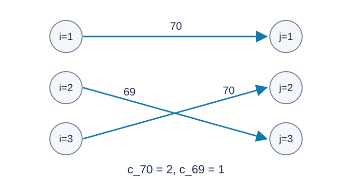

# 时间管理与多人运动：题解

## 解法与贡献

采用出题人的指数权值编码与 KM 最大权匹配思路。Codex（GPT-6）给出可直接证明的进位制编码、保存交替树的 Hungarian 实现、固定宽度整数运算和验证方法。KM、Hungarian 算法及其对偶证明均为经典结果。

## 将字典序变成精确整数权值

取进制 $B>n$ ，本题程序固定使用 $B=512=2^9$ .等级 $g$ 的权值为 $B^g$ .一个完美匹配的总权值为
$$
\sum_{g=0}^{70}c_gB^g.
$$
各位系数均不超过 $n<B$ ，不会进位。在首个不同的最高等级 $g$ 上，一单位 $B^g$ 严格超过所有更低位可能造成的差额。因此最大总权值恰好对应题目要求的字典序最大次数向量。不能直接把等级相加；最高等级的一次收益必须优先于任意较低等级的组合。

下面是样例三的一种最优匹配，收益等级为 $70,69,70$ .

令最小费用矩阵为 $C_{ij}=-B^{a_{ij}}$ ，转成最小权完美匹配。

## 交替树与对偶势

维护行势 $u_i$ 、列势 $v_j$ ，使已经加入的行满足
$$
u_i+v_j\le C_{ij}.
$$
定义松弛量为 $C_{ij}-u_i-v_j$ .当前匹配边都要求松弛量为零，称为紧边。

依次加入新行，从它生长交替树：由行经过紧边到列，若列已匹配，再沿其匹配边到行。每个尚未进入树的列保存所有树内行到它的最小松弛量及前驱。

如果尚无可扩展的零松弛列，就取最小松弛量 $\Delta$ .树内行势增加 $\Delta$ ，树内列势减少 $\Delta$ ，其余列保存的松弛量减少 $\Delta$ .树内两端的和不变，离开树的边松弛量不会变成负数，进入树的边只会更松。因此保留对偶可行性，并让至少一个新列成为紧边可达。

新行初始势为零，尚未要求可行；首次调整只涉及该行和虚拟零列，允许 $\Delta$ 为负，使新行对全部列可行。此后的调整量非负。遇到未匹配列后，沿前驱链翻转交替路径，匹配数增加一，全部匹配边仍然紧。

最终，任意完美匹配的费用都至少为 $\sum_i u_i+\sum_j v_j$ ；当前完美匹配的每条边取等号，费用恰好等于该下界，故为最小费用匹配。指数编码再把这个结论转成题目要求的最优次数向量。

## 避免重复搜索

保存当前交替树和每列最小松弛量后，一次增广至多吸收 $n$ 列，每次只扫描一行和更新线性数量的势，需 $O(n^2)$ 次宽整数操作。每次调势后从头 DFS 的写法可能反复扫描相同的边；保留搜索状态可得到总计 $O(n^3)$ 次操作的界。

## 可移植宽整数

令 $G$ 为等级数，本题为七十一；$W$ 为机器字位数，本实现为六十四。所需有效位数为 $O(G\log B+\log(n+1))$ ，令相应字数为 $L$ .本实现使用十二个无符号六十四位字，合计七百六十八位，以二进制补码进行加、减和有符号比较；所有字内溢出均为标准无符号运算。权值直接设置第 $9g$ 位，无需宽整数乘法。

最大权值 $H=B^{70}=2^{630}$ .这里费用都在 $[-H,-1]$ .真实列势初始为零且只减少；每次增广结束前仍有势为零的空闲列，对偶可行性使真实行势为负。匹配边紧，再结合新行只从不小于 $-H$ 的势开始，可将真实行列势限制在 $[-H,0]$ ；有限松弛量也只是常数倍 $H$ .虚拟零列用于累计费用，绝对值至多 $nH<2^{639}$ .程序的无穷大位在七百四十，符号位在七百六十七，留有足够余量。

只保存等级矩阵及 $G$ 个宽费用值，避免给每个矩阵元素都存宽整数。总时间为 $O(n^3L)$ ，空间为 $O(n^2+(n+G)L)$ .$n=0$ 时直接得到全零计数。

[参考程序](std.cpp)。可用任意精度整数独立核验一个匹配及其对偶势：检查双射、所有对偶不等式、每条匹配边的等号和最后的次数向量，就得到无需重跑搜索的最优性证书。

## 数据与复现

三个样例见题面。[生成配方](tests/plan.json)包含十份计分输入；[生成器](tests/generate.py)只依赖 Python 标准库，支持 --plan、--out-dir、--case 和 --std。正式大输入及可执行文件不放入发布包。时间和内存的参考测量见[性能记录](../../../docs/benchmark-R28.json)。
